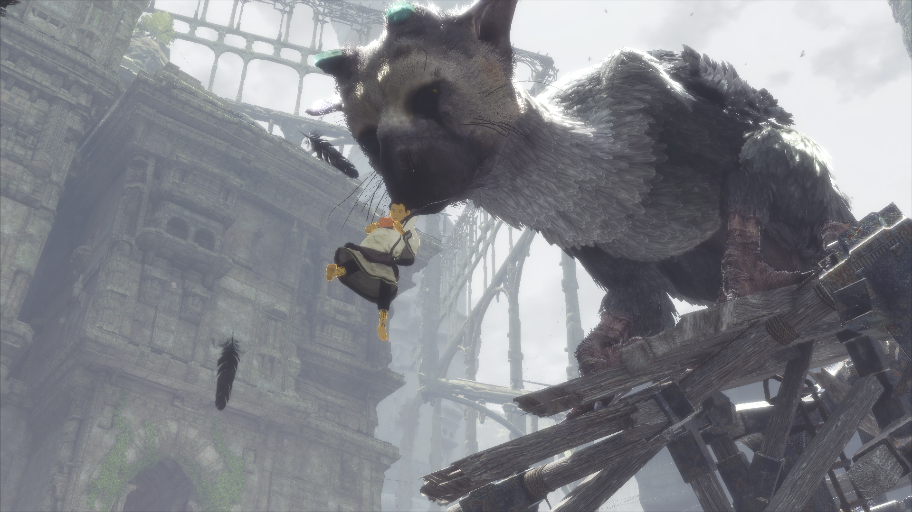
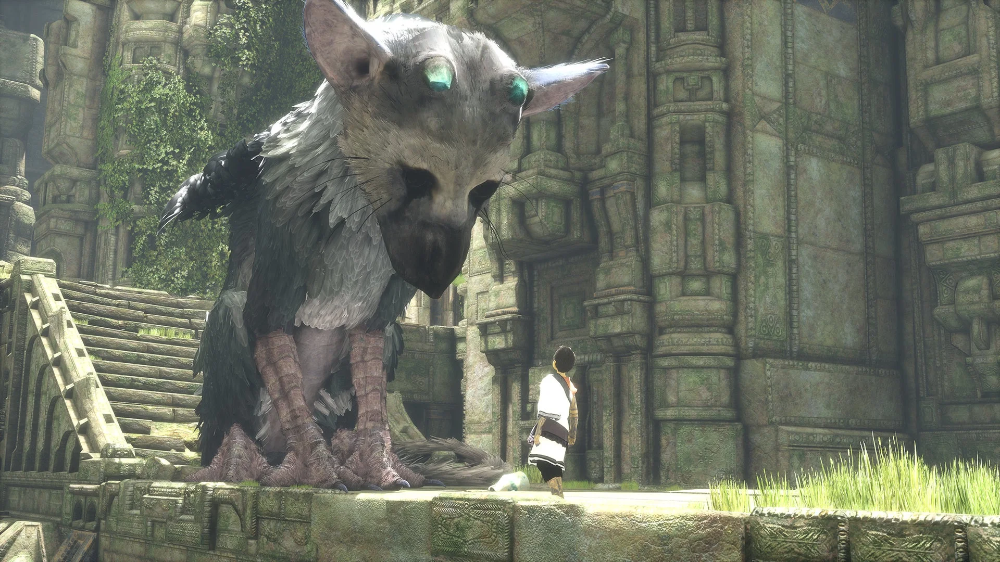
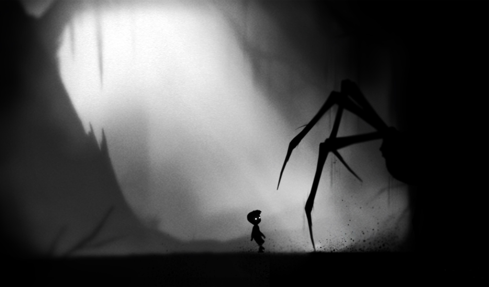
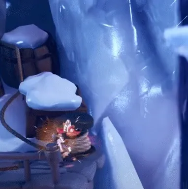

# The Aesthetics of Motion: Why Game Design Is Born from Animation and How to Polish It

**Valeriya Pudova**
2020

---

### Abstract

The article is devoted to the iterative process of game design through the prism of its visual and tactile perception — through animation and "game feel." Basic mechanics, rules, and stages of development are considered not as abstract flowcharts but as a living process of creating smooth, elegant, and responsive interaction between the player and the character. The material is aimed at game designers, animators, and developers striving to turn the dry logic of code into the living aesthetics of on-screen motion.

---

### Introduction: From Simple to Complex, from Blocking to Living Aesthetics

Everything a person is capable of doing is initially very fragile and weak. For a endeavor to become viable, to not perish in its infancy, it must follow a fundamental natural principle: **from simple to complex, from general to particular**. A mighty, centuries-old tree covering everything around with a dense crown was once just a small seed. If it had not gone through this difficult, sequential path of development, it would simply have perished.


_The movement of Trico and the boy is a dialogue without words. Game design is born where mechanics become inseparable from animation._

This path is traversed by ideas. It is followed by works of art, creations of science, and any complex digital products. It is the only reliable way to design a device, write a script, and create a working game.

In game dev, this natural seed is the initial concept. But if the architecture of a game is set by software code, its soul is formed by motion. The player learns about the virtual world not by reading design documents but through continuous observation of the character on screen. The way the hero shifts body weight while walking, how their foot interacts with uneven ground, how they react to danger — it is this aesthetics of motion that makes the player empathize with pixels and experience genuine admiration for the gameplay. Game design is born where mechanics become inseparable from animation.

---

### Concept Design: Animation as the First Language of the Game

Before the first working code appears in the game, its main character must already make their first movement — even if only on paper. It is here, at the concept stage, that animation becomes not a decoration but a **design tool**.

Experienced game designers and animators at this stage work not with numbers and not with cumbersome stat tables. Their main tool is the **animatic**: a rough storyboard of the character's key movements.

This simple, almost pencil-drawn sketch performs three critically important functions:

1. **Conveys character.** How does the character walk? Proudly, with squared shoulders? Or sneaking, hugging the walls? This decision will determine everything: from level design to sound accompaniment.
2. **Tests the mechanic.** If the character must perform an "accelerated dash," the animator immediately sees: this movement needs 5 frames of preparation, 3 frames of the active phase, and 8 frames of recovery. The game designer receives not an abstract number "dash duration = 0.3 sec" but a **felt timing**.
3. **Saves resources.** An animatic costs 1–2 days of work. Redoing a fully rigged and textured character — 2–3 weeks. A quick movement prototype reveals problems before they become expensive.



_Both the concept art and the final game speak the same language — 
the language of movement and gaze. The character's character is defined even before the first line of code is written._

In parallel with this, the technical team fixes hard constraints:

- How many bones can the character's skeleton (rig) contain?
- What is the RAM limit for animation assets?
- Does the engine support inverse kinematics (IK) in real time?

These constraints must not shackle creativity. They must **guide it**, as a riverbed guides a river. A brilliant animator is capable of making the player fall in love with a character even with 20 bones in the skeleton — if the movement is thought out at the concept stage.

All subsequent documentation (GDD, TDD, style guides) only details what was already decided at the animatic level. **Without living movement on paper, all other documents are merely architecture without a soul.**

---

### Pre-Production: From "Dirty" Gameplay to the First Playable Frame

At the pre-production stage, the magic of movement begins to take tangible form. Artists, together with game designers, define the list of concepts that best convey the essence of the game, and embed them into all accompanying documentation to illustrate the desired visual style.

Given the principle of movement from general to particular, initial low-poly models are created at this stage. These initial, rough characters — often without textures, smoothing, or shadows — are used for rough prototyping of the mechanics described in the GDD. This first working prototype goes through two most important stages of evolution:

```
┌─────────────────────────────────────────────────────────────┐
│ Prototype Evolution                                         │
├──────────────────────────────┬──────────────────────────────┤
│ First Functional             │ First Playable               │
├──────────────────────────────┼──────────────────────────────┤
│ • Rough blocking (cubes)     │ • Primary blending           │
│ • Basic physics check        │ • Character "feels" the world│
│ • Collision and trigger test │ • Game Feel appears          │
└──────────────────────────────┴──────────────────────────────┘
```

1. **First Functional (First functional prototype)**. At this stage, exclusively the technical operability of the basic systems is checked: rendering, physics, sound, triggers, and the correctness of animation file playback. Here the gameplay looks "dirty" — the character may be a simple gray cube or a robot making unnatural jerks without intermediate frames. The task of the stage is to make sure that the code mathematically correctly processes collisions and input commands.
2. **First Playable (First playable prototype)**. After adding scripts, basic behaviors, and mechanics, the game acquires sufficient functionality to be fully playable. Primary animation blending is added to the character (smooth mixing of movements when transitioning from running to walking or jumping). The game begins to look complete, especially after setting up basic textures and lighting effects.

Now the game can be seen, touched, felt, and compared with the initial concept. It is at this critical point that many projects without a clear plan cease to correspond to the original idea and turn into soulless technology demonstrators. If the prototype successfully conveys the desired feeling from the controls, it is reviewed by all company departments, investors, and publishers, after which the project officially moves to the production stage.

---

### Tuning and Polishing: From Numbers to Feelings

The process of bringing character movements to perfection is called polishing in the industry. But behind this beautiful word lie two fundamentally different stages of work.

#### Tuning — This Is Working with an Excel Spreadsheet

The game designer opens the configuration file and changes the numbers:

- Run speed: from `5.0` to `5.5` m/s
- Jump height: from `2.0` to `2.3` m
- Attack radius: from `1.5` to `1.8` m

This is mechanical work. It requires discipline but does not require artistic taste. Ideal Tuning is done **before** the final animations are added to the game.

#### Polishing — This Is Working with Movement

The animator opens the editor and adds **3 frames of preparatory crouching** before the jump. Without them, the jump feels "plastic," weightless. With them, the player *feels* the weight of the character's body — even if the numerical jump parameters have not changed by a single millimeter.

**Why is this fundamentally important for planning?**

Any animation polish inevitably drags along changes in the game world:

- If the animator added **inertial braking** with foot sliding, the game platforms must become 15–20% wider. Otherwise the character will slip into the abyss at every stop.
- If the animator increased the **arm swing** while running, this may require changing the ceiling height in narrow corridors — otherwise the arms will "pierce" the geometry.
- If the animator added a **warning gesture** before the boss's attack (raising a hand 8 frames before the strike), the difficulty level drops sharply — and the balance will have to be reconfigured.


That is why **polishing must occur after tuning**, when the level geometry is no longer changing. Otherwise you risk polishing the animation to a shine and then breaking it for the sake of a radical platform change — and polishing it again.

**Practical rule:**
*Tuning (numbers) — before final geometry.*
*Polishing (movement) — after.*

---

### Full Production: Animation at Every Stage of Maturity

At the full-scale production stage, the team already knows what the final character looks like. Now animation goes through a rigid sequential filtering — from experiments to crystallization.

#### Pre-Alpha: Dirty Blocking, Clean Timings

At this stage, the character is a gray, textureless model. But its animation is already **readable**. Animators deliberately make movements slightly faster than needed — this is a well-known practice of the Naughty Dog studio. Fast, sharp animation in Pre-Alpha leaves room for slowing down during final polishing. If it were made slow from the start, adding "weight" and inertia would be impossible without a complete rework.

At Pre-Alpha, the main thing is checked: **does the character feel heavy, light, fast, clumsy?** Without textures, without sound, without decorations — only the rhythm of movements.

#### Alpha: Blending and Freeze

When all basic mechanics are assembled together, the moment of **blending** arrives — smooth transitions between states:

- From running to walking
- From jumping to landing
- From attack to block

At Alpha, the animator no longer creates new movements. They configure **transition thresholds**: at what running speed does the character start "walking" and at what — "running"? How fast does the pose change during a sideways dash?

**Golden rule of Alpha:** During this period it is **forbidden to update the game engine and any tools** (Maya, Photoshop, MotionBuilder). Updating the engine is always a risk that the animation tree (Blend Tree) will be interpreted differently. One bug in the new build can turn a graceful movement into a twitching puppet. And fixing this will take weeks, rebuilding already agreed transitions.

#### Beta: Only Fixes, No Creativity

**Beta** is an absolute taboo on new animations. Here the animator turns into a surgeon:

- Fixes skeleton breaks (when a limb "twists" into a non-physical position)
- Eliminates micro-freezes at cycle joints
- Checks collisions — does the weapon sink into the geometry?
- Synchronizes footstep sound with foot contact (this is done manually, frame by frame)

The last 10% of the project is 90% of the stress. It is here that most bugs manifest because various systems (animation, physics, sound) work at different clock frequencies. The animator's task at Beta is to make the player **not notice** the animation. It must become natural, like breathing.

#### Release Candidate: Readability of Movements

The game is almost ready. Now it is tested by focus groups. But the animator does not sit idly by. They look at gameplay videos and answer one question:


_Spider legs in Limbo: the player reads the danger in 0.3 seconds. If this does not happen — it is a Brickwall._

**Does the player see the threat 0.3 seconds before the strike?**

If the boss raises a hand, but because of the animation this movement is unreadable — the player does not have time to react. This is not hardcore. This is a **Brickwall** — a terminal obstacle that kills the desire to play.

At RC, the animator can add **a single warning frame**: a bright flash on the sword blade, a change in the enemy's eye color, a muscle twitch before the attack. This turns a "cheating" boss into an honest opponent. The player loses not because of a bug but because of their own mistake.

---

### Observing the Rules of the Game: Contextual Harmony of Movements

The intuitive understandability of the game and the user's aesthetic pleasure are built on strict adherence to the internal rules of the virtual world. It is extremely important to establish these rules for the entire project at the earliest stages and never violate them: if a game element functions in a certain way, it must work exactly the same way throughout the entire game.

This rule directly governs the behavior of contextual animation of the character and objects:

```
┌─────────────────────────────────────────────────────────────┐
│ Contextual Animation System                                 │
├──────────────────────────────┬──────────────────────────────┤
│ Player at the edge of a cliff│ Player along a wall          │
├──────────────────────────────┼──────────────────────────────┤
│ • Center of gravity shift    │ • Touching the wall with hand│
│ • Balancing with arms        │ • Change in body tilt        │
│ • Panic idle animation       │ • Change of gaze vector      │
└──────────────────────────────┴──────────────────────────────┘
```

- **Contextual Idle (Idle Animation)**: If the hero stands in the middle of a safe room, their idle animation should broadcast calmness. But as soon as they find themselves at the edge of a bottomless cliff, the system must seamlessly switch the animation: the character begins to panic-balance with their arms, shift their center of gravity backward, peer down. This visual change conveys danger on a subconscious level without textual warnings.
- **Interaction with the environment**: When moving close to a wall, the character should naturally touch it with their palm, adjusting the tilt angle of the shoulder girdle. When running knee-deep in water, the leg animation must clearly demonstrate the resistance of the dense medium.

It is important to ensure uniform correspondence of the behavior of the game art. If the player jumps onto a platform that then falls, the texture and micro-animation (e.g., warning trembling or crumbling crumbs) must be present on every platform that behaves similarly. Such visual cues are critically important: they allow the player to intuitively understand the structure of the levels.

The game field itself must not disorient. The presence of an obvious passage or visual motion vector is a simple way to guide the player, even if branched omni-directional schemes are designed on the level for exploration. Planning the level structure must harmoniously combine architecture, environment animation, enemy (NPC) spawn points, and item pickup locations — this is a fundamental aspect of polishing that directly affects gameplay.

---

### Release Candidate: Fighting Roadblocks and Brickwalls Through Perception

When the game is almost ready, the final **Release Candidate** is sent for testing by focus groups. Special attention is paid to balance: places where the game, due to excessive ease, makes one bored are identified, as are zones of increased difficulty that can cause critical perception problems — *roadblocks* and *brickwalls*. In game design, animation serves as a powerful tool for regulating these states:


_Crash fails to jump. The player sees their mistake, not a game bug. Honest animation = honest defeat._

- **Roadblocks (Obstacles)** — sections where the difficulty of passage becomes excessively high. Often this is due to unpolished animation timings or hidden pixel-hunting, when, due to the visual unreadability of the enemy's movements, the player makes mistakes. This causes strong frustration and can easily lead to abandoning further passage.
- **Brickwalls (Stone Walls)** — a more dangerous, terminal version of roadblocks. This is a situation in the gameplay that physically cannot be solved by the average player. For example, if the boss's attack animation has no "warning" phase (preparation timing for the strike), the player is physically unable to react to it in time. Final frustration sets in, unconditionally leading to the complete deletion of the game.


After thorough testing of one or several versions of the *release candidate*, exactly the build in which such animation and logic barriers are fully eliminated is admitted to publication. Polished movement guarantees the player ideal visual control: even in hardcore projects, every defeat is perceived as the player's personal honest mistake, and not as the fault of unresponsive controls.

---

### Conclusion: A Tree Grown from a Seed

To polish a game is like cutting a diamond. But unlike a jeweler, the game team starts not with a diamond but with a **seed**.

The seed is the concept animatic. Rough, careless, ugly. But it is in it that the DNA of the future movement is laid: the character's character, the rhythm of combat, the aesthetics of the jump.

This seed sprouts in Pre-Alpha — a fast prototype where the character is still gray and shapeless but already lives at the right pace. At Alpha it becomes covered with bark — blending of transitions, smoothness of steps. Beta prunes the dry branches — freezes, bugs, breaks. RC checks whether the tree will withstand the storm — that is, the player judges it.

But a tree does not become a crown in one day. It requires polishing every leaf. So it is with animation: a fast prototype gives form, but only long, jewelry-like polishing turns technical mechanics into art that evokes admiration.

And remember: the player forgives pixel graphics. They forgive simple models and repeating textures. But they **never forgive** bad movement. Because movement is life.

---

### References

1. *Schell J.* The Art of Game Design: A book of lenses. – CRC press, 2008.
2. *Schell J.* The Art of Game Design: A deck of lenses. – Pittsburgh : Schell Games, 2008.
3. Wikipedia - Software release life cycle.