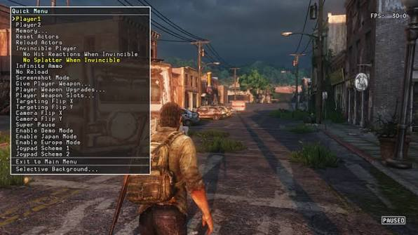

# Creating Testable Code: Interactive Development as a Philosophy

**Valeriya Pudova**
ARCADIA
6.02.2022
*Version 2.0 (revised)*

---

## Abstract

Every day a programmer spends hours waiting: compile, load the scene, reproduce the bug, stop, fix, repeat. This **Edit → Compile → Run** cycle is the main enemy of productivity. The article proposes a development philosophy where code is written so that modifications are made directly in the runtime, and the result is evaluated instantly. Practical tools are examined: Debug Menu, REPL, remote terminal, validation, logging, and profiling — everything that turns testing from a routine into a continuous process.

*Keywords: Testing, Collaboration, Process Automation, Debugging, Scripting, REPL, Runtime Editing, Live Reload*

---

## Table of Contents

- [Creating Testable Code: Interactive Development as a Philosophy](#creating-testable-code-interactive-development-as-a-philosophy)
  - [Abstract](#abstract)
  - [Table of Contents](#table-of-contents)
  - [Introduction: The Main Enemy of Productivity](#introduction-the-main-enemy-of-productivity)
  - [Terminology](#terminology)
  - [Units of Measurement](#units-of-measurement)
  - [Choosing Third-Party Solutions](#choosing-third-party-solutions)
  - [Automated Code Testing](#automated-code-testing)
  - [Antidote to Random: Determinism as the Basis of Predictable QA](#antidote-to-random-determinism-as-the-basis-of-predictable-qa)
  - [Optimization](#optimization)
  - [Target Platform](#target-platform)
  - [Shortcuts \& Debug Menu](#shortcuts--debug-menu)
    - [Functions](#functions)
  - [Debug Draw](#debug-draw)
  - [Log File](#log-file)
  - [Built-in Profiler](#built-in-profiler)
  - [Crash Report](#crash-report)
  - [Interactive Development](#interactive-development)
  - [REPL](#repl)
  - [Remote Terminal](#remote-terminal)
  - [Unity 3D Runtime Environment](#unity-3d-runtime-environment)
  - [Unity 3D Static Validation](#unity-3d-static-validation)
  - [Human-readable format](#human-readable-format)
    - [GUI vs Text](#gui-vs-text)
    - [Localization](#localization)
  - [Validation](#validation)
    - [Static Validation](#static-validation)
    - [Dynamic Validation Validate or Require](#dynamic-validation-validate-or-require)
  - [The Script Reload Trap: Anatomy of Runtime Compilation in Unity](#the-script-reload-trap-anatomy-of-runtime-compilation-in-unity)
  - [Case Study: How We Cut the Development Cycle by 80%](#case-study-how-we-cut-the-development-cycle-by-80)
  - [Conclusion: The Programmer as Sculptor](#conclusion-the-programmer-as-sculptor)
  - [References](#references)

---

## Introduction: The Main Enemy of Productivity

Before reading this article, pause for a second.

How many times have you restarted the game today? Ten? Twenty? Each time you waited for it to load, for you to reach the right place, for the bug to reproduce.

This does not seem like a big problem. 30 seconds is nothing. But 30 seconds × 50 times a day × 5 days a week × 50 weeks = 104 hours a year. Per person. Multiply by the size of your team.

This is what the article is about. Not about code. About time. About attention. About the fact that every time you wait for a compilation, you lose not seconds but context. And getting it back is harder than you think.

We will talk about tools. But in reality we will talk about how not to waste your life on waiting.

Game development is not writing code. It is **thousands of iterations**: checking mechanics, tuning balance, finding bugs, polishing animations, testing on the target platform. Each iteration requires the code to work — and work correctly.

But there is a problem. The standard development cycle looks like this:

```
Edit → Compile → Run → Test → Fail → Edit → Compile → Run → Test → Pass
```

This is called **Edit → Compile → Run**. And it is the main enemy of productivity.

Why? Because between "Edit" and "Test" lies a **waiting zone**:

- Compilation: 30 seconds — 2 minutes
- Scene loading: 10–30 seconds
- Repeating the game situation: another 10–30 seconds
- Total: **1–3 minutes per iteration**

Multiply this by 50 iterations a day — you get **2–3 hours of pure time** spent on waiting. And if you work with a console or VR platform, the deployment time can reach 10–15 minutes.

**But the worst thing is not the time.** The worst thing is **loss of context**. Every time you wait 30 seconds for loading, you exit the flow state. Getting back into it is hard. And exiting and entering 50 times a day is impossible.

**The philosophy of this article is simple:**

> The programmer must write code so that modifications are made in the runtime, and the result is evaluated instantly. Without a rebuild. Without a restart. Without replaying the level. Every tool described below serves one goal: **to minimize the Edit → Compile → Run cycle** and return the developer's attention.

---

## Terminology

**Tuning** — is changing parameters: *speed*, *jump height*, etc. Adding bonuses, NPCs, etc. At the final stages of development it is called ***fine tuning*.**

**Tweaking, Polishing** — small changes, elimination of all visible defects and shortcomings.

---

## Units of Measurement

For parameters, use standard units of measurement: *meter*, *kilogram*, *second*. Use other units with a mandatory hint: *ms*, *fps*, etc., so it is easier to use standard units.

**Why this is important for interactive development:** If you tune parameters in the runtime, you must understand what exactly you are changing. "Speed = 5" — is it 5 meters per second or 5 units per frame? Standard units eliminate ambiguity.

---

## Choosing Third-Party Solutions

In modern development, the temptation to take a ready-made solution from the Asset Store or use a popular framework is great. But this practice requires extreme caution.

**The problem:** Third-party solutions often bring more problems than benefits:

- They may conflict with other systems.
- Their internal architecture does not provide for **live reload** — and this is a key requirement for interactive development.
- Framework updates may break your code.
- The source code is closed, and you cannot adapt it to your pipeline.
- The documentation promises one thing, but the runtime behavior is another.

**The right approach:**

1. **Careful selection.** Before implementing a solution, check:
   - Does it support interactive development? Can parameters be changed in the runtime?
   - Does it have automated tests?
   - How often is it updated?
   - Can you look into the source code?

2. **Sometimes it is better to create your own.** If the framework does not meet your interactivity requirements, and adapting it is impossible — writing your own solution can save a ton of time in the long run.

3. **If the decision is made — dive into it.** The person responsible for implementation must fill in the gaps in the documentation and add autotests for all procedures used in the project. This is especially important for systems that must work in the runtime without restarting.

**Golden rule:** A third-party framework is a tool, not a religion. If it hinders your Edit → Compile → Run cycle, it is not worth the time spent.

---

## Automated Code Testing

Some parts of the code designed within the company must be covered by automated tests (Code coverage). These include:

- Libraries of mathematical operations.
- Libraries of data structures.
- Libraries of network protocols.
- And others similar to them.
- Third-party C++ libraries integrated into Unity, especially similar to the above.

**Connection with the leitmotif:** Autotests are insurance. If you actively use interactive development and change code in the runtime, the risk of breaking something increases. Autotests allow you to quickly verify that basic functionality is not impaired.

## Antidote to Random: Determinism as the Basis of Predictable QA

When a game designer asks to make "a rare zombie leader appear with a probability of 0.2" (that is, on average 2 leaders per 8 regular creatures), the programmer's first intuitive reaction is to use `Random.Range()`. In the context of interactive development and testing, this is a hidden trap.

**What is the physics of the problem:**
A pure pseudorandom number generator (PRNG) gives no guarantees of local density. In one game session, a tester may encounter 5 leaders in a row, and in another — not a single one for an hour. If a rare bug occurs at the junction of leader spawn and location physics, reproducing, localizing, and fixing it in the *Edit → Compile → Run* cycle becomes impossible. Randomness destroys repeatability.

**Solution:**
Complete rejection of runtime randomness in critical simulation nodes. Instead of a PRNG, the spawn system must use cyclic deterministic pattern lists or rigid counters:
* 5 regular zombies;
* 1 zombie leader;
* 3 regular zombies;
* 1 zombie leader.

The mathematical expectation remains the same (0.2), but the system becomes absolutely predictable. The tester or automated script knows exactly at which simulation step the target object will guaranteed to appear. Control of the runtime returns to the engineer's hands, and floating "random" bugs disappear as a class.

---

## Optimization

Optimization is performed at every stage of game production, but its nature changes depending on the stage of the project. Here it is important to find a balance between **prototyping speed** and **final product performance**.

At the early stages, when mechanics are still being tested by trial and error, premature optimization is the enemy. The first version of the code may be inefficient, but it allows you to quickly test a hypothesis. Often after testing it turns out that this code is no longer needed at all — and the time spent on optimizing it turns out to be lost forever.

**Therefore the rule is:** do it fast and ugly — for verification. But as soon as the mechanic is approved, **immediately** implement benchmarks and profiling. This allows you to identify the bottleneck before it grows into the architecture.

A special case is when the game genre comes into conflict with the engine. For example, a 2D scroller on a 3D engine. Here optimization becomes a non-trivial task, and all stages of testing must be passed in advance, at the prototype stage, to understand whether the engine can produce the required number of pixels on the target platform without FPS drops.

**But there is one area where there should be no compromises — game launch time.** All departments (designers, animators, QA, programmers) restart the game dozens, and sometimes hundreds of times a day. Each extra second of loading is multiplied by the number of launches and by the number of people on the team. This is not just irritation — it is direct losses in productivity.

**Practical summary:**

| Stage | Approach to optimization |
|--------|----------------------|
| **Prototype (hypothesis testing)** | Code is written in the simplest and most obvious way. Optimization is ignored. |
| **After mechanic approval** | Benchmarks are introduced immediately. Bottlenecks are identified. |
| **Production** | Optimization becomes part of every commit. |
| **Always** | Game launch time is a sacred cow. No compromises. |

---

## Target Platform

Despite the fact that the game is designed for a target platform: PlayStation, Oculus, etc., during development it is mandatory to make the game so that it can be tested on the development platform. For this, from the very beginning, simulation of the target platform's input devices (e.g., Oculus controller) is integrated into the game: with a PC keyboard and a PS2 joystick.

This is quite difficult in VR, but it can be considered an ideal goal to strive for. By advancing in this direction we will expand testing opportunities with a large number of participants, and the gain will be obvious.

**Connection with the leitmotif:** If the game launches on PC (and not only on console), its launch takes seconds, not minutes. This directly shortens the Edit → Compile → Run cycle. The faster the game launches on the development platform, the more iterations a developer can make per day.

---

## Shortcuts & Debug Menu

From the very beginning, the game is equipped with a debug menu and a set of *shortcuts* (or *keystrokes* for some functions) to provide QA specialists and developers with all the tools that facilitate the process of testing and tuning the game.

**Technical requirements for Debug Menu:**

- The menu does not have to be beautiful; rendering text is enough.
- The menu must be well readable: noticeable text color, font with outline, and a shading semi-transparent background under the text.
- The menu must not significantly affect performance.
- The menu must be organized using a hierarchy system and horizontal separators.
- Options in the menu must have *keystrokes* hints (for a PC keyboard).
- Changes to parameters in the menu must take effect instantly.
- The menu API must be so simple that adding a new option should not take more than a few minutes of developer time. As a rule, this is one line of code.
- Values changed from the initial ones must be highlighted, and a special keystroke must reset them to the initial value.
- There must be the ability to enter constraints (min, max), as well as the precision of the displayed value (number of digits after the decimal point). If values are output in a column — consider adding the ability to align the value in the column cell by the decimal separator. This can be convenient for tracking several related values in real time.
- Use of keys for changing a numeric value:
  - Increases/decreases by a pre-set value, this value can be any: 0.01, 0.1, 1 or 10, etc. An additional logarithmic mode (change depending on the magnitude of the current value) must be present as an option. The step of changing the value should depend on the value itself, for example: ±0.1 for values up to \|10\|, ±1 for values up to \|100\|, and so on.
  - When holding the accelerator button, the increment increases 10 times.
  - All the above functions can be implemented using lambda functions.

A wonderful example of a menu system can be seen in [EMACS](https://www.gnu.org/software/emacs/manual/html_node/elisp/index.html).


> ### 💡 CASE STUDY: THE LAST OF US
> 
> In *The Last of Us* on PlayStation 3, the developers implemented a powerful debug menu system that works directly on the target platform. This is not just a "tool for programmers" — it is a full-fledged game management environment available right in the runtime.
>
> **Access to the menu:**
> - **Dev Menu** — L3 + Start
> - **Quick Menu** — L3 + Select
> - **Debug Fly** — L3 + R3 (free flight through the level)
>
> **What you can do right in the game:**
> - Change the game speed (Clock) — slow down or speed up gameplay for debugging timings
> - Load any task (Tasks) — any level, any cutscene, any checkpoint, instantly
> - Enable infinite ammo, invulnerability, disable reloading — for quick testing of complex sections
> - Hide assets on the scene (Selective Background) — to check collisions and visibility
> - Manage the player's weapons and slots — to test different configurations without restarting
>
> **What is especially important:** This menu works on a **real console**, on a **real build**, without the need to connect a debugger. The entire toolkit is available right in the game, anywhere, at any time.
>
> The developers even created secret training rooms (*Training Debug Rooms*), accessible only through this menu — special test levels for debugging mechanics, combat sequences, and AI.
>
> *"In Uncharted 1 and 2, the full Dev Menu was available in retail builds, but a Dev Kit was required for access. In The Last Of Us, the menu was trimmed for the retail version, but the remaining functionality still allows you to do practically everything needed for testing."*
>
> **Conclusion:** If you are working on a console project, you cannot afford to restart the game every 10 minutes. Tools like this Debug Menu turn development from "wait-restart-check" into a continuous process. Everything described above is not a luxury. It is a **necessity** dictated by the harsh conditions of console development.

### Functions

The menu must contain all parameters that can be used for tuning. The range of functions depends on the specific project. The most popular are listed below:

- **User Settings Editor** — user settings editor
- **Data Editor** — developer settings editor
- **Play/Pause** (with keystroke)
- **Change level to any** — even to one that is not present in the player's menu
- **Screenshot** — save a screenshot with geolocation in the game (with keystroke)
- **Snapshot** — screenshot of game parameters and game log
- **Hard Reset** — restart of the entire system
- **Soft Reset** — restart of the game
- **Scene Reset** — restart of the current level
- **Scene Reset & Restore** — restart of the current level at the player's current location
- **Scene Reset & Previous Restore** — restart of the current level at the player's previous location
- **Mini games mode** — scattering of physical objects: balls, cubes, ragdolls, magnetic "weapon," etc. All this can be useful for testing collisions, physics system, and performance optimization.
- **Time x0.1, x0.5, ... x1.0 x2.0** — slowing down and speeding up time (with keystroke)
- **Time rewind** — for games that use time, there must be the ability not only to stop time but also to rewind it in any direction.
- **Show/Hide Debug Draw** — show or hide debug rendering
- **Show/Hide Textures** — show/hide textures
- **Enable/Disable Lighting** — enable/disable lighting
- **Enable/Disable Post Effects** — enable/disable post-processing operations
- **Switch camera** — switch camera mode (if any)
- **Fly through camera** — free flight camera, must work even in a paused game
- **Back camera** — camera behind the character, allows you to see the character himself in first-person shooters
- And so on...

In any case, any necessary menu options can be added later, as needed.

**Connection with the leitmotif:** Debug Menu is the main tool for shortening the Edit → Compile → Run cycle. Instead of changing a parameter in the code, recompiling, and restarting the game, you simply open the menu, change the value, and see the result instantly. This saves hundreds of hours across the project.

---

## Debug Draw

A high-performance primitive rendering system: wireframe, wireframe + flat shaded semi transparent, as well as 3D texts. The system must not produce garbage. Each primitive, besides color, must have a lifetime: one frame or time in seconds. You can start with the most necessary primitives and expand this list as development progresses.

**Connection with the leitmotif:** Debug Draw allows you to see collisions, trajectories, hit zones, and other invisible entities right in the runtime. This helps the programmer verify the correctness of the system without stopping the game.

---

## Log File

Best logging practices should be followed, with a standard timestamp format.

Minimizing garbage production is one of the technically complex tasks in real-time applications. Especially when the amount of text output to the log is large and, especially, on a mobile platform. Another problem is output to a log file in multithreaded systems. All this must be taken into account at the early stages of design. And resort to the practices most suitable for the project.

The log file must help understand where the problem is, even if the problem happened yesterday. The log file formatting must be friendly to REGEXP and GREP.

---

## Built-in Profiler

For performance optimization, a profiler HUD is integrated into the game. There must also be the ability to activate periodic recording of profiler information (metrics) to the log.

**Connection with the leitmotif:** If you change parameters in the runtime, you must immediately see how this affects performance. The built-in profiler gives this feedback instantly.

---

## Crash Report

It is also necessary to think through what data must be saved for a comprehensive crash report. This may be an archive consisting of: stack trace, log file, screenshot, possibly additional information will be required... All this is thought through for each project.

Crashes are different, and not every crash allows saving additional data. For example:

- **System Crash** (general system crash) leaves the programmer no choice. The system retains the information that is provided for.
- **Unity Exceptions** allows saving in the report the information that can help in understanding the problem.

---

## Interactive Development

Implies instant application of changes without the need to rebuild the project. Any input data: source code, animation parameters, character logic, asset position in the scene — must be immediately transmitted to the already running game. This is especially important and technically difficult when the game is running on a remote VR platform.

> **The goal to strive for.** Even if we achieve it only by 50% — it is better than nothing.

---

## REPL

**Read Eval Print Loop** — is an interactive system in which the developer can inspect any object, send the necessary messages to the running system, or run short scripts to automate the system of debugging and polishing the game.

**Usage example:** Imagine you want to check how the character reacts to a change in gravity. Instead of changing a constant in the code and recompiling the game, you simply enter in the REPL:

```python
game.physics.gravity = 9.8
```

And the character starts falling faster — right now, in the running game.

**Connection with the leitmotif:** REPL is the fastest way to test a hypothesis. You write one line and see the result. No compilations, no restarts. This is the ideal tool for investigating system behavior.

---

## Remote Terminal

If the target platform does not have a keyboard, it is very important to provide the ability for a remote connection to the game via a terminal. In this case, the developer can perform all the above operations remotely.

**Connection with the leitmotif:** On consoles and VR headsets, the deployment cycle takes minutes. The remote terminal allows you to bypass this — you connect to an already running game and change parameters via a text interface from a PC.

---

## Unity 3D Runtime Environment

The Unity application must continue working after changes are made to the source code.

Changing the source code and writing it to a file triggers the compiler and then updates the Unity Runtime Environment. After that, deserialization of objects, etc., is launched. It is necessary to use such programming practices in which the compilation process does not cause Unity Exceptions and does not require restarting the game.

**Connection with the leitmotif:** This is the technical basis of interactive development in Unity. If you cannot change code without restarting — you cannot work effectively.

---

## Unity 3D Static Validation

To minimize errors that may occur at the stage of developing game logic and mechanics, the source code and Unity 3D tools must have scene validation functions, such as:

- Finding 3D object configuration errors: default material, etc.
- Finding objects inefficient for rendering: large *mesh*, inefficient *shader*, presence of *multitexturing*, etc.
- Finding incorrectly configured components: missing necessary components, undefined parameter, or out-of-range value.

**Connection with the leitmotif:** Static validation catches errors before they require restarting the scene. This is another way to shorten the Edit → Compile → Run cycle.

---

## Human-readable format

In the process of creating a game, and especially after its publication, it is very useful to use a text file format for making changes and adjustments to the game. This can be a simple text record of data, a table in csv format, json, or xml. Any easily readable text representation of game data and settings is acceptable.

### GUI vs Text

In the question of choosing between a text format and a GUI, in most cases text is preferable. In this case, you do not need to spend time developing a GUI. In addition, sometimes simple GUI tools that seem sufficient have too many limitations in practice. Often they lack elementary tools (e.g., search & replace, import, export, etc.). Using the text form means giving the developer all the power of modern text editors.

### Localization

Prefer a text format for text input, preferably one of the standard ones (e.g., a .po file). Also, separate the text and its display style (like html and css). In this case, the style description will contain not only the color and size of the text but also the font name and other style attributes. A separate language rules description file usually contains the basic pluralization rules: numbers, dates, etc.

**Connection with the leitmotif:** If data is stored in a text format, it can be edited without recompilation. Simply changed a value in the file — and the game picked it up on the next launch (or even without a restart, if hot data reload is implemented).

---

## Validation

### Static Validation

Static validation tools can facilitate project testing. Unlike validation tools using C# attributes, a special validation process can have the following advantages:

- Work only when launched, and therefore can be more complex and produce a more detailed report.
- Have disableable tests and check only what is needed.
- Contain rather complex procedures (for example, such as checking for the presence or absence of additional UV maps).

### Dynamic Validation Validate or Require

Used in various projects where static validation of some value is absent (or difficult to implement): message system, animation system, sound effects system. As an example, let us take a localization system where each key in the database must correspond to a text message. Suppose there is a class that uses such a message:

```csharp
display(L("foo"))
```

However, it displays it extremely rarely. Then the absence of a definition for this key will not be noticed immediately. If we assume that static validation is inapplicable, for example, for the following reasons:

- It requires parsing the C# source code to find all expressions L(...).
- The key name is not a constant and is computed during the game.
- Another reason

Then for simplified testing, you can use the dynamic validation interface. In this case, the class using the resource must request its validation at the moment the game starts. At the same time, (for the example above) two scenarios are possible:

1. **Validate Mode** — The language file was loaded. Then the method `validate_key(key)` will report an error if `key` is invalid.

2. **Require Mode** — The language file was not loaded. Then the method `validate_key(key)` will report to the localization system the requirement for this key. The locale loader will report an error if the locale files do not have a definition for this key.

**Connection with the leitmotif:** Validation is a way to catch an error before it requires restarting the game. If validation runs automatically when loading a scene, the developer receives feedback instantly.

## The Script Reload Trap: Anatomy of Runtime Compilation in Unity

Unity declares a wonderful capability — to change C# code "on the fly" right during Play Mode, automatically updating the Runtime Environment. However, without understanding the internal physics of this process, hot reload (Live Reload) instantly turns the runtime into a generator of `NullReferenceException` exceptions.

**What is the physics of the problem:**
At the moment when the Unity compiler picks up the changed file, the following hidden processes occur:
1. The engine completely freezes the simulation thread.
2. All non-serialized fields and dynamic pointers (references to other components, cached methods, lambdas) are **forcibly nullified**.
3. The thread state is deserialized back into the objects on the scene.

The most dangerous: during runtime recompilation, Unity **never calls the Awake() and Start() methods** for objects already present on the scene. If your reference initialization was tied to these methods, after a hot code update all logic will instantly fall apart, requiring a full scene restart and nullifying all the value of interactive development.

**Solution:**
A strict architectural regulation for distributing the resource lifecycle:
* **Initialization:** All non-serialized fields, dynamic event subscriptions, and heavy resource capture must be initialized strictly in the `OnEnable()` method. This method is guaranteed to be forcibly called by Unity immediately after the runtime deserialization of the script is complete.
* **Memory release:** Any reset of references, unsubscription from events, and release of resources must be performed in the `OnDisable()` method.

Observing this rule guarantees that the game will continue stable operation in the same frame where the code was changed, preserving the iteration context.

---

## Case Study: How We Cut the Development Cycle by 80%

At an international company where I worked on arcade machines, we faced a classic problem: every time we needed to change game parameters (speed, balance, animation timings), we went through the full cycle:

```
Edit → Compile → Deploy → Run → Test → Fail → Repeat
```

This took **2–3 minutes per iteration**. At 50–100 iterations a day — that is **up to 5 hours of pure time** spent on waiting. And if the account required synchronization with a remote server — the time grew to 10–15 minutes per cycle.

**The solution was radical but simple:**

We created a **tool for editing parameters directly on the target platform** — right in the running arcade machine. The developer (or balancer) could:

- Open the menu on the machine's screen.
- Change any parameter (speed, health, timings) in real time.
- Immediately see the result — without restarting, without deploying, without compiling.

**But the most important thing was inside:** the system saved an **increment of all changes** — each change was logged with a timestamp. At the end of the session, the developer pressed the "Export" button — and all changes were packed into an update file. This file was sent to the team, went through code review, and was merged into the main repository.

**Result:**

| Metric | Before | After |
|---------|----|----|
| Time per iteration | 2–15 minutes | 5 seconds |
| Iterations per day | 20–30 | 100+ |
| Errors during deployment | ~10% | <1% |
| Time to find balance | weeks | hours |

**Conclusion:** Interactive development is not a luxury. It is a way to preserve the team's main resource — **attention and flow**. Every time you interrupt a developer for 2 minutes of loading, you kill their context. Runtime editing tools return this context back.

**Connection with the leitmotif:** This example demonstrates all the principles described in the article — Debug Menu, remote editing, change logging, minimizing the Edit → Compile → Run cycle. This is not theory. This is practice tested in combat conditions.

---

## Conclusion: The Programmer as Sculptor

Game development is not construction. Construction requires a precise plan, blueprints, and sequential erection. Game development is **sculpture**.

A sculptor does not build a statue according to blueprints. He takes a piece of stone and removes the excess. He looks, tries, steps back, approaches again. Each movement is an iteration. Each iteration brings him closer to the concept.

A programmer who works in the Edit → Compile → Run cycle is like a sculptor who, after each chisel strike, must wait for the stone to "reload." He loses the rhythm. He loses the feel for the material. His work becomes mechanical, not creative.

The tools described in this article — Debug Menu, REPL, remote terminal, validation, logging, profiling — are not just "developer features." They are a **way to return the programmer's attention**. They are a way to make development continuous rather than discrete. They are a way to turn the programmer from an assembler into a sculptor.

**The main principle worth remembering:**

> Every tool in the project must either shorten the Edit → Compile → Run cycle or help the developer find problems within this cycle faster.

If a tool does neither — it is not needed. If a practice slows down iterations — it should be abandoned. The developer's time is the most valuable resource in the project. And it should not be spent on waiting.

---

## References

- Schell J. The Art of Game Design: A book of lenses. — CRC press, 2008.
- Schell J. The art of game design: A deck of lenses. — Pittsburgh : Schell Games, 2008.
- Gregory J. Game engine architecture. — crc Press, 2018.
- Wikipedia - Software release life cycle.
- Pudova V.A. "Game Development Process" — ARCADIA 2022.
- Pudova V.A. "The Aesthetics of Motion: Why Game Design Is Born from Animation" — 2022.