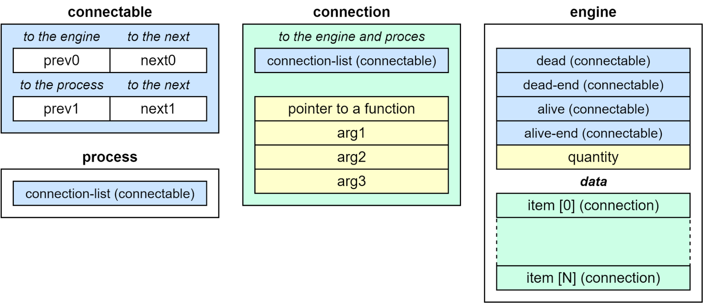
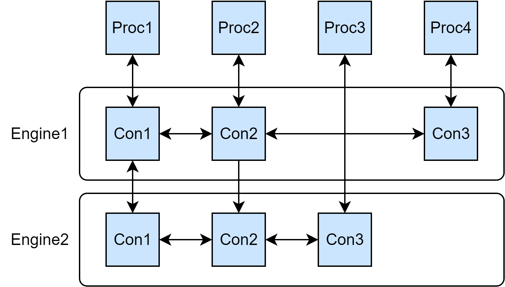

# Two-Way Sub-System Matrices: Parameter Management Architecture in OpenGOAL

*How a system of orthogonal lists enables flexible control of game parameters with automatic blending and minimal component coupling*

**Abstract.** The article examines an architectural approach to organizing game subsystems, implemented in the OpenGOAL engine. The system of orthogonal two-way lists allows multiple processes to simultaneously control the same parameters (sound volume, light brightness, time of day) with automatic blending and without rigid coupling of components. Unlike ECS, this system is intended for high-level logic, not for low-level computations. The material will be useful to game developers interested in flexible architectures for managing the state of the game world.

---

## 1. The Problem: Parameter Management in a Complex Game

Imagine a typical game situation:

- The player enters a cave — the echo volume should smoothly increase.
- At the same time, the sun sets — the brightness of light sources should change.
- The character receives a speed buff — the animation should speed up.
- The sound of footsteps depends on the surface type.

In the classic OOP approach, parameter management looks like direct calls:

```csharp
// Someone somewhere writes
AudioManager.Instance.SetVolume(0.8f);
LightManager.Instance.SetBrightness(0.5f);
```

Problems begin when there are many parameters, and dozens of different systems want to control them simultaneously. For example:

- **The environment system** says: "The volume should be 0.8 because we are in a cave."
- **The health system** says: "The volume should be 0.3 because the character is wounded."
- **The dialogue system** says: "The volume should be 0.5 because an important conversation is taking place."

How to combine these requests? Apply the minimum value? The maximum? The average? Or perhaps smoothly transition between them?

It is precisely to solve this problem that the system of **orthogonal two-way matrices** was developed in OpenGOAL.

---

## 2. Architecture: Basic Concepts

The system is built on three base classes, each of which performs a strictly defined role:


*Fig. 1 — Orthogonal connection system*

### 2.1. Connectable — the connection node

The base class that contains two independent two-way lists:

```csharp
public class Connectable
{
    public object Owner;
    
    // Horizontal list (within Engine)
    public Connectable Next0;
    public Connectable Prev0;
    
    // Vertical list (between Engine for one Process)
    public Connectable Next1;
    public Connectable Prev1;
}
```

Each `Connectable` can simultaneously be in two independent lists:
- **Horizontal (0)**: links nodes within one `Engine`
- **Vertical (1)**: links nodes belonging to one `Process`

### 2.2. Connection — the node with data

Inherits `Connectable` and adds parameters:

```csharp
public class Connection : Connectable
{
    public object Arg0;  // Handler function or object reference
    public int Arg1;     // Parameter identifier (ESetting)
    public int Arg2;     // Application method (EMethod)
    public int Arg3;     // Parameter value
}
```

### 2.3. Engine — the control subsystem

Manages the list of `Connection` and performs their update:

```csharp
public class Engine
{
    public string Name;
    public int Length;  // Number of active connections
    
    // Sentinels for lists
    public Connectable AliveList;
    public Connectable AliveListEnd;
    public Connectable DeadList;
    public Connectable DeadListEnd;
    
    // Pool of pre-allocated connections
    public Connection[] Data;
}
```

### 2.4. Process — the entity of the game world

Any entity that can control parameters (character, light source, zone trigger):

```csharp
public class Process
{
    public string name;
    public Connectable ConnectionList;  // Head of the vertical list
}
```

---

## 3. Two-Way Lists: How It Works


*Fig. 1 — Orthogonal connection system*

### Horizontal vector (next0 / prev0)

Links all `Connection` within one `Engine`. Each `Engine` has two lists:
- **AliveList** — active connections that must be processed
- **DeadList** — pool of inactive connections for reuse

When a new `Engine` is created, all connections are pre-allocated in the pool:

```csharp
public Engine(string name, int size)
{
    Data = new Connection[size];
    for (int i = 0; i < size; i++)
        Data[i] = new Connection();
    
    // All connections are in DeadList
    DeadList.Next0 = Data[0];
    DeadListEnd.Prev0 = Data[Data.Length - 1];
    
    // Link all elements into a chain
    for (int i = 0; i < Data.Length - 1; i++)
    {
        Data[i].Next0 = Data[i + 1];
        Data[i + 1].Prev0 = Data[i];
    }
}
```

### Vertical vector (next1 / prev1)

Links all `Connection` belonging to one `Process`. This allows quickly finding all subsystems in which the process is registered.

---

## 4. Registration and Execution

### Adding a connection

When a process wants to start controlling a parameter, it creates a connection:

```csharp
// In SettingsControl
public void AddSetting(Process process, int setting, EMethod method, int arg)
{
    engine.AddConnection(process, null, setting, (int)method, arg);
}

// In Engine
public void AddConnection(Process process, object arg0, int arg1, int arg2, int arg3)
{
    // Take a connection from DeadList
    Connectable connectable = DeadList.Next0;
    Connection connection = connectable as Connection;
    
    // Configure parameters
    connection.Arg0 = arg0;
    connection.Arg1 = arg1;  // ESetting
    connection.Arg2 = arg2;  // EMethod
    connection.Arg3 = arg3;  // Value
    
    // Move to AliveList
    DeadList.Next0 = connectable.Next0;
    connectable.Next0.Prev0 = DeadList;
    
    connectable.Next0 = AliveList.Next0;
    connectable.Next0.Prev0 = connectable;
    connectable.Prev0 = AliveList;
    AliveList.Next0 = connectable;
    
    // Add to the process's vertical list
    connectable.Next1 = process.ConnectionList.Next1;
    if (connectable.Next1 != null)
        connectable.Next1.Prev1 = connectable;
    connectable.Prev1 = process.ConnectionList;
    process.ConnectionList.Next1 = connectable;
    
    Length++;
}
```

### Calculating the resulting value

Each frame, `SettingsControl` updates the parameters:

```csharp
public void Update()
{
    // Start with default values
    target.CopyFrom(defaults);
    
    // Apply all requests from Engine
    target.UpdateFromEngine(engine);
    
    // Calculate the resulting values
    ApplySettings();
    InterpolateSettings();
}
```

`SettingsData.UpdateFromEngine` traverses all active connections and applies them:

```csharp
public void UpdateFromEngine(Engine engine)
{
    var item = engine.AliveListEnd.Prev0;
    
    while (item != engine.AliveList)
    {
        var prev = item.Prev0;
        UpdateConnection(engine, item as Connection);
        item = prev;
    }
}
```

Update methods for different value types:

```csharp
protected float UpdateFloat(float current, EMethod method, float value)
{
    switch (method)
    {
        case EMethod.Set:    return value;                // Absolute value
        case EMethod.Rel:    return current * value * 0.01f; // Percentages
        case EMethod.Scale:  return current * value;       // Scaling
        default: return current;
    }
}

protected bool UpdateBool(bool current, EMethod method, bool value)
{
    switch (method)
    {
        case EMethod.Set:    return value;    // Set
        case EMethod.Or:     return current | value;  // Logical OR
        case EMethod.And:    return current & value;  // Logical AND
        default: return current;
    }
}
```

### Application methods

| Method | Purpose | Example |
|-------|------------|--------|
| **Set** | Set an absolute value | `Volume = 0.8` |
| **Rel** | Percentages of the current value (0..100) | `Volume *= 50%` |
| **Scale** | Scaling (0..1) | `Volume *= 0.5` |
| **Or** | Logical OR (for flags) | `Flags |= 0x01` |
| **And** | Logical AND (for flags) | `Flags &= 0xFE` |

---

## 5. Example: Sound Volume Management

Let us consider a real scenario with three processes controlling the volume:

```csharp
// 1. The "Cave" process — absolute value
public class CaveProcess : Process
{
    void OnEnter()
    {
        settings.AddSetting(
            this,
            (int)ESetting.Volume,
            EMethod.Set,
            0.8f  // Volume 80%
        );
    }
    
    void OnExit()
    {
        settings.RemoveSetting(this, (int)ESetting.Volume);
    }
}

// 2. The "Damage" process — scaling
public class DamageProcess : Process
{
    void OnTakeDamage()
    {
        settings.AddSetting(
            this,
            (int)ESetting.Volume,
            EMethod.Scale,
            0.5f  // Reduce volume by half
        );
    }
}

// 3. The "Dialogue" process — absolute value
public class DialogProcess : Process
{
    void OnDialogStart()
    {
        settings.AddSetting(
            this,
            (int)ESetting.Volume,
            EMethod.Set,
            0.6f  // Volume 60% during dialogue
        );
    }
}
```

### How it works at runtime:

```
Initial state (default): Volume = 1.0

1. The player enters the cave:
   - CaveProcess: Set(0.8) → Volume = 0.8

2. The player takes damage:
   - CaveProcess: Set(0.8)
   - DamageProcess: Scale(0.5) → Volume = 0.8 * 0.5 = 0.4

3. A dialogue begins:
   - CaveProcess: Set(0.8)
   - DamageProcess: Scale(0.5)
   - DialogProcess: Set(0.6) → Volume = 0.6 (overrides)

4. The dialogue ends (the connection is removed):
   - CaveProcess: Set(0.8)
   - DamageProcess: Scale(0.5) → Volume = 0.8 * 0.5 = 0.4
```

The resulting volume depends on which processes are active and in what order they are applied.

---

## 6. Removing Connections (O(1))

When a process is destroyed, it must release all its connections. Thanks to the vertical list, this is done instantly:

```csharp
public Connection MoveToDead()
{
    Engine engine = GetEngine();
    
    // Remove from the Engine's horizontal list (O(1))
    Prev0.Next0 = Next0;
    Next0.Prev0 = Prev0;
    
    // Remove from the Process's vertical list (O(1))
    Prev1.Next1 = Next1;
    if (Next1 != null)
        Next1.Prev1 = Prev1;
    
    // Move to DeadList
    Next0 = engine.DeadList.Next0;
    Next0.Prev0 = this;
    Prev0 = engine.DeadList;
    engine.DeadList.Next0 = this;
    
    engine.Length--;
    
    return this;
}
```

A process can remove all its connections with a single call:

```csharp
public void RemoveSetting(Process process, int setting)
{
    var item = process.ConnectionList.Next1;
    while (item != null) 
    {
        var next = item.Next1;
        var conn = item as Connection;
        
        if (conn.BelongsToEngine(engine) && 
            (setting == (int)ESetting.All || conn.Arg1 == setting))
        {
            conn.MoveToDead();  // O(1) for each connection
        }
        item = next;
    }
}
```

---

## 7. Important Clarification: This Is Not ECS

The OpenGOAL system is often confused with ECS (Entity-Component-System), but these are fundamentally different approaches with different goals:

| Characteristic | OpenGOAL | ECS (Unity DOTS) |
|----------------|----------|------------------|
| **Main goal** | Flexible parameter management with blending | Maximum performance of mass computations |
| **Cache-friendliness** | Not a priority. Objects are scattered in memory | All components of one type lie in contiguous arrays |
| **Iteration** | Over linked lists (not cache-friendly) | Over linear arrays (cache-friendly) |
| **Application** | High-level logic, state management | Low-level computations (physics, rendering) |
| **Flexibility** | High — dynamic change of object archetype | Low — archetype is fixed |
| **Blending** | Built-in at the architecture level | Requires manual implementation |
| **Real usage** | Parameter management in Jak and Daxter | Physics, rendering in modern games |

In OpenGOAL, `Connection` is not just data, it is an **active participant in the system** that contains application logic (`EMethod`). And the objects themselves (`Process`) can be scattered in memory — the system does not require cache-friendliness from them.

**Key difference from ECS:** in OpenGOAL, flexibility and the ability to dynamically change the set of parameters controlled by an object are important, not the speed of traversal over an array.

---

## 8. Universality of the Pattern

Although in the original OpenGOAL implementation the system of orthogonal matrices was used exclusively for managing parameters (volume, brightness, time speed), the architectural pattern itself is universal.

> **Important clarification:** In Jak and Daxter, the system was **not** used for physics, rendering, or mass computations. Its real application is parameter management with blending. However, the data structure can be reused for other tasks.

### Potential scenarios (hypothetical)

1. **Buffs and debuffs system**
   - Player process: "Speed = 5"
   - Buff: "Multiply speed by 1.5"
   - Debuff: "Multiply speed by 0.5"
   - Result: 5 × 1.5 × 0.5 = 3.75

2. **Quest system**
   - Quest process: "NPC is active"
   - Time-of-day process: "NPC is active only at night"
   - Progress process: "NPC is active only after quest X"

3. **Weapon modifier system**
   - Weapon: "Damage = 10"
   - "Fire" modifier: "Multiply damage by 1.2"
   - "Heavy" modifier: "Multiply damage by 1.5"
   - Result: 10 × 1.2 × 1.5 = 18

### Why this pattern did not become ECS

It is important to understand why this system did not turn into ECS:

| Aspect | OpenGOAL (original) | Why not ECS |
|--------|---------------------|---------------|
| **Goal** | Flexibility of parameter management | ECS needs a different memory structure |
| **Iteration** | Over linked lists | Not cache-friendly for mass computations |
| **Data** | Scattered across the heap | ECS needs contiguous arrays |
| **Scenario** | High-level logic | ECS — for low-level computations |

---

## 9. Code from a Real Project

Below is a fragment of real code demonstrating the use of the system for managing settings in a game. The full code includes:

- `Connectable.cs` — the base node with two two-way lists.
- `Connection.cs` — the node with parameters and control methods.
- `Engine.cs` — the subsystem with a pool of connections.
- `Settings.cs` — the wrapper for managing settings with three copies (default, target, current).

```csharp
/// <summary>
/// Three copies of settings:
/// - default — base values (if no one controls the parameter)
/// - target — default values + changes from all processes
/// - current — actual values (applied every frame)
/// </summary>
public class SettingControl<T> where T : SettingsData, new()
{
    public T current;
    public T target;
    public T defaults;
    public Engine engine;
    
    public void Update()
    {
        // Start with defaults
        target.CopyFrom(defaults);
        // Apply all requests from Engine
        target.UpdateFromEngine(engine);
        // Calculate the resulting values
        ApplySettings();
        InterpolateSettings();
    }
}
```

---

## 10. Conclusions

OpenGOAL's two-way orthogonal matrices are a tool for managing complexity and flexibility in game projects. Unlike ECS, this system is intended for:

- Parameter management (volume, brightness, time speed)
- World state (time of day, weather, regional effects)
- Animation blending (smooth transitions between states)
- High-level logic where dynamic change of object behavior is required

The system gives developers the ability to:

1. **Dynamically change an object's archetype** — add and remove abilities, effects, modifiers.
2. **Resolve request conflicts** without writing complex priority code.
3. **Get smooth transitions** automatically (blending is built into the architecture).
4. **Quickly remove objects** (O(1) thanks to vertical lists).

This is an architecture born for flexibility and expressiveness, not for performance records. And this is its main value.

---

## Additional Materials

1. **OpenGOAL GitHub** — open implementation of the engine: [github.com/open-goal](https://github.com/open-goal)
2. **GDC 2004 — Jak and Daxter** — a talk on Naughty Dog's technical solutions.
3. Game Engine Architecture — the book by Jason Gregory, section on parameter management systems.

---

*Author: Valeriya Pudova (hww)*
*Source material: RA Game Developing Notes (2023)*
*Publication date: August 17, 2026*