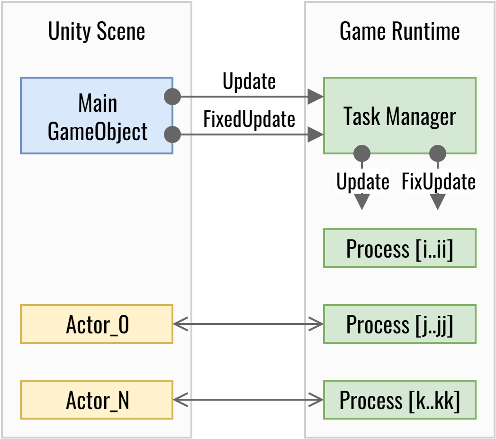
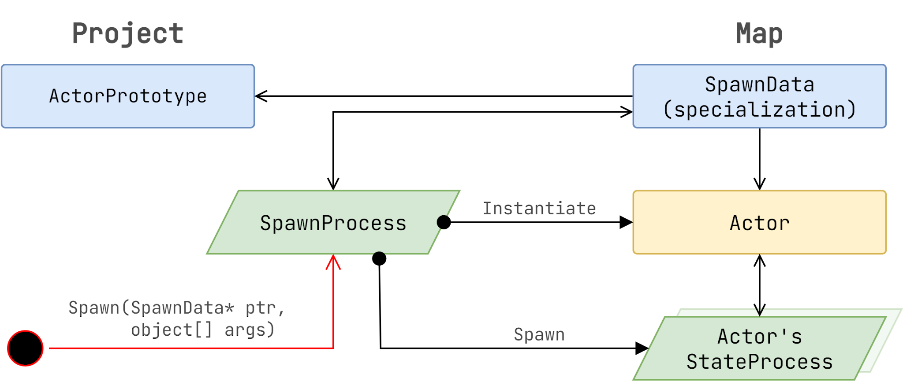
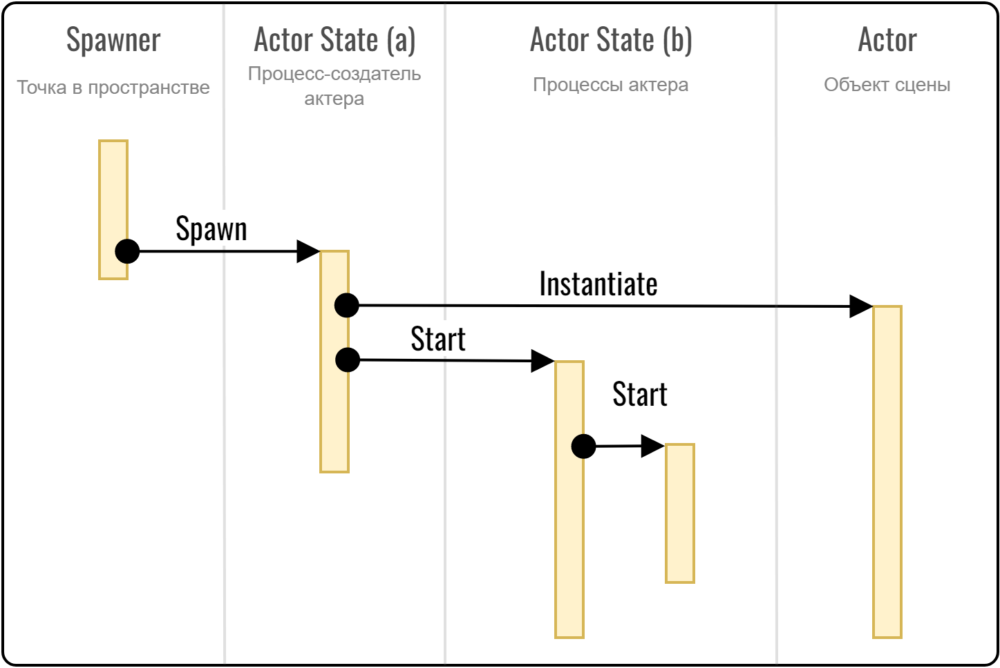

# Unity Spawning Methods

## Methods of Instantiating Scene Actors in Unity

**Valeriya Pudova**
2008

---

## Table of Contents

- Introduction
- Description of the Approach
- Instantiating Actors
- Scene Object Structures and Code Data Structures
- API Example
- Conclusions

---

## Introduction

There are many ways to instantiate scene objects in Unity and to launch processes associated with these actors. Let us list them:

1. **Using the Unity Runtime System**
   a. A prefab placed in the scene in editor mode, followed by launching the game.
   b. A prefab placed in the scene at runtime (Drag&Drop), or using the `GameObject.Instantiate` method.

2. **A custom game runtime**, in which a special spawn process instantiates a prefab via the `GameObject.Instantiate` method, launches the necessary processes, and updates the states of objects. In this case, the prefab itself does not launch any processes (see Diagram 1).

Each of the listed methods has its own advantages and disadvantages.
For example, method (1a) allows you to see precisely the position, orientation, and size of a character in its environment right in the editor.
Method (1b) is familiar and works with purchased assets; however, it is inefficient from a performance standpoint — an "awakened" actor, or many actors, can create a high computational load.

In this document, I will focus on method (2), which has been successfully applied in several projects.

---

## Description of the Approach

Diagram (1) shows a simplified structure of method (2). The scene contains a single object (`Main GameObject`), which calls methods in `TaskManager`.


**Diagram 1.** Custom game runtime.

`TaskManager` launches processes that can create and update actors. Processes are of two kinds:

- Standalone processes without actors (processes i…ii in the diagram)
- Actor processes (processes j…jj and k…kk in the diagram)

---

## Instantiating Actors

First, let us define the constituent parts of a scene actor. Diagram (2) shows the main components required for instantiation.


**Diagram 2.** Main elements of a scene actor.

- **Actor** — an animated game character controlled by processes.
- **ActorPrototype** — an object with parameters created in the Unity editor. This may be one or several prefabs and assets.
- **SpawnData** — a scene object in the editor containing information about which `SpawnProcess` to use, as well as when, where, and which prototype to instantiate, and what parameters to set for it after instantiation (actor specialization, akin to injection).
- **SpawnProcess** — a program that performs all operations to instantiate an actor. Upon launch, the process receives `SpawnData` as an argument, and possibly additional arguments.
- **StateProcess** — a set of processes that control the character at a given moment in time (a given state).

Despite the fact that many different archetypes can use the same `SpawnProcess` implementation, the `SpawnProcess` itself can be considered the initial state of the actor.

---

## World Model Data Structures

Scene object structures must not replicate world model data structures. The scene or prefab hierarchy is created by artists based on an intuitive understanding of the essence, as well as for technical reasons — the skeleton and mesh must have a certain hierarchy.

Since the data structure used by the code does not have to match the structure of the scene object, it is better to view `ActorPrototype` as a combination of two containers:

- **Type** or **Archetype** — the code model of the prototype.
- **Prefab** — the visual model of the prototype.

This allows different archetypes to be used on the same prefab (e.g., `Cyborg` and `Cyborg_Ragdoll`).

In the proposed solution, it is the processes that spawn actors with their own processes. In the usual Unity approach, processes are created by the actors' components.

---

## API Example

Below is a small fragment of the API. It consists mainly of two groups of methods:

- **Spawning** — launching standalone processes or scene actor processes.
- **Instantiating** — instantiating an actor and launching its processes.

First, let us define the following data types:

- `IProcess` — the interface or base class of a process. Processes are organized into a tree, and each has an event handler.
- `State` — a named state of a process (more precisely, a set of processes). The state defines the initialization and exit code, as well as an event handler.
- `ProcessBucket` — a list of homogeneous structures (processes) processed in a single pass. A game may have several such lists.
- `SpawnData` — instantiation parameters, for example, the parameters of a special scene point called a `Spawner`.
- `Archetype` — the actor archetype — the totality of all data needed to construct it. Usually a `SerializedObject` is used as the archetype.
- `Actor` — a scene object created based on an archetype. As a rule, `Actor` is a Unity component.

Another important type is `ResultCode`, which reports errors inside methods. This is not only a debugging tool: depending on the error, processes may change their behavior.

```csharp
public enum ResultCode
{
    Invalid,             // < not initialized (default value)
    Null,                // < equals null (empty result)
    Success,             // < successful operation
    Allocated,           // < the object was allocated
    NotAllocated,        // < no free objects in the pool
    InvalidState,        // < transition to an invalid undefined state
    InvalidStateReturn,  // < message delivery to the FSM failed
    InvalidReturn        // < unable to return a valid value
}
```

For working with the pool, there is a method for finding a free process or releasing an occupied one:

```csharp
// Find a free process or release a low-priority process
public IProcess FindFreeOrReusable(ProcessBucket headObject, bool forced);
```

The following set of methods is intended for managing processes without actors:

```csharp
// Create a process as a child of an existing one
SpawnResult SpawnProcess(IProcess parent,
                         Archetype type,
                         State state,
                         params object[] args);

// Create a process based on a spawner — a point in scene space.
// This process can create one or many actors
SpawnResult SpawnProcess(SpawnData data,
                         IProcess parent = null);

// Create a process for an existing scene actor
SpawnResult SpawnProcess(Actor entity,
                         Archetype type,
                         State state,
                         IProcess parent = null,
                         params object[] args);

// Initialize a process with archetype and state parameters.
// The method is called after retrieving the process from the pool
SpawnResult InitProcess(IProcess process,
                        Archetype type,
                        State state,
                        params object[] args);

// Stop the process and release it to the pool
SpawnResult TerminateProcess(IProcess process,
                             bool terminateEvent = true);
```

Next come the methods for working with actors. These methods are a replacement for `GameObject.Instantiate`:

```csharp
T Instantiate<T>(IProcess process,
                 GameObject prefab,
                 Archetype type) where T : Actor;

// Instantiate an actor for an existing process at a point
T Instantiate<T>(IProcess process,
                 GameObject prefab,
                 Archetype type,
                 Vector3 position,
                 Quaternion rotation) where T : Actor;

// Instantiate a child actor for a process at a point and with rotation
T Instantiate<T>(IProcess process,
                 GameObject prefab,
                 Archetype type,
                 Vector3 position,
                 Quaternion rotation,
                 Transform parent) where T : Actor;

// Destroy the process together with its actor or actors
void DestroyActor(IProcess process);
```

To stop state processes, there is the `Go` method:

```csharp
// Stop the current processes and create new ones
process.Go(IProcess parent, State state, params object[] args);
```

However, in practice, a different method of transitioning to a new state was used. Since each state had an `OnEnter` code, calling this method automatically performed the transition:

```csharp
// Stop the current processes and create new ones
ResultCode Goto_WalkingState(params object[] args)
{
    // State initialization code and launch of necessary processes
}

// Example of passing parameters to a state
Goto_WalkingState(/* specify the path target, if any */ currentZoneExitPoint);
```

The instantiation order does not begin with `GameObject.Instantiate`. This method is executed inside a process and is not always mandatory. In other words, the programmer creates data containers and algorithms for modifying them. The algorithm changes the state of the world, as well as instantiates and updates scene objects (see Diagram 3).


**Diagram 3.** Instantiating a scene actor.

The actor instantiation process must distribute the load across frames. Some objects must be created quickly — without delays. For such processes, it is worth limiting the instantiation time to two frames: `Instantiate → Spawn`. Other objects (e.g., background actors) can be created with a longer delay.

---

## Conclusions

The proposed terminology and API can be improved, but the approach of using a custom game runtime has proven to be very effective. The advantages of the method are listed below:

- Actor instantiation performance does not cause noticeable spikes.
- Data structure update performance is significantly higher than that of the Unity runtime system.
- There are no "single frame" problems — situations where one object unexpectedly updates before or after another, leading to errors.
- Pipeline simplification due to the fact that code is much more separated from data, unlike in the Unity component system.

When starting a new project in Unity, be sure to think about how to organize the runtime system to minimize risks.