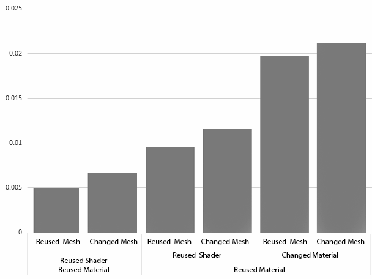
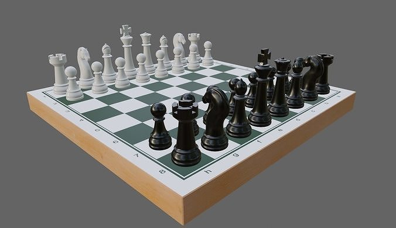
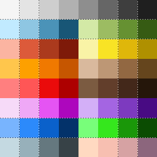
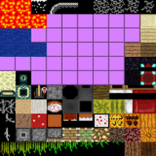
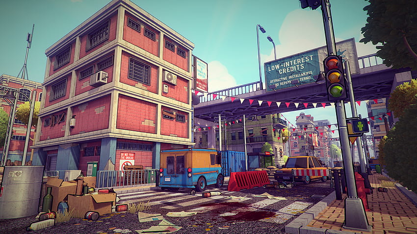
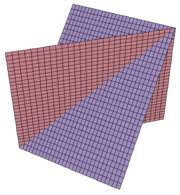
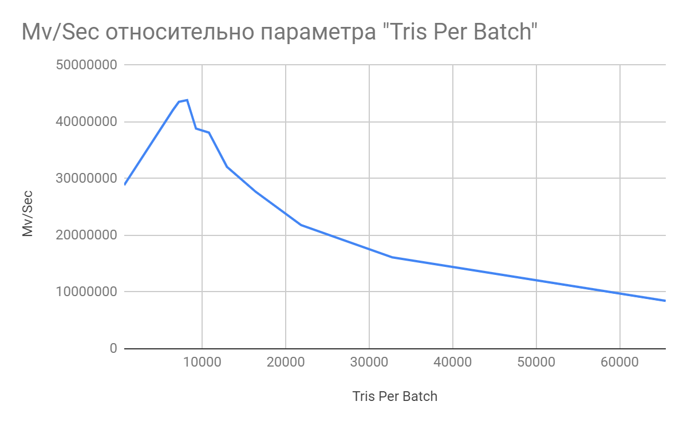
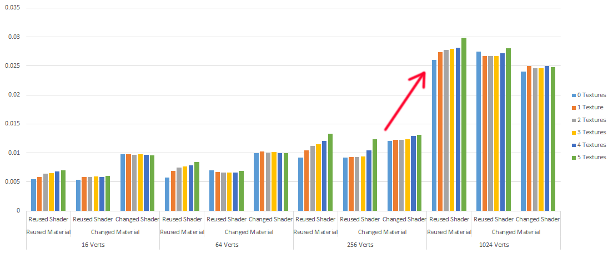
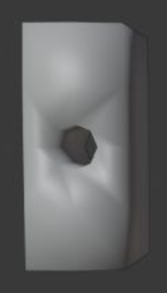
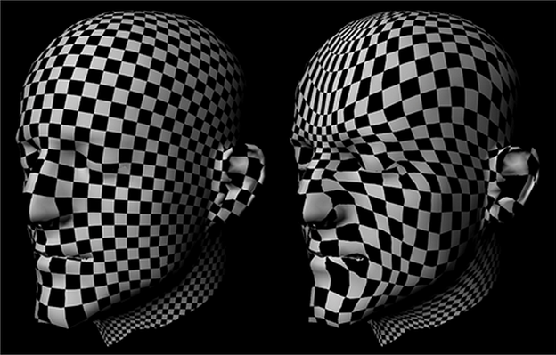

# GPU Sweet Spot: Graphics Optimization Rules for Mobile Platforms

**Most 3D artists are convinced: optimizing a model is exclusively a struggle for low poly count. This is a dangerous misconception.** Modern mobile chips easily chew through millions of triangles, but instantly "hang" the game due to traps in the structure of meshes and materials that are invisible to the eye.

Below is an engineering checklist for a 3D artist who wants their models to work on real hardware, and not just look beautiful in a portfolio.

---

## Table of Contents

1. The Polygon Trap: The Hidden Cost of Materials
2. The Law of the Atlas: The Logic of Shared Materials vs. Textures
3. The Anatomy of Mobile Rendering: Why Large Objects Are Evil
4. Texture Size
5. The Culture of Transparency and Batching
6. Production Culture: Normals, UVs, and Naming

---

## 1. The Polygon Trap: The Hidden Cost of Materials

An artist can spend two days crunching a model's mesh from 5000 to 3000 polygons, thinking they are saving the project. But if at the same time the object has **three materials instead of one**, the game's performance will become **worse**.

A simplified formula for the cost of rendering a frame:

$$Resources = RP + (SM + SMesh + SMesh + Pix) + Shad + RCnt$$

For the 3D modeler, the group in parentheses is critically important: **(SM + SMesh + SMesh)**.

- **RP** — the cost of render passes (depends on post-processing and the number of light sources with shadows).
- **SM** (Setting Material) — the cost of switching material state.
- **SMesh** (Setting Mesh) — preparing a new mesh for rendering.
- **SMesh** (second time) — the cost of switching between submeshes within one object.
- **RMesh** (Render Mesh) — the actual rendering of triangles.
- **Pix** — the cost of reading, blending, and writing pixels (depends on the blending method).
- **Shad** — the complexity of shader computations.
- **RCnt** — the number of visible objects on screen.

**What is the physics of the process:**
The most expensive resource on mobile platforms is the **number of Draw Calls** (rendering commands). Each new material → a new Draw Call. The CPU sends these commands, and it is the CPU that becomes the bottleneck. The video card (GPU), on the other hand, computes triangles at enormous speed.

**Rule:**
If an object contains **fewer than 500 triangles**, optimizing its mesh **does not yield an FPS gain**. The only thing that really matters is **minimizing the number of unique materials**.

||
|--|
|*Figure 1 - The impact of draw calls on rendering cost. The elements (SM + SMesh + SMesh) are the main priority for the 3D modeler.*|

---

## 2. The Law of the Atlas: The Logic of Shared Materials vs. Textures

To reduce the number of Draw Calls, there are three main approaches:

### A) Shared Materials (shared materials without textures)

Using several pure color materials for the whole scene.
**Example:** chess — 32 pieces and the board are rendered through just two materials (black and white).
✅ The video card does not need to load textures — this is the **cheapest rendering**.
⚠️ Works only with a small number of colors (up to 10–20).

||
|--|
|*Figure 2 - Chess pieces require just two materials — black and white.*|

### B) Texture Atlas (texture atlas)

Combining hundreds of small textures into one large canvas.
**Example:** an entire city or forest is packed into 2 textures (one for opaque objects, the second for translucent ones).
✅ Allows using one material for thousands of different objects → one Draw Call.
⚠️ Requires careful UV unwrapping to avoid pixel bleeding (mipmap bleeding). Fetching texels from an atlas costs GPU resources.

**Conclusion:**
If you need 10–20 colors — choose Shared Materials.
If you need visual variety and hundreds of objects — use an atlas, but with caution.

|||
|--|--|
|*Figure 3 - A texture atlas with pure colors.*|*Figure 4 - A texture atlas with subtextures (images).*|

### C) The whole world consists of one or two materials

If it is impossible to use approaches 1 and 2, then in most cases the following rule applies:

- Use **one submesh, one material, and one texture** for an object that is fully opaque **or** fully translucent.
- Use **two submeshes, two materials, and two textures** for an object that has both opaque and translucent parts.

**Exception:**
A complex character may require more textures to **simplify the production process**. This is a conscious compromise between performance and the convenience of the artists' work. For example, there may be separate layers for:

- Body
- Clothing
- Accessories and weapons

A good example of layer separation is described in the article [Texturing Game Characters in Substance Painter](https://learn.unity.com/project/texturing-game-characters-in-substance-painter).

||
|--|
|*Figure 5 - Such a scene can be rendered with a small number of textures and materials.*|

---

> **The Main Law of Material Optimization**
> In any of these three cases, the number of materials must equal the number of submeshes.

---

## 3. The Anatomy of Mobile Rendering: Why Large Objects Are Evil

Modelers love to assemble large objects (long fences, hangars, monolithic sections of ground) into a single mesh. For mobile platforms and VR headsets (Oculus Quest, Pico), **this is a technical death sentence**.

**What is the physics of the process:**
Mobile GPUs use **Tile-Based Rendering** — they split the screen into small squares (tiles) and compute them in isolation.
A huge monolithic object is always at least partially in view. The engine cannot cull it and is forced to scroll the giant's geometry through the memory cache for each tile. The result is chip overheating and FPS drops.

||
|--|
|*Figure 6 - Large overlapping objects are not rendering-friendly on TBR platforms.*|

**Rule:**
Mobile platforms have a hard zone of maximum efficiency — the **Sweet Spot**.
For example, for Oculus Quest this is **5–7 thousand triangles per batch**.
Any large object must be assembled from **small modules** whose size fits within the platform's constraints.

||
|--|
|*Figure 7 - Each platform has its own optimal performance zone (sweet spot) for rendering many objects with different mesh sizes. For example, for Oculus Quest the best performance is achieved when using objects in the range of 5–7 thousand triangles per batch.*|

---

## 4. Texture Size: The Bandwidth Trap

Most 3D artists are convinced: if a high-resolution texture physically "fits" into the video memory of the headset or smartphone, then it can be used. This is a dangerous architectural misconception. The memory itself may be half empty, but the game will start to lag mercilessly.

| |
|---|
| Figure 8 - The platform has problems when the texture size exceeds a certain threshold. |

What is the physics of the process:
On mobile platforms and standalone VR headsets (Oculus Quest), RAM and video memory (VRAM) are one physical chip. They share a common data bus, which has a very narrow "neck" — bandwidth (Memory Bandwidth).
When the GPU tries to simultaneously render dozens of objects with 4K textures on screen, the following happens:

- Clogging of the data bus: A 4K texture contains 4 times more pixels (texels) than a 2K texture. Just to transfer these data arrays from RAM to the graphics chip, the common bus is clogged "to the brim." The processor (CPU) and video card (GPU) start to idle, simply waiting for the pixels to arrive over the bus.
- Texture cache catastrophe: Inside the GPU there is a tiny but ultra-fast memory — the texture cache. When the video card paints a pixel, it fetches a piece of the texture into this cache. If the texture is small (e.g., 512x512), its fragments fit perfectly into the cache, and the GPU works at maximum speed. A huge texture does not fit into the cache. The video card constantly encounters cache misses, being forced to go back to slow shared memory.

Rule: Texture size should be determined not by "beauty up close" but by its physical resolution on the player's screen. If an object occupies a 200x200 pixel area on screen, stretching a 2048x2048 texture onto it is a technical crime that will eat up the precious Bandwidth of the entire system.

Always use Mipmap levels (LOD textures) so that the engine automatically substitutes a lower texture resolution as the object moves away from the camera.

---

## 5. The Culture of Transparency and Batching

Rendering translucent materials is one of the heaviest operations for a graphics chip. Unlike opaque geometry, which the video card draws "head-on," transparency forces the hardware to work in a mode of constant stress.
What is the physics of the process:
When an object has translucent areas (Alpha Blending), the GPU cannot simply write the pixel color to the screen buffer. It is forced to perform the heavy Read-Modify-Write operation: read the color of what is already drawn behind, blend it with the color of the translucent object, and write the result back.
If several layers of transparency overlap each other on screen (e.g., a lush tree crown made of transparent planes or smoke effects), a catastrophic Overdraw effect occurs. The same screen pixel is recalculated 5–10 times per frame. The mobile video card instantly chokes, the memory bus is overloaded, and FPS drops several times over.
To keep the simulation within working limits, the 3D artist must observe three strict rules:

## 1. Alpha Test vs. Alpha Blend: The Anatomy of a Compromise

- Alpha Blend (soft fade): On mobile devices and VR headsets this is a strict taboo. It generates endless Overdraw and forces the engine to spend CPU resources on constant, per-pixel sorting of objects by depth (to understand which translucent object is closer to the camera and which is farther).
- Alpha Test (hard mask cutout): A pixel is either 100% visible or fully transparent. The edges turn out stepped and rough ("ugly"), but this method does not require layer sorting. However, it has a hidden trap: Alpha Test breaks the Early-Z technology. Modern GPUs can discard pixels hidden behind walls before running heavy shaders. But with Alpha Test, the chip does not know whether to discard a pixel until it executes the shader and checks the transparency mask.
- Engineering solution: Use Alpha Test as a compromise only for distant objects (trees from afar). Up close, it is often more profitable to cut the mesh with additional polygons along the contour of the leaf or part, making honest opaque geometry, than to use a square polygon with a transparent mask. On platforms with MSAA enabled, use the modern alternative — Alpha to Coverage, which gives soft edges without a performance loss.

## 2. The Illusion of LOD (Level of Detail)

Automatic level-of-detail switching systems (LOD) are a wonderful tool, but artists often shove them everywhere.

- Rule: LOD calculation makes sense only for dynamic objects or with a fast-moving camera. If in your scene the camera is static (or moves along a strictly limited rail), the constant mathematical calculation of how far an object is and which LOD to enable for it wastes central processor (CPU) resources absolutely in vain. With a static camera, LODs should be disabled, and the scene geometry should be initially fixed at optimal quality.

## 3. The Hidden Cost of Batching

When programmers say: "Don't worry about Draw Calls, we'll enable batching and the engine will glue everything together itself," they keep silent about the side effects.

- The Static Batching Trap: This tool really does combine static objects with a shared material into one rendering call. But physically it creates one gigantic monolithic mesh in RAM. As a result, we return to the "Large Objects" problem (Section 3): a huge fence or a piece of the city will hang entirely as dead weight in the headset's memory, even if the player has buried their nose in a single post.
- The Limits of Dynamic Batching: It works "on the fly" only for small, moving objects (projectiles, coins, particles) and is rigidly limited to a cap of ~300 triangles. If the modeler exceeds this limit by even one polygon, the object falls out of batching and creates an extra Draw Call.

---

## 6. Production Culture: The Hidden Mathematics of Geometry

Most artists estimate the weight of a model by the polygon counter in Blender, Maya, or 3ds Max. However, the game engine sees geometry differently. Due to hidden traps at the stage of creating UVs and normals, a model of 1000 polygons can suddenly turn into 2000 or 3000 vertices upon import into the engine, overloading the shader processors.

## Normals and Hard Edges

Incorrect normals do not just create ugly creases and artifacts on the light, forcing programmers to spend time fixing others' mistakes. They directly affect performance.

| |
|---|
| Figure 9 - Defects caused by incorrect normals. |

What is the physics of the process:
The game engine calculates the load not by triangles but by the number of vertices (Vertex Count). When you assign a Hard Edge status to an edge (sharp edge / split of smoothing groups), the engine physically cannot smooth the normal at this point. It has to break and duplicate vertices along this entire edge. Each face gets its own copy of the vertex with its own normal direction.

Rule: The more unjustified Hard Edges on a model, the higher its real weight in the engine. Strive to move hard edges onto the texture (via a normal map), leaving the mesh itself as smooth as possible (Smooth Edges).

## UV Unwrapping and the Seam Trap

Checking the unwrap with a checkerboard texture is not just an aesthetic requirement for fighting pixel stretching. It is a technical necessity.

| |
|---|
| Figure 10 - On the left — a good unwrap, on the right — a bad one (stretched UVs). |

What is the physics of the process:
Just as in the case of Hard Edges, the game engine duplicates vertices at each texture seam (UV Seam). A geometry vertex may be one, but if it belongs to two different unwrap islands, it has different UV coordinates. The engine is forced to copy it in memory.
If the modeler mindlessly cuts the mesh into hundreds of small UV islands, the real Vertex Count of the model on the mobile GPU will grow 2–3 times. The video card will spend extra cycles processing the same points.

## Naming as an Element of Architecture

The requirement to give objects clear names instead of the standard Mesh_01, Box_offset_2, or Material_red is not a whim of the lead artist but protection against the human factor.
When a project is assembled for mobile platforms, programmers set up automatic pipeline optimization scripts (Asset Postprocessors). For example, a script can automatically batch all objects containing Static_Prop_ in their name, or apply special compressed texture formats to objects tagged *UI*. If meshes are named chaotically, automation breaks, and the team has to manually sift through thousands of assets looking for the causes of performance drops.

Rule: An asset name must be strictly structured and self-documenting (e.g., Character_Body_01). This is the only way to keep the project under control when the number of objects in the scene exceeds thousands.

## Additional Recommendations for Production Culture

- Double-sided geometry: Avoid enabling the "Two Sided" checkbox in the material settings. It completely disables the most important hardware optimization of the video card — Backface Culling. The GPU starts spending resources on processing internal polygons that the player will physically never see. If you need thickness (e.g., for cloth or a sheet) — honestly model it with geometry.
- Abuse of polygons "just in case": Always delete invisible polygons — those pressed against walls, located inside other objects, or hidden under the ground. They not only take up memory space but also participate in visibility calculations, spending CPU resources.

## Additional Recommendations (for production culture)

- **Double-sided geometry:** avoid it — it doubles the load on the rasterizer.
- **Occlusion:** effective only with a moving camera. With a static camera, occlusion calculation wastes CPU in vain.
- **Alpha Test:** remember that it gives stepped edges but can be justified for large distant objects.

---

## Final Optimization Checklist (Criticality Scale from 1 to 10)

The higher the score, the more this error hits the performance of the mobile platform. Check the model strictly from top to bottom.

| Action when checking an asset | Impact on FPS (0–10) | Physical meaning / Why it is critical |
| --- | --- | --- |
| 1. Reduce the number of materials to a minimum | 10 / 10 | Each material generates a new Draw Call, overloading the processor (CPU). |
| 2. Use an atlas or shared colors instead of a pile of textures | 10 / 10 | Protects the memory bus (Bandwidth) from being clogged with heavy texture data. |
| 3. Check normals (artifacts) and UVs (with a checkerboard) | 9 / 10 | Chaotic unwrap seams and Hard Edges physically double the Vertex Count of the model in the engine. |
| 4. Avoid Alpha Blend (strict taboo), use Alpha Test | 8 / 10 | Saves the mobile chip from the Overdraw effect (multiple redrawing of pixels). |
| 5. Split large objects into modules of 5–7k triangles | 7 / 10 | Allows tile-based rendering (TBR) to effectively cull invisible geometry. |
| 6. Avoid double-sided geometry (Double-sided) | 6 / 10 | Preserves the hardware optimization of Backface Culling. |
| 7. Apply static batching only after profiling | 4 / 10 | Protects RAM from bloating with monolithic invisible meshes. |
| 8. Enable LOD only for moving objects/camera | 3 / 10 | Saves the CPU from idle distance calculations with a static frame. |
| 9. Optimize poly count only if the mesh has > 500 tris | 2 / 10 | Saves the artist's time. Optimizing a small mesh by polygons is useless. |

---

**Author:** Valeriya Pudova (hww)
**Year:** 2022
**Contacts:** Telegram [@valery_h2w](https://t.me)