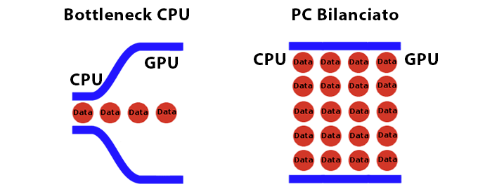
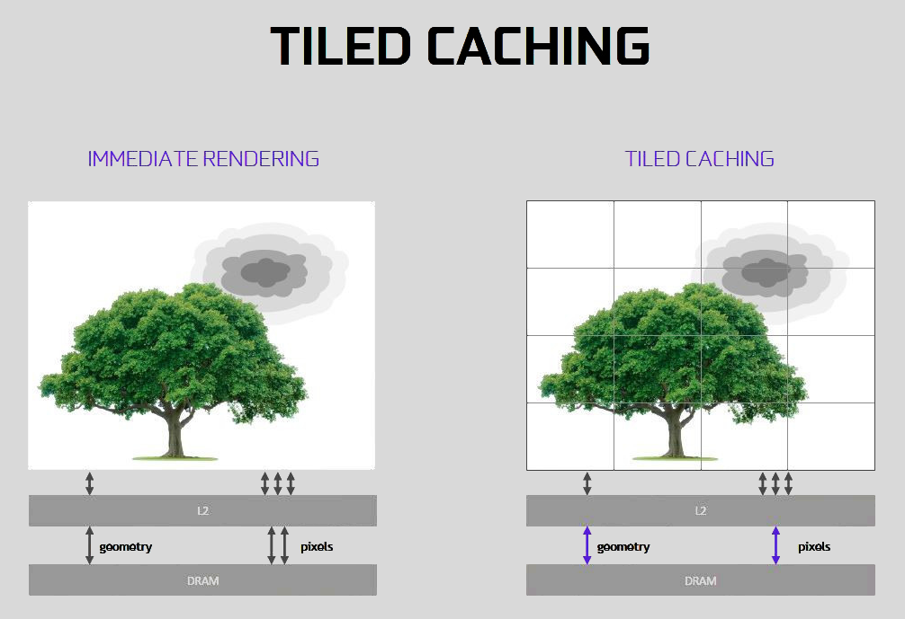
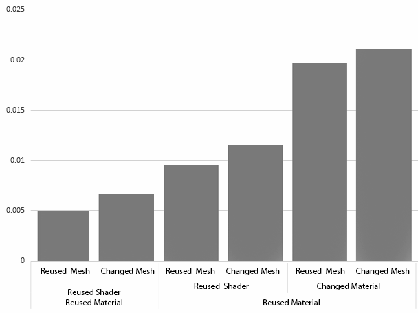
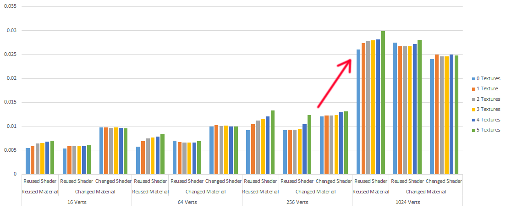
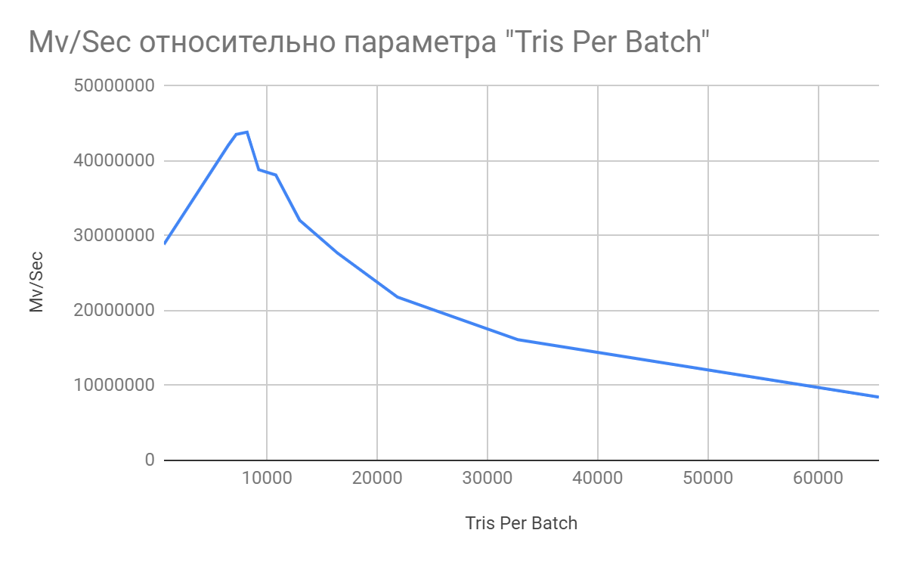
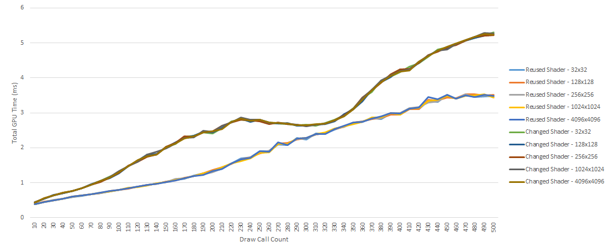

# Oculus Quest Performance

## Abstract

The article describes optimization techniques for Oculus Quest with a focus on practical implementation. The material combines official Meta recommendations, engineering experience, and an artist's perspective. Unlike the original, all key meanings have been restored here, including sections on Tile-Based Rendering, Early-Z, render order management, and practical checklists. **All illustrations are preserved.**

**Keywords:** Oculus Quest, Performance, Optimization, CPU, GPU, FPS, TBR, Early-Z

---

## Introduction

It is obvious that the number of draw calls must be limited. But this number is not universal: 10 or 200 — it depends on the scene. The same applies to the number of triangles. However, performance is not determined by these numbers alone. Below we will examine the processes and options that are most critical for mobile architecture.

- **Tile-Based Rendering (TBR)** — a key feature of mobile GPU architecture.
- **CPU cost estimation** — what is actually expensive for the processor.
- **GPU cost estimation** — what loads the graphics.
- **Artist's perspective** — a simplified but practical approach.
- **Engineering checklist** — coding rules for Quest.

---

## 1. CPU & GPU Balance

Quality optimization is the search for equilibrium between the load on the central processor and the graphics accelerator. If one device is idle waiting for the other — this is a loss of performance.

There are two main bottlenecks:

| Type | Description |
|-----|----------|
| **CPU Bound** | The processor does not have time to send tasks to the GPU. There are many reasons: too many draw calls, heavy scripts, physics, garbage collector, frequent shader and material switches. |
| **GPU Bound** | The graphics processor is overloaded. Even if there are few draw calls, complex shaders, large meshes, heavy textures, and low memory bandwidth create [a bottleneck]. |

||
| :---: |
| *Figure 1 — Load distribution and the bottleneck effect between CPU and GPU.* |

---

## 2. Tile-Based Rendering (TBR) — The Architectural Foundation

Oculus Quest uses a TBR architecture. The screen is divided into small tiles. Rendering occurs in two stages:

1. **Vertex pass** — all vertices are processed, and for each primitive it is determined which tile it falls into.
2. **Fragment pass** — fragment shaders are executed for each tile.

**The key TBR optimization — Early-Z.** If objects are rendered **from near to far**, the GPU can discard pixels hidden behind opaque objects **before** executing the fragment shader.

||
| :---: |
| *Figure 2 — The principle of Tile-Based Rendering: splitting the screen into tiles and two-pass rendering.* |

> ⚠️ **Important:** As soon as **any translucent** object (even alphatest) enters a tile, the Early-Z optimization is **completely disabled for the entire tile**. All pixels in this tile will be fully computed, even if they are hidden.

---

## 3. The Early-Z Trap and Render Order

Everyone knows: opaque objects should be rendered from near to far. But there are hidden traps in Unity.

### Trap 1: Alpha Test Kills Early-Z

If a bush with alpha test (foliage, lattice) is rendered on top of an opaque wall, then Early-Z is disabled in that area. The GPU does not know whether a pixel is transparent or not until it executes the fragment shader. This means that resources are spent on pixels that the player will not even see.

> **Solution:** Change the render order. The opaque object must be rendered **first** — then it will be written to the Z-buffer. The translucent polygon will update only the actually visible pixels.

### Trap 2: UI Renders on Top of the Entire Scene

By default, UI in Unity is rendered **after** the entire scene. If the player has a large menu in front of their eyes, it redraws the pixels of the already finished three-dimensional world. This is pure overdraw.

> **Solution:** Set `Custom Render Queue` for UI to `Geometry-1` or `Geometry+1`. If the interface updates the Z-buffer **before** the scene is rendered, the GPU will hardware-discard all geometry hidden behind the interface.

---

## 4. CPU Cost Estimation

### Changing a Shader Is More Expensive Than Changing a Material

This is the golden rule: switching a shader is one of the most expensive operations. The ideal minimum: one shader for opaque objects, one for transparent, one for unlit. Everything else is a luxury.

### Changing a Material Is More Expensive Than Changing Geometry

It is cheaper to have 2 meshes with 1 material than 1 mesh with 2 materials. Practical conclusion: merge nearby opaque objects into one mesh, and textures into one atlas.

### What Is Almost Free for the CPU:

- Replacing a material's texture (with the same shader)
- Replacing a material's color
- Texture size (from 32×32 to 4096×4096)
- Texture filter
- Compression method

> But all this can be expensive for the GPU — see below.

||
| :---: |
| *Figure 3 — Comparison of relative CPU costs for switching shader, material, and mesh.* |

### CPU Summary (Priorities):

1. **Minimize shader switching** — the most expensive.
2. **Minimize material switching** — also expensive, but less so.
3. **To a lesser extent — mesh switching** and a large number of textures.

---

## 5. GPU Cost Estimation

### Complex Mesh — A Non-Linear Problem

Mesh size affects performance non-linearly. The performance drop is especially noticeable when going from 256 vertices to 1024. Most likely, this is due to GPU cache misses.

||
| :---: |
| *Figure 4 — Non-linear performance drop as mesh size grows.* |

> **Conclusion:** Sometimes it is cheaper to render many small identical objects than one large one. Especially if the objects fit into the GPU cache.

### Sweet Spot for Oculus Quest

The optimal geometry size per batch is **6–8 thousand triangles**. This is the zone where performance is maximal.

||
| :---: |
| *Figure 5 — Performance (Mv/Sec) depending on geometry size in one call (Tris Per Batch). A plateau in the 6–8K range is clearly visible.* |

### Multitexture — Not So Scary

Although the official guide advises avoiding multiple textures, the graphs show that this is not too expensive. However, it can give unstable results due to cache misses.

> But a multitexture material is **more profitable** than an additional shader or material (i.e., an additional draw call).

### What Is Almost Free for the GPU:

- Texture size (from 32×32 to 4096×4096) — **does not affect** performance
- Texture filter
- Compression method

||
| :---: |
| *Figure 6 — Dependence of frame time (Total GPU Time) on the number of draw calls (Draw Call Count). The upper cluster of lines clearly shows the crushing cost of changing a shader (Changed Shader) compared to reusing the old one (Reused Shader). At the same time, the graphs for textures from 32×32 to 4096×4096 merged into monolithic lines, proving that texture size itself is free for the GPU on this platform.* |

> ⚠️ **Exception:** Cubemap is **more expensive** than a 2D texture. Use them minimally.

### GPU Summary (Priorities):

1. **Minimize shader switching**.
2. **Minimize material switching**.
3. **Do not use objects with a large number of triangles** (stay in the Sweet Spot).
4. Pay attention to the **disproportionate performance drop** when increasing primitives.

---

## 6. Artist's Perspective

Here is a restored and expanded section for those who do not want to dig into the weeds of code.

### Main Optimization Technologies on Oculus Quest:

| Technology | How It Helps |
|------------|--------------|
| **Occlusion Culling** | Ignoring not only objects outside the frame but also those hidden by others. |
| **Primitive Culling & Clipping** | Discarding or clipping primitives that do not fall into the frustum. |
| **Sorted Rendering + TBR** | Rendering from near to far. Disabling the fragment shader for hidden pixels. Partially reduces overdraw. |
| **GPU Cache** | Fast rendering of objects whose size fits into the cache. |
| **Shader Instancing** | Suitable for many small dynamic objects: bullets, decor, particles, foliage. |

### Complex Mesh vs Large Game Object —

*[The source text ends here — the section appears to be truncated in the original file.]*