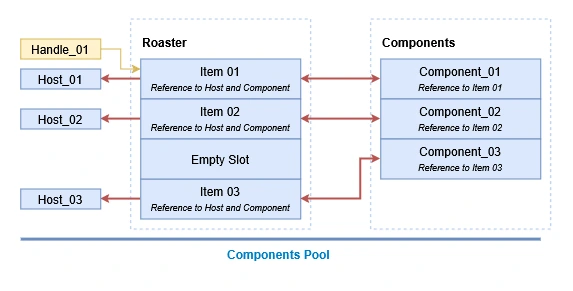
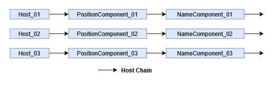
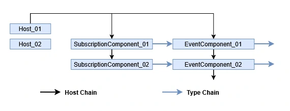
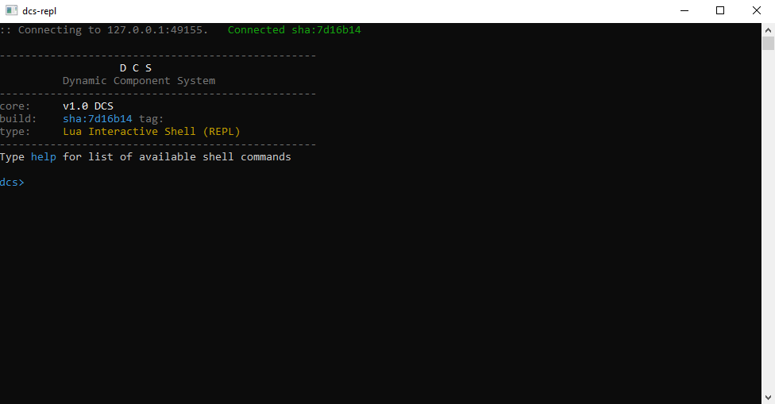
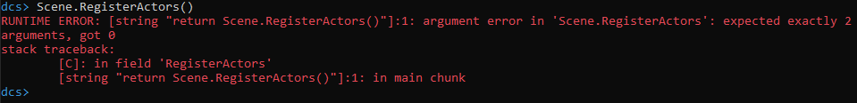

# An Experiment in Building a Data-Oriented System in Unity: Where Theory Breaks Against Reality

> An honest report on an experiment: a dynamic component system, Lua integration, and spatial data in Unity.

**Valeriya Pudova (hww), 2026**

---

## Table of Contents

1. [Introduction](#1-introduction-what-and-why)
2. [ECS: Idea vs. Reality](#2-ecs-idea-vs-reality)
3. [Component System Architecture](#3-component-system-architecture)
4. [Spatial Data](#4-spatial-data)
5. [Authoring: The Scene as Metadata](#5-authoring-the-scene-as-metadata)
6. [Lua: The Conductor, Not the Musician](#6-lua-the-conductor-not-the-musician)
7. [Data-Oriented: When Needed, When Harmful](#7-data-oriented-when-needed-when-harmful)
8. [About DCS and Lua](#8-about-dcs-and-lua)
9. [Conclusion](#9-conclusion)
10. [Addenda](#10-addenda)

---

### Section 1. Introduction

This article is not a manifesto and not a textbook. It is a report on an experiment.

Some time ago, I became interested in testing one idea: is it possible in Unity, on C#, to build a dynamic component system — the kind Insomniac used in its engines. The one where an object has not one or two components, but many, where components are not only data (position, velocity) but also messages between objects. The one where everything is data, and everything lives in flat arrays.

Why? Not for performance. Not because "it's trendy." But because it's interesting — as an idea. I wanted to understand: where theory converges with reality, and where it breaks. What this system gives in practice, and what it takes away.

Plus, a second experiment: Lua. I wanted to get rid of the "edit → compile → restart" cycle and get interactive programming right inside a running game.

Plus a third: spatial data. This is the part that adapts a Unity scene to the data-oriented approach: a dead world of authoring objects is compiled into runtime data, and then brought to life by processes.

These three things go together in this article because it is impossible to separate them. The component system requires Lua for parameters. Lua requires spatial data for AI. Spatial data requires the component system for runtime. This is one experiment, broken down into three.

The purpose of this article is to honestly tell what worked, what did not, and why. Without "ECS is the future" and without "ECS is a dead end." Because the answer is twofold: for some tasks the system is necessary, for others it is harmful. Where exactly — that is what we will talk about.

---

### Section 2. ECS: Idea vs. Reality

The idea I wanted to test was simple: an object does not have a fixed set of fields. It has a set of components, and this set can be changed on the fly. One component is position. Another is name. A third is the "damage taken" event. A fourth is AI state. A fifth is another event. A sixth is another. There can be many components, and they can be anything.

Each component is a struct. Not a class, not a MonoBehaviour. A simple data structure lying in a flat array — a pool. Access to a component is through a Handle: 16 bits for the index in the pool, 16 bits for generation (protection against "dangling" references). Systems traverse pools linearly, read components, write components. No `GetComponent<T>`, no MonoBehaviour, no object trees.

This is very different from how Unity is built out of the box. And it works.

What worked well.

Traversal is linear. Components lie contiguously in memory. When a system processes all enemies with a `HealthComponent`, it does not search for them across the scene — it walks the array. Cache-friendly. Memory-efficient. No allocations per frame.

Components can be stacked. This is perhaps the most interesting part. An object can have several components of the same type — for example, three "damage taken" events in a frame. Or two `DamageSourceComponent`s — from different sources. In the OOP model, this is done through lists inside a single MonoBehaviour, which is complex and ugly. Here — naturally.

And finally, the same system uniformly delivers messages. An event is also a component, just with a flag. A subscriber is also a component. Delivery goes through the same pools, the same Handle. There is no separate event system — events are part of the component model.

What did not work well.

The first problem is two ways of access. Two types of Handle live in the system.

*Host Handle* — a reference to an object. It is like an "identifier of the game object." Through it you can ask: "what components does this object have?" — and get a chain of components.

*Component Handle* — a reference to a specific component in a specific pool. Through it you can directly read or write data.

The first is for searching. The second is for working. Both are needed. And this grows. Somewhere the system wants "all objects with component X" — it walks pool X, takes each component, reads the Host from the Roster. Somewhere the system wants "this object's component X" — it walks through the HostChain, searches by type, gets a Component Handle. Somewhere both methods are needed in one place, and the code becomes non-trivial.

Below is an illustration. This is real code from the system reading input for movement:

```csharp
for (int i = 0; i < animPool.Partition; i++)
{
    ref var anim = ref animPool.Components[i];
    if (anim.PositionHandle.IsNull) continue;

    ref var pos = ref posPool.ResolveHandle(anim.PositionHandle);

    if (!anim.KeyboardInputHandle.IsNull)
    {
        ref var kb = ref kbPool.ResolveHandle(anim.KeyboardInputHandle);
        forward = kb.Forward;
        fire = kb.Fire;
    }
    // ...
}
```

Here three pools are in one function: `AnimationStateComponent`, `PositionComponent`, `KeyboardInputComponent`. Between them — Handle. The logic is smeared across three arrays. It works fast, but reads heavily.

The second problem — dependencies break cache-friendliness.

If component A depends on component B, then A stores a Handle to B. Then the system traverses pool A linearly, but when processing each element jumps to pool B — by Handle. This is not a linear traversal. Cache is lost. We won on one axis (linear iteration) and lost on another (random access to dependencies).

This is not a problem specific to this system. This is a general problem of data-oriented design. It is solved either by putting the dependency next to the data (then it is not two components but one), or by moving dependencies into external systems that traverse both pools simultaneously. But there is no beautiful solution.

The third problem — C# is not suited for low-level programming.

In C++, all this would look natural. Templates, `std::variant`, no boxing, `constexpr`, `entt`, `flecs`. In C# — one has to make compromises.

The main compromise is boxing. In C#, a struct cast to an interface is boxed into a heap object. If you have `struct AnimationStateComponent : IInitializable`, and you write `if (comp is IInitializable init) init.Init(prius)` — the compiler creates a copy on the heap, calls `Init` on the copy, and throws it away. Changes are not saved.

This is non-obvious. This is annoying. This forces you to look for workarounds — generic constraints, `ref` delegates, `InitCallback` in the pool. Each workaround works, but complicates the code.

Low-level programming in C# is a trial. It is not "just C++ with a different syntax." It is a different language, a different memory model, different rules. And when you try to go beyond what C# was designed for, every step is a struggle.

What this means.

The idea itself is correct. Components, pools, Handles, linear traversal — works. Memory-efficient, fast, interesting. But the implementation in C# — with creaks. Not because C# is bad, but because it is not for this. It is for something else — for convenience, for safety, for rapid development. And low-level work is not its strong suit.

This is not a verdict. This is an honest observation. If the same experiment were conducted in C++ — the rakes would be different. Perhaps fewer. Perhaps more. But this is what happened in Unity, in C#. With its own compromises.

---

### Section 3. Component System Architecture

Before talking about rakes and compromises, it is worth explaining how this system is built inside. Otherwise, the conversation about "two Handles," "chains," and "generations" will remain words without meaning. This section is about mechanics. I will try to break it down into atoms so that a reader who has never seen ECS understands what is happening here and why it is built this way and not otherwise.

#### Component Pool

Let's start with the basics. A component is a data structure. Not a class, not a MonoBehaviour. A simple `struct` with fields. It has only one mandatory field — `RosterIndex`, an integer. Everything else is what a specific component needs. For `PositionComponent` — this is `Vector3 Position` and `Quaternion Rotation`. For `NameComponent` — this is `Name`. For `DamageEventComponent` — this is `float Amount` and `Host Source`. Each component defines its own fields.

```csharp
public struct PositionComponent : IComponent
{
    public int RosterIndex { get; set; }
    public Vector3 Position;
    public Quaternion Rotation;
}
```

Components do not live on their own. They lie in pools. A pool is a container for components of one type. `PositionComponent` — one pool. `NameComponent` — another. `DamageEventComponent` — a third. The pool owns all instances of its type and manages their lifecycle.

The pool is not structured like a regular array. If it were just an array, then when deleting a component from the middle, all subsequent ones would have to be shifted — this is expensive and breeds holes. Instead, the pool uses a two-array scheme, often called a sparse set.

The first array is dense. It is `Components[]`. In it, components lie contiguously, without holes. If there are one hundred components in the pool, they occupy indices `0..99`. No gaps. This is critical for performance: systems traverse this array linearly, and the processor predicts the next access.

The second array is sparse. It is `Roster[]`. In it, indices are fixed. Each component is assigned a permanent number in the Roster upon creation — and this number never changes as long as the component is alive. Even if the component moved in the dense array, its number in the Roster remained the same.



Why is this needed? Because a reference to a component must be stable. If we referenced the index in the dense array directly, then upon any deletion of another component the index could shift — and all references would break. But through the Roster — no. The Roster stores the current position of the component in the dense array, and this position is updated when the component moves.

How does deletion happen? Very simply. If the fifth out of one hundred elements in the dense array needs to be deleted, then we take the last (hundredth), put it in the place of the fifth, and reduce the array size by one. The component that was last moved to the place of the deleted one. In the Roster, its `Index` is updated — now it points to the new place. That's it. No shifts. One move. Practically free.

The Roster, besides the index, stores two more things. The first is generation. This is a number that increases every time a slot in the Roster is reused for a new component. The point is protection against dangling references. If you have a Handle to a component that has already been deleted, the generation in the Handle will not match the generation in the Roster — and the system will understand that the reference is outdated. No "use after free," no access to freed memory.

The second is Host. This is a reference to the game object that owns the component. Host is also just a pair of numbers (id + generation). Through Host you can ask: "what other components does this object have?" More on this below.

#### Handle

Handle is a reference to a component. It looks simple: two 16-bit numbers packed into one 32-bit. The first is the index in the Roster. The second is generation. If generation does not match what is currently in the Roster, then the reference is outdated, and the component no longer exists.

```csharp
public struct Handle
{
    public ushort Id;          // index in Roster
    public ushort Generation;  // protection against dangling references
}
```

Handle** is not a pointer. It is a number. If two Handles have the same Id and Generation, they point to the same component. If Generation is different — to different ones (or one of them is outdated). This makes Handle serializable, copyable, transmittable over the network — and safe. You cannot "accidentally" access a deleted component: the system will check generation and refuse.

Why does Handle point to the Roster specifically, and not to the dense array? Because the dense array moves. The component that was at position 99, after deleting the fifth, moved to position 4. If Handle pointed directly to 99, it would break. But through the Roster — no: the Roster stores the current position, and it is updated with every move.

This is the correct architecture. And it works in any ECS, not just ours.

#### Host

**Host** is the game object. More precisely, it is a reference to the game object. Also a pair of numbers (id + generation), like Handle. But if Handle points to a component, then Host points to an object that may have many components.

Why is Host needed if there is Handle? Because we do not always know which component we need. Sometimes we need to ask: "does this object have component X?" Or: "give me all the components of this object." A Handle to a component will not help here — it already points to a specific one. We need another reference that points to the object as a whole.

Host, like Handle, is protected by generation. If Host is "outdated" (the object was deleted, and the id was reused), generation will not match what is in `HostManager`, and the system will understand that the reference is invalid.

`HostManager` is the central manager that issues Hosts, stores their generation, and links Host with a MonoBehaviour (Actor). Actor is the scene, a Unity object. Host is the logic, an ECS object. The link is through a weak GCHandle. This allows a system that knows Host to quickly retrieve the real Unity object: `HostManager.GetActor(host)` will return either Actor or null. Without searching the scene.

#### Two Chains

Now — the most interesting part. There are two ways to link data: by object and by type.

**HostChain** — a chain linking Host with all its components. Each Host has a head — the index of the first `ChainNode` in the common chain. `ChainNode` stores a Handle to the component and the component type. Nodes are linked through `Next`. Thus one Host can have many components, and all of them are found in a linear pass.

```csharp
public struct ChainNode
{
    public Handle Component;
    public int TypeId;
    public int Next;
}
```



**TypeChain** — a chain of a different kind. It links the message type with all subscriptions to this type. When a system sends an event, it does not search for subscribers across the entire scene. It takes the head of the chain for this event type — and walks through it. All subscribers are already there.

This unifies message delivery. Events are the same components, just with an `IEvent` flag. Subscriptions are the same components, just with a `TargetEventTypeId` field. Delivery is through the same pool and Handle system. No separate event machine. Everything within one model.

The two chains are independent. HostChain answers the question: "what components does this object have?" TypeChain answers the question: "who is subscribed to this event type?" One is about the object, the other is about the type. Together they cover both ways of accessing data.



#### Domains

All this — pools, chains, HostManager — is combined into one container. It is called Domain.

**Domain** is an execution space. It has its own pools. Its own chains. Its own components, but a shared HostManager. Domains do not intersect. A component from one domain is not visible in another. A Handle from one domain is not valid in another.

Why several domains? Because different parts of the game should not interfere with each other. For example, GUI is one domain. The scene is another. The network layer is a third. Each has its own logic, its own components, its own events. If they are mixed in one domain, any bug in the GUI will break the scene. And by separating them — we isolate the problems.

In a typical game, there are one or two domains. In large ones — more. Separation is by meaning, not by "trendy." If you have one scene and one logic — one domain. If the scene, GUI, and network are independent — three domains.


#### Two Additional Registries

All this — pools, chains, domains — works. But there are two things that were not named, and they are important for the outside world — primarily for Lua.

The first is DomainRegistry. This is a registry of all domains in the system. Each domain has a name and an index. A domain with the name `"scene"` and a domain with the name `"gui"` are different domains, they have different indices, different data. `DomainRegistry` allows you to find a domain by name or by index. Why? Because calls come from Lua with the domain name — "work with the domain `scene`." Lua does not know internal indices. It knows names. `DomainRegistry` turns a name into a reference to the domain. One lookup. One operation. Without searching across all domains.

The second is ComponentRegistry. This is a registry of all component types. Each type has a name and a unique identifier that is issued once — at system initialization. `PositionComponent` is a type with one id. `NameComponent` — with another. `DamageEventComponent` — with a third. `ComponentRegistry` allows you to turn a type name into its id or into its pool. Or vice versa — id into name (for debugging and Lua). Why? Because systems need to know which pool to work with. Store all pools in one place, where each type knows its id. When Lua asks "create a component of type `DamageEvent`" — `ComponentRegistry` finds the id and directs the call to the correct pool. One operation. Without reflection, without searching by type at runtime.

These two registries are bridges between names and data. Inside the system, names are not needed — there are numbers. But outside — in Lua, in the editor, in logs — names are convenient. Registries allow you to use names without paying for them inside the hot-path. `ComponentType<T>.Id` is a static field that is computed once at startup. After that — a constant. No lookups. No reflection. Just a number.

#### How It All Fits Together

The complete picture is as follows. There are components — data structures. They lie in pools. Each component belongs to some Host. The link Host ↔ components is through HostChain. Components of a special kind (events) are delivered through TypeChain — this is the link event type ↔ subscriptions. All this together — inside Domain. Domain is the container in which the game lives.

When a system processes something, it does not search for objects across the scene. It traverses the pool linearly. For each component, it knows the Handle. The Handle leads to the data. The data is nearby, in a flat array. The processor is happy.

When a system sends an event, it does not search for subscribers. It takes the head of TypeChain for this type. Walks through it. Subscribers are there. No searches. No allocations. No `GetComponent`.

When a system wants to retrieve a Unity object by Host, it calls `HostManager.GetActor(host)`. This is one operation. A weak reference. Fast.

This is the very "data-oriented" model that so much is said about. Only without marketing. Concretely: pools, Handles, chains, domains. Understandable and working.

---

### Section 4. Spatial Data

The component system is the foundation. But by itself, it does not answer the question: how to find an object in the world? How to understand that this soldier is this specific soldier and not another? How to understand that he is of type "infantryman" and not "tank"? How to understand where he is located? These questions are answered by the spatial layer — the next level above components.

#### Three Aspects of an Object

In order to work with objects effectively, we divided their identification into three independent aspects. Each aspect answers one question.

The name answers the question: *"who are you specifically?"*. This is the unique identifier of the object. It allows you to find the object by name, distinguish it from others, reference it in a script or in code. "Jack" is a name. "NorthGates" is also a name. It is one per object, it does not change during the object's lifetime, and through it you can always find this object.

The archetype answers the question: *"what type are you?"*. This is not a unique identifier but a category. The archetype says: "this object is an infantryman." Or "tank." Or "gate." Or "camera." Through the archetype, you can find all objects of this type. You can assign common code to them. You can process them identically. The archetype is not about what the object is, but about how to work with it. And, importantly, the archetype does not have to be unique. Many soldiers — one archetype.

Flags answer the question: *"how should you be executed?"*. This is not about the object. This is about the system that processes the object. Flags belong to systems, not objects. For example, the physics system has a flag "work with colliders." The render system has a flag "draw opaque." The AI system has a flag "think every frame." The object does not have flags — but the system, when processing an object, looks at its archetype and decides whether this object concerns it.

This is a subtle point, and it is fundamental. In the OOP model, flags would be on the object — for example, `bool isVisible` or `bool isStatic`. In the data-oriented model, flags are on the system — because the decision about what to do with the object is made by the system, not the object. The object does not know that it is being drawn or not. The render system knows this. And this is correct from the DOD point of view: logic is with systems, data is with objects.

#### How to Store Names and Archetypes

Strings at runtime are expensive. Each string is a separate heap allocation. String comparison is character-by-character. String copying is slow. And all this is pressure on the garbage collector.

Therefore, strings in this system are not stored as strings. They are collapsed into a 32-bit number via CRC32. Each string corresponds to exactly one number. String comparison becomes number comparison — one operation. Storage — four bytes instead of several dozen. Copying — one `mov`.

The original string is not lost. It is stored in one buffer — an interning table — and can be restored by number at any moment. This allows you to use the number for internal logic, and the string — only for debugging and for Lua, where strings are familiar.

The class that does all this is called `Name`. It is a wrapper over a 32-bit number. Not string. Not pointer. A number.

```csharp
public struct Name
{
    public uint Id;
    // ...
}
```

#### Identification Components

Based on the above — we have three main components.

**NameComponent** stores the name of the object. One object — one name. Through this component, you can find the object by name. Or get the object's name for output, for saving, for Lua.

**ArchetypeComponent** stores the archetype of the object. One object — one archetype. Through this component, you can collect all objects of one type. Or check whether the object fits the system's filter.

**PositionComponent** stores the position of the object in the world. Position and rotation. Through this component, you can understand where the object is and where it is looking.

```csharp
public struct NameComponent : IComponent
{
    public int RosterIndex { get; set; }
    public Name Name;
}

public struct ArchetypeComponent : IComponent
{
    public int RosterIndex { get; set; }
    public Name Archetype;
}

public struct PositionComponent : IComponent
{
    public int RosterIndex { get; set; }
    public Vector3 Position;
    public Quaternion Rotation;
}
```

These three components are the foundation of spatial data. The identity of the object consists of them: the name says *who*, the archetype says *what*, the position says *where*. Everything else is a superstructure.

#### Indices

The three components are there — but how to search by them? If we have ten thousand objects, and we want to find all soldiers — we cannot traverse all ten thousand and check each one. That is too slow.

For this, indices are built. An index is a structure that pre-groups objects by a common attribute. It does not check — it already knows. Because the objects were added to it once, upon creation.

We build three indices.

**NameIndex** — from name to object. If you need to find "Soldier Ivan" — the index immediately says which Host it is. No traversals. One lookup.

**ArchetypeIndex** — from archetype to a list of objects. If you need to find all soldiers — the index immediately gives the list. Then you can traverse only them — and not all ten thousand.

**FlagsIndex** — an optional search container from flag to a list of objects. If you need to find all objects with the flag "static" — the index gives the list. The same principle.

An index is not magic. It is just a structure that contains already grouped data. It is more expensive in memory — you need to store lists. But it is cheaper in CPU — the search takes constant time, not linear. A trade-off, as always.

#### SpatialDomain

All three indices — plus three pools — live together, in a separate domain. It is called SpatialDomain.

**SpatialDomain** is a superstructure over the component system. It does not replace it. It uses it. Name, archetype, and position are the same components as any others. They lie in the same pools. But access to them is optimized through indices that immediately know who is where.

Why a separate domain, and not just more pools in the common one? Because spatial data is not needed by all systems. The GUI does not need to search for objects by name. The network does not need archetypes. Space is needed by those who work with the world — AI, physics, triggers, spawners. By separating space from the rest, we isolate its responsibility.

#### DynamicSpatial

Separately inside SpatialDomain lives DynamicSpatial.

It is responsible only for dynamic objects — those that move. Those whose position changes every frame. Soldier, car, bullet, projectile. There are not many of them — dozens, hundreds. But their position is constantly changing — and searching for them through a static index is inconvenient.

DynamicSpatial is structured differently. It is a spatial map — a grid divided into cells. Each object lies in the cell where it is now. When it moves — it moves from cell to cell. The search "all objects near point X" becomes a search over several cells, not over the whole world.

This is not a replacement for indices. This is a supplement. Static objects — through indices. Dynamic ones — through DynamicSpatial. Each — where it is more convenient.

#### How It All Fits Together

The complete picture is as follows. There are components. There are three special components — Name, Archetype, Position — that describe the object in the world. There are indices that know who is where. There is SpatialDomain, which contains all this. And there is DynamicSpatial — inside — for those who move.

When a system needs to find an object by name — it calls NameIndex. By archetype — ArchetypeIndex. By flag — FlagsIndex. When it needs all objects nearby — DynamicSpatial. No `GameObject.Find`. No traversals of the whole scene. No searches through the hierarchy. Only direct access to already known data.

This is spatial data. Simple in the basics, complex in the details. They work fast, they cost memory. And they free the programmer from the routine of searching.

---

### Section 5. Authoring: The Scene as Metadata

Until now, we talked about how the system is built. Now — about where it gets its data.

#### The Dead World

The key idea is that the world is initially dead. We do not create it at runtime. We load it already prepared — as data. Actors live in this dead world, but they do not work. These are blanks, descriptions, metadata. They are waiting to be brought to life.

An actor is not just any scene object. It is a special object inherited from a special class `BaseActor`. All other scene objects are decorations; no one sees them. The system works only with actors. Everything else — is ignored at the data level. This greatly simplifies life: no need to deal with what is not part of the game logic.

#### What an Actor Has

Any actor has a position in the world — position, rotation, scale. This is the minimum.

Further — depending on the specific actor — it may have its own fields. A spatial shape: `ShapeBox`, `ShapeSphere`, `ShapeCylinder`, `ShapeBorder` — if the actor describes some area in the world. A spawner — if the actor creates others. `Encounter` — if the actor combines a whole combat scene, a section of the world, a zone with logic.

And there is the simplest actor — `Locator`. It has only a name and a position. Nothing more. It does not describe a shape. It does not create objects. It does not manage a zone. Just a point with a name. Sometimes that is all that is needed — to put a marker in the world to which logic from Lua will later be attached.

#### A Common Language for Complex Actors

All complex actors have a generalized way of reading and writing their fields. This is important. It does not matter whether it is a spawner or an encounter, a region or a shape — any of them can accept the request "read field X" and answer. And can accept the request "write value Y to field X." This unifies work with them from scripts. Lua should not know that a spawner has its own fields, and an encounter has its own. It says "read field `prefabPath`" — and gets an answer. The spawner knows how to answer. The encounter knows how to answer. This is polymorphism, but without class inheritance — through a common interface.

Many of these actors can reference code in Lua. This is another layer of flexibility: the scene author can write in the inspector "on activation of this object, call the module `encounters.village` and the function `on_activate`" — and the system will call it. Without compiling C#, without rebuilding the project. Only text in the inspector.

#### Facts

Finally, actors have a dynamic argument table. It is called Facts. It is a free "key — value" structure where values are simple types: numbers, strings, vectors, colors. Facts do not have a fixed schema. Each author can create their own keys, their own values. No one checks that `health` is an `int` and not a `string`. This is the author's responsibility.

Why is this needed? Because a game designer is not a programmer. He does not want to write a C# class for each object in the scene. He wants to say: "this barrel has `health = 50`, `explodes = true`, `loot = \"coins\"`." Without compilation, without rebuilding, without waiting for the programmer. Facts are a tool for game designers. It uncouples them from programmers. Each works in their zone: the programmer — at the level of systems, the game designer — at the level of scene data.

#### Compilation into Assets

All this data — actors, fields, facts — is saved into special assets. Through separate editor tools. An asset is not a scene. It is a set of baked data: a list of actors, their fields, their facts, their spatial shapes. Everything needed to load the world at runtime.

Assets can be loaded several at once. This allows working with several scenes simultaneously. For example, the main scene and a separate scene for an interior. Or a scene and a separate scene for a network game. Each — its own asset. Loaded together, work independently.

Finally, there is a visualizer for this baked data. It shows what is inside the asset — which actors, where, with what fields, with what facts. This is a debugging tool: loaded an asset, looked at what is actually inside, made sure everything is baked correctly.

#### Facts and Spatial Data — Where to Copy

Here there is an unresolved question, which it is honest to mention.

When an asset is loaded at runtime, its facts need to be stored somewhere. Two options. The first is to copy the facts into spatial data. The second is not to copy, but to look at them through the scene object when needed.

Both options have pros and cons. If you copy — spatial data is decoupled from the real world. `GameObject.Find` is not needed. No references to Unity objects. Everything inside the data. If you do not copy — we save memory, but each access to a fact requires going to the scene object, which is more expensive and more complex.

In our project, facts are copied. This does not mean that this is the only correct choice. It is just how it was done. And in general — copying has nothing bad about it. But decoupling from Unity objects gives flexibility: spatial data knows everything it needs itself. It does not depend on the scene. And if it becomes necessary to save the state of the world — it will save without problems.

On the other hand, you can look at it differently. Facts are a tool of the game designer. He always has a way to convert the host into a scene object. And from the object — to get the facts. Then storing them in spatial data is not mandatory. It is enough to store only what is needed for orientation in the world — name, archetype, position, shape. And facts — to look at through the object when needed.

We chose copying. But this is not a final answer. This is an open question that is worth testing in practice.

---

### Section 6. Lua: The Conductor, Not the Musician

When we talk about Lua in this project, it is important to understand one thing: Lua here is not a programming language. Lua here is a description language. The conductor, not the musician. It does not play the parts itself. It indicates who plays and when. It deals with top-level logic — the game script. It does not create objects, does not allocate memory, does not link components. It says: "at this point, a soldier appears, he will have such a name, he will go there." Everything else — C# does.

This is a fundamental decision. It goes against how Lua is usually used in the game industry. In most projects, Lua is a powerful language on which half the game is written. With us — it is not so. With us, Lua is a thin layer. Deliberately thin.

#### Why Thin

The reason is simple. Lua is a tool for the game designer, not the programmer. The game designer wants to say: "there will be a village here, peasants live in it, they work during the day and sleep at night." He does not want to create a `prefab`, instantiate it, allocate a Host, add components, link them with a Unity object, initialize systems. All this is programmer work. It must be in C#. And it is in C# — in factories and systems.

Lua only calls these factories. One call: `Soldier.Spawn(prefabPath, name, x, y, z)`. That's it. Inside — C# does everything needed. Lua does not know what is inside. It does not need to know. This is not its responsibility.

A thin interface is not a compromise. It is a conscious design. If Lua knew about components, about Handles, about `Animator` — the API between Lua and C# would grow to hundreds of functions. Each component — a new function. Each field — a new function. Marshaling — each type. This is what we observed during development. And this is what we consciously moved away from.

#### Remote Console

The second aspect that took a lot of time is the remote console. The idea was this: while the game is running — you want to communicate with it directly. Write code, check it in the moment, change behavior without restarting. This is what is called REPL — read-eval-print loop.

The problem is that Unity does not provide such an opportunity out of the box. No built-in REPL. No way to write C# and immediately see the result. You can rebuild the project every time — but this is long and inconvenient. Especially when the game is already running.

We made our own console. It connects to the game via HTTP. From the outside. A separate program. A separate process. The game listens on a port. The console sends commands. The game executes them in the Lua state. The response is returned back. All this works while the game is running. No restarts. No rebuilds.



This is one of the few things that justify the presence of Lua in the project. C# does not provide this out of the box. Lua does — because its state can be changed on the fly. But this is not about speed and not about expressiveness. This is about interactivity. About the feeling of a live dialogue with the game.

#### Errors That Speak

The third aspect — errors. When something goes wrong in Lua — the error should be useful. Not "nil value," but "field `position` not found on object `Soldier_131077_1`, because it was not spawned." Not "stack overflow," but "call to `Vector3.New` from `soldier.lua:47` led to a stack overflow in `Vector3.__add`."

We made a special error system. It intercepts errors in Lua at the boundary with C#, enriches them with context — stack, names, values — and sends them both to the Unity log and to the remote console. If you work through the console — you see the error immediately. If not — it is in the Unity log, as usual.



This is not rocket science. These are the little things that make work pleasant. Without them — Lua turns into a black box in which nothing is clear.

#### Argument Validator

The fourth aspect — argument validation. When Lua calls a C# function, all arguments come as `object`. The type is not checked automatically. `float` may turn out to be `string`. `Host` may turn out to be `nil`. And the function will fail somewhere in the middle, not understanding what exactly went wrong.

We made a special layer — `ArgReader`. It allows a function to tell the system: "I need exactly three arguments, the first — integer, the second — string, the third — Vector3." And the system checks. If it does not match — an error immediately with a clear message. Mandatory and optional arguments. Default values. Ranges. Everything needed so that functions do not fail randomly.

This is standard practice in any integration of scripts into C#. Without it — debugging turns into hell. With it — errors are found immediately and clearly.

### Vectors and Quaternions

A separate story — vectors. And quaternions. In C#, Vector3 is a simple structure of three numbers. In Lua — not a structure. Lua has no structures. Only tables, numbers, strings, functions, userdata. And that's it.

It was possible to make Vector3 a table with fields x, y, z. It was possible to make it a function with a metatable. It was possible to pass three numbers separately. It was possible to store the vector in a pool and pass only the index.

We tried several options. We settled on userdata. Vector3 and Quaternion are userdata with direct fields inside. Twelve bytes for a vector, sixteen for a quaternion. No additional allocations. No references to the pool. No three numbers in a row.

This is not the most efficient way. This is not the most beautiful way. This is not the most flexible way. But — the simplest. And the most agnostic. Userdata works always, everywhere, the same way. It does not require special support on the C# side. It does not require special logic on the Lua side. It simply exists. Like a number. Like a string. Like a table.

We compared with other options. Each of them had its pros and cons. And each of them required a compromise. Userdata also requires a compromise — but a smaller one than the others. And this decided the matter.

Vector3 in Lua looks the same as in C#. It has fields x, y, z. With it, you can add via +. Subtract via -. Multiply by a number. It works naturally. As if it were native to Lua. And inside — userdata. Twelve bytes. Simple. Understandable. No surprises.

#### Finite State Machines

And the fifth aspect, perhaps the most interesting. We made a compact library of finite state machines for Lua. The idea is simple: there is an object in the game, it has a state — "standing," "running," "shooting." Each state — its own logic. Its own delegates: what to do upon update, what to do upon receiving a message, what to do upon checking for the presence of a message.

This library allows you to describe all states in Lua in one file. Without bloating C#. Without breeding classes. Compact, readable, flexible. The game designer writes himself: "in the `guard` state, the soldier turns 90 degrees if he hears a shot." The programmer does not participate. Only Lua. Only data.

And this is, perhaps, all that is worth saying about Lua. It works, it is useful, but it is not universal. It is not a programming language in our project. It is a description language. The conductor. And this is not a compromise. It is a conscious choice.

---

### Section 7. Data-Oriented: When Needed, When Harmful

There is one thought that I want to convey clearly. Data-oriented programming is not a universal truth. It is a tool. And like any tool — it is needed when it is really needed. And harmful when not needed.

What does "really needed" mean? It means: you have thousands of objects on screen at the same time, and the logic of these objects is simple and homogeneous. Five thousand units in an RTS. Ten thousand bullets in a shooter. One hundred thousand particles in a simulation. Here DOD wins. Because it can process them linearly, densely, in parallel, without losses on abstraction.

And what does "not needed" mean? It means: you have one hundred objects on screen or fewer. It means: each object has its own complex logic, its own state transitions, its own interactions with others. Here DOD loses. Because it complicates programming, requires discipline, forces you to think about data, not logic.

And this is not a theoretical conclusion. This is a conclusion from practice. I built this system. I put it through ten iterations. And I see where it works well and where it works poorly. It is not bad. It is simply not for all tasks.

#### About PS5 and PC

Separately, it is worth saying about platforms. On PlayStation 5 and similar consoles, there is a feature: coprocessors work in a small amount of memory. This means that data must be compact, dense, without garbage. DOD is perfect for this. It does not create garbage. It does not waste memory on abstractions. It works with what is there.

On PC — the picture is different. The architecture is much more performant. Caches are large. There is a lot of memory. Garbage is not such a problem. And here DOD loses its advantage. Its complexity remains, but the gain — does not.

#### Ratchet & Clank as a "Decoy"

There is one example worth analyzing. Ratchet & Clank. The game looks as if a lot is happening there. Many enemies, many effects, many moving objects. It seems that DOD is indispensable.

But this is not so. If you look closely — there are not so many objects on screen. Dozens, not hundreds. Hundreds, not thousands. The logic of each — its own, complex, unique. And here DOD gives nothing. Classic OOP fits better. And the game is made on OOP. Despite the fact that it looks large-scale.

This is an important lesson. The visual impression is deceptive. The game looks complex, but from the processor's point of view — it is simple. And this means that DOD is not needed here. And this is not bad. This is correct.

Advice

If you are making a game on PC, and you do not have thousands of objects on screen — DOD is not needed. It will complicate development. It will force you to think about data, not logic. And you will not see the gain. Think better about how to reduce the number of objects on screen. Sometimes this is possible. Sometimes — not. And if not — DOTS. If yes — OOP.

### Section 8. About DCS and Lua

Two experiments are over. It is time to summarize.

#### DCS: Dynamic Component System

The component system in the form in which we made it — works. It solves its tasks. It is memory-efficient. It is cache-friendly. It unifies not only components but also message delivery. It is friendly to parallel threads and to the Burst compiler.

But — it is not as efficient as Leo ECS or DOTS. Because C# is not C++. Because the lack of struct inheritance, managed references — all this interferes. We made compromises at every step. And this left a mark on performance and on code complexity.

This does not mean that the idea is bad. The idea is good. The implementation — as far as C# allows. If we did it in C++ — it would be better. But we did it in C#. And we got what we got.

The main advantage of our system is unification. Not only components, but also messages. Not only data, but also delivery. Everything in one model. And this is unique. This is what I wanted to get. And this works.

#### Lua: Positive, but with a Caveat

The experience with Lua is positive. I will say honestly. We made the REPL, argument validation, error system, finite state machines, userdata vectors. All this works. And works well.

But — there is a caveat. And this caveat is important.

Lua makes sense only for teams of more than five people. When you have several game designers and several programmers. When you have a division of labor. When the game designer wants to write logic without compilation. When the programmer wants not to be distracted by constant edits.

For a small team — five people or fewer — Lua begins to play a negative role. The division of code into two domains — C# and Lua — creates additional overhead. Each change needs to be coordinated. Each function is needed in two places. The API grows. A layer appears that no one wanted. And this is a problem.

#### What Is Important to Note

The experience showed one thing that is important for everyone. A concept can be developed and used within any paradigm. OOP does not cancel data-oriented thinking. DOD does not cancel OOP. Lua does not cancel C#. They can coexist. And this is not a compromise. This is correct design.

If you are making a game and think: "maybe I need a component system?" — first ask yourself: how many objects do I have on screen? What is their logic? Is there any point in complicating for the sake of performance that I will not see?

If you think: "maybe I need Lua?" — first ask yourself: how many people are in the team? Is there a division into programmers and game designers? Are you ready to bear the additional complexity?

Honest answers to these questions are more important than fashion, than "everyone does it," than "this is the future."

### Section 9. Conclusion

#### What Remained Unclear?

A lot. The authoring system has not been tested. Spatial data has not been run on large scenes. DCS has not been compared directly with DOTS or Leo ECS on the same tasks. Lua has not been tested on teams of different sizes. This is honest. I do not claim to know the truth. I share what I saw.

#### What Is Worth Trying?

The first — to pull out the spatial data and launch a new project on their basis. This is the right path. There are no disappointments here. The architecture is good, works, it can be developed.

The second — not to repeat the mistakes with Lua on small teams. If the team is up to five people — Lua is not needed. C# will cope. Hot-reload can be obtained without Lua — through Assembly Reload, through proper practices. REPL — can be made on Roslyn, if you really want to.

The third — not to be afraid to mix paradigms. DOD in OOP — is normal. Components in MonoBehaviour — is normal. Lua in C# — if justified. No paradigm exists in pure form. Everything is a mixture. And this is not a compromise. This is reality.

#### What Was This Article About?

I spent quite a lot of resource on this system. On elaboration, on thinking, on decision-making, on redoing, on testing. It was interesting. And it was long.

I decided to share this experience so that, if you have your own ideas, you do not have to go through the same path. Do not have to spend time on the same rakes. So that you can pick up this experience already ready — draw your own conclusions, set up your own experiments, get an even more impressive result.

> Thanks to everyone who participated in the discussion and helped with the code. Without you, this experiment would not have taken place.

---

## Addenda

Additional material after the publication of the article.

---

### A. Revision of the Component Pool

The `IComponent` interface is preserved as an empty marker for cutting off in marshaling. `RosterItem` is reduced from 16 to 8 bytes: the `Host` field is removed (stored in the component itself), fields are reduced to `ushort` (`Index`, `Generation`, `Next`, `Prev`). The order of the dense array is now maintained by an intrusive doubly-linked `used-list` over `RosterItem` (`Head`/`Tail` in `RosterLink`), which allows `Swap-Back` to determine the last slot through `_usedList.Tail` **without reading `RosterIndex` from the component** — this is exactly what makes `IComponent` optional. The `Free-list` remained singly-linked through `Next`. `DeliverDirect` is converted to a static delegate-bridge `IMessageReceiver` (without boxing and `is`-check in the `hot-path`). The public pool API is preserved; reads of `Roster[..].Host` are replaced with access to `Host` in the component or through `TryGetHost`.

**As a result:**

- the memory volume under `Roster` and components decreased;
- the cast `Component → Host` noticeably accelerated.

---