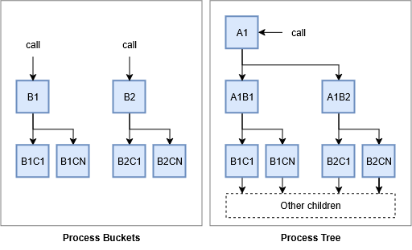
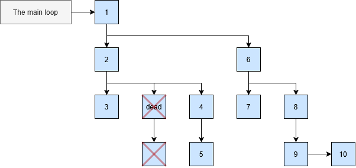
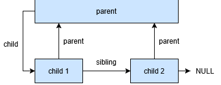
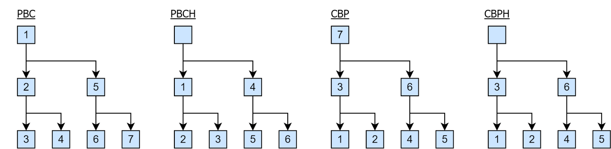
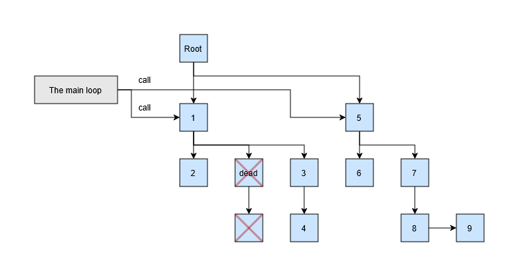
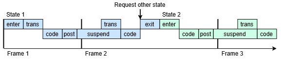
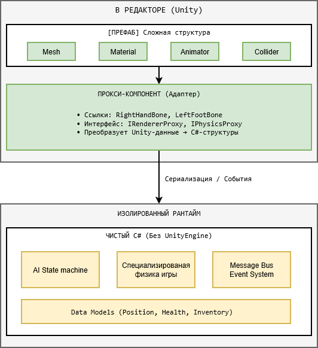

# In Search of Lost Determinism: Designing an Isolated C# Game Runtime According to Naughty Dog's Canons

> 20.08.2026, Valeria Pudova, hww.github.io
> 

## Introduction: The Illusion of Control in Modern Engines

Most modern game engines, including Unity, offer a component-oriented approach where an object's visual representation is tightly coupled to its logic. However, this convenience of the editor comes at the cost of three fundamental problems:

   1. Non-determinism of calls: The execution order of standard updates (Update) between hundreds of objects is not guaranteed, which makes the runtime unpredictable.
   2. Blurred lifecycle: Native thread managers and coroutines operate as a "black box." You cannot rewind time, freeze an isolated group of tasks, or predict the exact frame when logic switches.
   3. Coupling to the visual scene: The object hierarchy in code is forced to mirror the physical structure of the scene.

The central thesis of this architecture: The tree of logical processes does not have to and should not coincide with the tree of the visual scene.

To achieve 100% execution determinism, lock-step synchronization, or an honest replay system, the logical runtime must be fully isolated. We isolate it as a custom process dispatcher inspired by the ideas of the Crash Bandicoot and Jak and Daxter engine series (the GOAL/OpenGOAL compiler environment), where each game element is a predictable microprocess with a strictly controlled lifecycle.

## Chapter 1 Macroarchitecture: Flat Buckets vs. Hierarchical Trees

When designing an isolated runtime, the developer faces a choice of how to store active tasks: flat buckets (groups) or a hierarchical tree.
At first glance, these are opposite approaches, but in reality, a hierarchical process system is a generalization (superset) of a flat bucket system. A hierarchical system allows you to create hierarchy objects that combine what is internally a bucket.

|*Process Buckets: Flat bucket system, Process Tree: Hierarchical process system*|
|--|
||

### 1.1 Comparative Analysis of Approaches Through the Lens of Determinism

| Criterion | Flat Buckets | Hierarchical Process Tree (ProcessTree) |
| -- | -- | -- |
| Nature of the structure | An array or flat list of objects, divided by phases (AI, Physics, UI). | A graph (tree) where a node stores references to parent, child, and brother. |
| Order control | Ideal determinism within a single bucket (strictly by array index). | Determinism is determined by a strict tree traversal algorithm (e.g., DFS — Parents Before Children). |
| Object relationships | Objects are isolated. Logical relationships (who is whose satellite/weapon) have to be stored as external IDs. | Logical relationships are embedded in the runtime structure itself. A weapon is a child process of the character. |
| Event distribution | Each object is sent a message directly or via global broadcast. | Directed distribution. A message descends along the hierarchy branch of processes. |
| Resource management | When a parent is deleted, dependent objects in buckets must be manually iterated and cleaned up. | Cascading pruning. If a parent transitions to dead status, its entire child branch is instantly excluded from the runtime. |
| Iteration cost | Low | Medium |

The hierarchical system allows root or intermediate tree nodes to be used as isolated buckets (e.g., to allocate default pool, camera pool, target pool, entity pool, display pool branches).


*Option A: Root process execution*

At the same time, each bucket (or subtree) gains the ability to operate in isolation. The process tree can deliver messages through the hierarchy, search for objects through the hierarchy, but this will be a managed hierarchy of processes, not a hierarchy of visual scene graphs.

### 1.2 Implementing a Compact Tree: The Three-Pointer Structure

The classic representation of a hierarchy through child lists (e.g., List<Process> children) is not suitable for a deterministic Zero GC runtime. Dynamic lists inevitably generate hidden heap allocations when the tree structure changes, and they also blur the CPU cache by distributing nodes across different addresses.
An elegant low-level solution to this problem is to organize the process tree structure using just three fixed pointers (references) inside each ProcessTree object:

* parent — a direct reference to the parent node of the upper level.
* child — a reference to the first (eldest) child in the local group.
* sibling (or brother) — a reference to the next neighboring node (brother) of the same level.

```cs
public abstract class ProcessTree 
{
    protected ProcessTree parent;
    protected ProcessTree firstChild;   // Eldest child in the group
    protected ProcessTree nextSibling;  // Next neighboring node (brother)
}
```



### 1.3 Technical Advantages of the Approach

   1. Fixed memory size: Each node weighs strictly the same. The tree structure is completely static from a memory allocation perspective, which eliminates heap fragmentation when adding or removing hundreds of objects in a frame.
   2. Traversal efficiency: Deterministic iteration algorithms (such as DFS — depth-first traversal) are implemented as simple while loops that sequentially follow child and sibling references. This runs at maximum CPU speed without creating intermediate iterators or overhead.

## Chapter 2 Anatomy of Deterministic Traversal: Iteration Rules

To ensure that process tree traversal is strictly deterministic and does not produce side effects (when an object updated earlier changes the state of an object updated later in an unpredictable way), the runtime uses fixed traversal types based on higher-order functions.

### 2.1 Main Traversal Patterns

* PBC (Parents Before Children): The function is first executed for the process, and then for all its children. Execution terminates if the process returns an error ErrorCode.InvalidReturn. If the parent transitions to dead status in the current frame, the runtime instantly stops descending into its branch, guaranteeing that "orphaned" objects will not execute logic in a half-destroyed state.
* PBCH (Parents Before Children Ignore Top): Skips the top process of the tree, executing PBC traversal for all child subtrees.
* CBP (Children Before Parents): The function is first executed for all children, and only then for the parent process itself.
* CBPH (Children Before Parents Ignore Top): CBP traversal with the root node ignored.

Process execution of the tree can proceed strictly sequentially from parent nodes to child groups (buckets).



If necessary, the main loop can exclusively execute certain isolated nodes to more precisely control the order of calls at the macro level.


*Option B: Direct execution of child elements*

### 2.2 Process Bitmasks: Multiple Traversal and Contextual Filtering

The process tree may be traversed by the runtime not once but several times within a single frame — depending on the current system task or game loop phase. Each iteration is launched for a specific global event:

* Main logic update (Update-loop).
* Physics time discretization step (FixedUpdate-loop).
* Late animation and camera update (PostUpdate-loop).
* System cross-cutting operations (e.g., cascading data collection to create a deterministic game save Snapshot).

During multiple traversal, the runtime must instantly prune nodes that should not react to the current event. For this, each Process has a process mask (Process Mask) — a 32- or 64-bit field where each bit encodes certain properties, purpose, or time domain of the object.

From a technical standpoint, when the scheduler invokes the next update cycle, it receives the current system mask (e.g., the blocking mask). For each process tree node, the iterator performs a bitwise AND (logical AND) between the system mask and the process's own mask. If the result is non-zero ((process.Mask & currentMask) != 0), this means an intersection of blocking flags, and the scheduler completely ignores this process and its entire branch, instantly moving to the next node.

### 2.3 Historical Context: Low-Level Masks in OpenGOAL

In the original architecture of the Crash Bandicoot and Jak and Daxter engine series by Naughty Dog, this system operated with low-level memory states and specific gameplay entities of the PlayStation 2.

In modern practice of designing isolated runtimes in C#, this concept retains its mathematical speed but evolves into a much more readable, structured, and extensible system of categories:

```cs
using System;
/// <summary>/// Masks for categorizing processes and controlling behavior./// Used for filtering, queries, and behavior control./// </summary>
[Flags]public enum ProcessMask
{
    /// <summary>No flags - default state</summary>
    None = 0,

    // =======================================================================
    // CORE BEHAVIOR FLAGS (basic behavior)
    // =======================================================================

    /// <summary>Process is disabled and does not execute logic</summary>
    Disabled = 1 << 0,

    /// <summary>Process is sleeping - skips update but remains in memory</summary>
    Sleeping = 1 << 1,

    /// <summary>Process is in a transition state between states</summary>
    Transitioning = 1 << 2,

    // =======================================================================
    // ENTITY CATEGORIES (entity categories)
    // =======================================================================

    /// <summary>Process represents the player</summary>
    Player = 1 << 4,

    /// <summary>Process represents an enemy</summary>
    Enemy = 1 << 5,

    /// <summary>Process represents an NPC</summary>
    NPC = 1 << 6,

    /// <summary>Process represents an interactive object</summary>
    Interactive = 1 << 7,

    /// <summary>Process represents a collectible item</summary>
    Collectible = 1 << 8,

    /// <summary>Process represents an environment element</summary>
    Environmental = 1 << 9,

    // =======================================================================
    // SYSTEM CATEGORIES (system categories)
    // =======================================================================

    /// <summary>Process controls the camera</summary>
    Camera = 1 << 10,

    /// <summary>Process controls UI elements</summary>
    UI = 1 << 11,

    /// <summary>Process controls audio</summary>
    Audio = 1 << 12,

    /// <summary>Process controls visual effects</summary>
    VisualEffects = 1 << 13,

    /// <summary>Process controls game logic</summary>
    GameLogic = 1 << 14,

    /// <summary>Process represents the game menu</summary>
    GameMenu = 1 << 15,

    // =======================================================================
    // BEHAVIOR MODIFIERS (behavior modifiers)
    // =======================================================================

    /// <summary>Process should pause when the game is paused</summary>
    Pausable = 1 << 16,

    /// <summary>Process is preserved between scenes</summary>
    Persistent = 1 << 17,

    /// <summary>Process is temporary and can be cleaned up</summary>
    Temporary = 1 << 18,

    /// <summary>Process is critical and must not be interrupted</summary>
    Critical = 1 << 19,

    /// <summary>Message about logical completion of this state's task</summary>
    StateTaskCompleteFlag = 1 << 20,

    /// <summary>Process is in debug mode</summary>
    Debugging = 1 << 21,

    // =======================================================================
    // LEGACY COMPATIBILITY (for backward compatibility)
    // =======================================================================

    /// <summary>Process tree node without functionality (legacy)</summary>
    ProcessTree = 1 << 30
}
```

With such a structure, the culling call in the scheduler becomes a fast low-level check in C#:

```cs
// If the process contains bits matching the current blocking/ignoring mask
if ((currentExecutionMask & process.Mask) != ProcessMask.None)
{
    // Instant deterministic skip of logic invocation at the frame iterator level
    return; 
}
```

## Chapter 3 Microlevel: Lifecycle and Micro-Nuances of State Transitions

The process lifecycle in a deterministic runtime is strictly regulated and isolated from the volatile environment of the game engine. Unlike the classic component approach, each process goes through a strictly controlled sequence of system statuses recorded in ProcessStatus: Dead → Ready → Init → Pending → Transition → Suspended.

[Insert Figure: figure10_finite_state_machine_classes]
Each state inside a process contains a strictly defined set of methods (delegates):

* `Enter` — called upon entering the state.
* `Code` — the state's coroutine, acting as the process's "main thread."
* `Exit` — called after exiting the state.
* `Post` — called every frame after the main code execution.
* OnEvent — called when a message is delivered to this state.

Let's examine the micro-nuances of the transition function go(NewState):


### 3.1 The Finalize Method

A study of the evolution of Naughty Dog's proprietary technologies shows that the problem of interrupting logic in the initialization phase remained relevant even after abandoning the GOAL language. In the later C++ engine architecture used to create the Uncharted series, another specialized delegate was added to the state lifecycle — Finalize.

#### 3.1.1 Why Was Finalize Needed?

The classic scheme Exit → Enter → Code assumes that if a state was initialized in Enter(), the mirror method Exit() will perform cleanup for it. However, if an immediate transition trigger go() fires inside Enter() to a completely different state, the standard Exit() method of the current state will not be called, since the process has not physically settled into this state yet.
This created a dangerous vulnerability for a deterministic runtime:

* If memory was allocated inside Enter(), a local connection was created, or a proxy object captured a scene resource, and then an instant context reset occurred — these resources would hang in memory forever, causing hidden leaks.

#### 3.1.2 Mechanics of Finalize

The Finalize delegate acts as an emergency context finalizer. It is called by the scheduler only in one specific scenario: when a process requests a switch to another state while directly inside the Enter() phase of the current state.

The presence of Finalize guarantees that even if a state existed for a negligible fraction of a millisecond and was interrupted mid-flight, the runtime will deterministically close all resources that this state managed to deploy, maintaining absolute purity of Zero-GC memory pools.

### 3.2 Micro-Nuances and Runtime Rules

* The place of the go() call decides everything:
* Calling go() from the main Code thread: The transition happens immediately within the current frame. The code below the go() instruction in the same function is interrupted. The runtime stops the current coroutine, instantly calls the Exit() method of the old state, switches context to the new state, executes the Enter() method of the new state, and starts its Code coroutine up to the first interruption (suspend).
  * Calling go() from side methods (Init, Trans, Post, Exit, OnEvent): Since these methods are called by the runtime dispatcher from outside, an instant context reset is impossible. The go() method simply saves the target state into the nextState variable and returns control to the current process. The process completes execution of the current method to the end of its block, and the runtime performs the physical state change on the next iteration.
* Micro-nuances of the Exit call:
* The Exit() method is always called when the process normally leaves the state, guaranteeing cleanup of local resources (unsubscribing from events, disabling local debug drawing).
  * Exception: If the process is destroyed forcibly (transitioned to dead status due to the death of a parent node), execution of the branch is abruptly terminated. Cleanup upon process death falls on the object's own system methods (OnDisable), not on the logical Exit of the state, since the state is already invalid at that moment.
* Protection against infinite recursion (State Loop):
* If inside the Enter() method of the new state the programmer accidentally calls go() again, this may cause a stack overflow. The runtime intercepts this transition, putting the process status into a special initialize-go mode. This allows the state to be properly closed before Code starts and prevents the thread from crashing.

The internal state of the process is stored in the status variable and participates in the scheduler's decision-making process and process management methods.

```cs
   /// <summary>
   /// Represents the internal execution status of a process
   /// Used exclusively by the runtime system for execution management
   /// </summary>
   public enum ProcessStatus
   {
       /// <summary>
       /// Process is newly constructed or has been deactivated and returned to pool
       /// - Process exists in pool and can be reused
       /// - Activate() has not been called or Deactivate() has completed
       /// - No resources allocated, no execution context
       /// </summary>
       Dead = 0,

       /// <summary>
       /// Process has been activated but not yet initialized or started
       /// - Activate() has been called with valid parent and name
       /// - Process has PID, parent reference, and proper mask flags
       /// - Entity reference may be set if inherited from parent
       /// - No state machine initialized, no coroutine running
       /// - Process is idle and awaiting initialization or direct state transition
       /// </summary>
       Ready,

       /// <summary>
       /// The initial state of a Process upon creation, before its first frame of execution.
       /// </summary>
       /// <remarks>
       /// This state is set automatically by the Kernel when a process is launched via <see cref="Runner.Run"/> or <see cref="Runner.RunFromPool"/>.
       /// <para>
       /// The Process remains in this state until its assigned initializer function is executed.
       /// The initializer is responsible for setting up the Process and must call <see cref="GoHook"/> to transition
       /// to the first operational state (typically "Enter"). This is the only valid way to leave the <see cref="Init"/> state.
       /// </para>
       /// <para>
       /// A Process in the Init state has not yet entered the main logic flow and is considered to be initializing.
       /// </para>
       /// </remarks>
       Init, 

       /// <summary>
       /// Process has a scheduled deferred operation pending execution
       /// - GoHook was called from external context or during initialization
       /// - runAtNextFrame lambda is set to perform state transition
       /// - Kernel will execute the deferred operation next frame
       /// - Typically transitions to Suspended after state transition
       /// </summary>
       Pending,

       /// <summary>
       /// Imediately after anter new state, will be replaced to suspended as
       /// soon as it possible.
       /// </summary>
       Transition,
       /// <summary>
       /// Process coroutine has yielded and awaits next execution cycle
       /// - State coroutine has executed yield return statement
       /// - Process preserves execution context and stack frame
       /// - Most common state during normal process lifetime
       /// - Will be resumed by kernel in next appropriate update cycle
       /// </summary>
       Suspended
   }
   ```

## Chapter 4 Anatomy of the Data Container: Polymorphism, Typing, and Object Pooling

A message itself is essentially a lightweight transport data container that carries the context of an event from source to destination. When implementing this system in C#, using the new operator to create messages inside the game loop is strictly forbidden, as permanent heap allocation will instantly lead to micro-freezes of the runtime due to the Garbage Collector.
To combine the flexibility of object-oriented programming with the Zero GC requirement, the architecture relies on an abstract base message class with mandatory support for memory reuse through object pools (Object Pooling).

### 4.1 Base Message Contract

Every message in the system inherits from a single root that stores metadata necessary for debugging, routing, and disposal:

```cs
using UnityEngine;
public abstract class Message
{
    /// <summary>Process that sent the message (optional)</summary>
    public Process Sender;

    /// <summary>Message creation time for debugging and profiling (Time.time)</summary>
    public readonly float CreateTime = Time.time;

    /// <summary>
    /// Resets the object state for safe return to the pool (Object Pooling).
    /// All descendants must override this method to clean up their heavy fields.
    /// </summary>
    public virtual void Reset() => Sender = null;

    public override string ToString() => $"{GetType().Name}";
}
```

### 4.2 Implementing a Concrete Message: Camera Control Context

In practice, messages are divided by logic domains. Below is an example implementation of a high-level CameraSwitchMessage that controls the behavior and following modes of the game camera.
Note the use of static factory methods (encapsulating object assembly) and strict validation via Debug.Assert, which is critically important for maintaining the stability of a deterministic runtime:

```cs
using UnityEngine;
/// <summary>
/// All camera messages.
/// </summary>
public class CameraMessage : Message{}
/// <summary>
/// Message for switching camera modes and controlling camera behavior.
/// </summary>
public class CameraSwitchMessage : CameraMessage 
{
    public enum SwitchType
    {
        Idle,
        FreeCamera,
        OrbitCamera,
    }

    public SwitchType Switch;
    public Entity Entity;
    public Transform Transform;
    public Vector3 Position;

    // Constants for quick access from external contexts without bloating syntax
    public const SwitchType Idle = SwitchType.Idle;
    public const SwitchType FreeCamera = SwitchType.FreeCamera;
    public const SwitchType OrbitCamera = SwitchType.OrbitCamera;

    // =======================================================================
    // FACTORY METHODS (Called when retrieving an object from the pool)
    // =======================================================================

    public static CameraSwitchMessage WithSwitch(SwitchType switchType)
    {
        // In the real runtime there will be a call: var msg = MessagePool<CameraSwitchMessage>.Spawn();
        return new CameraSwitchMessage()
        {
            Switch = switchType,
            Entity = null,
            Transform = null,
            Position = Vector3.zero
        };
    }

    // =======================================================================
    // MEMORY LIFECYCLE
    // =======================================================================

    public override void Reset()
    {
        base.Reset(); // Reset the Sender field in the base Message class
        Switch = default;
        Transform = null;
        Entity = null;
        // The Position field is overwritten by factories on the next Spawn, 
        // but nulling reference types (Transform, Entity) is critically important for preventing memory leaks!
    }
}
```

Thanks to this structure, when the dispatcher finishes broadcasting CameraSwitchMessage through the process tree at the end of the frame, it calls the Reset() method and returns the message instance to the class pool. References to Unity components (Transform, Entity) are instantly nulled, which fully protects the runtime from memory leaks and "zombie objects" that could be held in memory by destroyed scenes.

### 4.3 Dispatch Mechanics: Atomicity of Transitions and Topological Broadcasting

When a message is retrieved from the queue and passed to the target object, control passes to the base delivery methods of the Process class. In a deterministic runtime, this stage is a critical gateway. A process has the right to react to external stimuli only when it is in a stable state and its execution context is 100% predictable.
Below is the reference system code from the runtime core that implements message delivery and cascading broadcasting through the process tree:

```cs
#region Message System
/// <summary>
/// Sends a message to the event handler of the process's current state.
/// Guarantees deterministic execution by blocking message processing during critical transitions.
/// </summary>
/// <param name="message">Message to process</param>
/// <returns>
/// true - the message was accepted and processed by the state handler,
/// false - the message was rejected (process is not ready to process or has no handler)
/// </returns>
/// <remarks>
/// <para>
/// The message processing mechanism is built on the principle of determinism — the process reacts to events
/// only in stable states when its execution context is predictable.
/// </para>
/// <para>
/// The critical phase is the transition between states (status WaitingToRun). At this moment:
/// - OnExit() is executed for the previous state
/// - The current state is changed
/// - OnEnter() is executed for the new state
/// Processing messages during this operation can lead to undefined behavior,
/// state races, and hard-to-debug errors.
/// </para>
/// </remarks>
public override bool SendMessage(Message message)
{
    // The process has no active state (not initialized, completed, or the state has no handler)
    if (state == null)
    {
        // Log only if the logging level allows seeing transitive states
        if (LogLevel > LogLevel.Trans)
            Debug.Log($"[Process] Ignoring event {message} - no event handler");

        // The message cannot be processed due to missing context
        return false;
    }

    // Detailed logging for debugging the message flow
    if (LogLevel > LogLevel.Status)
        Debug.Log($"[Process] Send event {message}");

    // CRITICALLY IMPORTANT CHECK:
    // If the process is in a transition state (WaitingToRun), all incoming messages are ignored.
    // This ensures atomicity of transitions and prevents:
    // - Attempts to process messages by an outdated state
    // - Interference with OnExit()/OnEnter()
    // - Overlapping asynchronous operations during context switching
    if (IsWaitingToRun)
    {
        // At this logging level, ignoring messages is visible (important for debugging deadlocks)
        if (LogLevel > LogLevel.Trans)
            Debug.Log($"[Process] Ignoring event {message} - process is transitioning states");

        return false;
    }

    // The process is in a stable state (Suspended) - the message is passed to the current state's handler
    // The returned result indicates whether the message was processed by the state handler
    if (state.Event != null)
        return state.Event.Invoke(this, message);
    return false;
}
/// <summary>
/// Broadcast message to process and optionally children
/// </summary>
public override bool BroadcastMessage(Message message, bool includeChildren = true)
{
    var result = SendMessage(message);

    if (includeChildren)
        result |= BroadcastMessageToChildren(message);

    return result;
}
/// <summary>
/// Broadcast message to process and optionally children
/// </summary>
public override bool BroadcastMessageToChildren(Message message)
{
    bool result = false;
    var child = firstChild;
    while (child != null)
    {
        if (child is Process childProcess)
        {
            result |= childProcess.BroadcastMessage(message, true);
        }
        child = child.nextSibling;
    }

    return result;
}
/// <summary>
/// Broadcast message to direct children only (not recursive)
/// </summary>
public override bool BroadcastMessageToDirectChildren(Message message)
{
    bool result = false;
    var child = firstChild;
    while (child != null)
    {
        if (child is Process childProcess)
        {
            // Send only to direct children, without recursion
            result |= childProcess.SendMessage(message);
        }
        child = child.nextSibling;
    }
    return result;
}
#endregion
```

### 4.4 Deep Dive into System Logic

1. Protection of the transitive phase (IsWaitingToRun):
   The most common cause of bugs in custom state machines of game engines is an object attempting to react to an event at the moment it is executing Exit or Enter logic. For example, at the moment of an explosion, a boss transitions to a death state, and in that same nanosecond it receives a message about additional damage from a periodic effect (DoT). Without the IsWaitingToRun check, the object would try to re-process damage in the context of the old state, causing a cascading failure. Ignoring messages during the WaitingToRun phase guarantees atomicity of state transitions.
2. Routing by tree topology:
   The BroadcastMessageToChildren and BroadcastMessageToDirectChildren methods clearly illustrate how the process tree replaces global data buses. We can send a message point-to-point to a parent process (e.g., SquadProcess — the squad process), and it will deterministically, predictably, and without unnecessary allocations descend through firstChild -> nextSibling references strictly to the required child units.
3. Absorption and boolean result:
   Note the bitwise addition of results (result |= ...). The system knows exactly whether a message died in the void or at least one node in the process hierarchy successfully intercepted and processed the event (state.Event.Invoke).

## Chapter 5 Queue Topology: Three Message Delivery Strategies

In the proposed runtime, there is no "single correct" way to transmit events. Depending on the architectural task, performance requirements, and complexity of a specific module's logic, the system flexibly combines three different message distribution methods. All of them are absolutely valid if applied in the right place.

* Strategy 1: Instant delivery (Direct method call)
* Strategy 2: Global message queue (Global Message Bus)
* Strategy 3: Local message queue inside the object (Per-Process Queue)

### 5.1. Strategy 1: Instant Delivery (Direct Method Call)

In the simplest case, message delivery happens immediately, working like a regular method call via process.SendMessage(message).

* When to apply: For tightly coupled gameplay pairs where the reaction must be immediate and does not generate cyclic dependencies. For example, a tripwire physical trigger instantly sends a Hit message to the character who stepped on it.
* Limitation: The calling process must be sure that the target object is in a stable state and ready to take the hit (which is guaranteed by the IsWaitingToRun system checks inside SendMessage).

### 5.2. Strategy 2: Global Message Queue (Global Message Bus)

All processes write events into a single flat system buffer, from which the dispatcher sequentially distributes them to recipients in a fixed frame phase (e.g., at the end of the frame).

* When to apply: For cross-cutting system events or lock-step synchronization, where it is critically important to collect all world intents per frame, shuffle them for QA non-determinism tests, or transmit them over the network.
* Safety and Handles: At the moment when the queue reaches a specific message at the end of the frame, its recipient may already be destroyed by cascading deletion of the parent branch. Therefore, direct memory references to processes are forbidden in the global queue. Addressing goes through lightweight handles (Handle — a unique process ID + generation counter). Before invoking, the dispatcher checks the handle against the system table, and if the process is dead, the message is safely disposed, preventing NullReferenceException.

### 5.3. Strategy 3: Local Message Queue Inside the Object (Per-Process Queue)

Each process (or specialized manager) carries its own isolated micro-queue, where other systems can stack messages. The object itself decides at which specific moment of its logical step to read and process the accumulated buffer.

### 5.4. GUI Controller as a Reference Application of the Local Queue

A classic example where a local queue is vital is a GUI controller (the game's interface system). During a single frame, dozens of messages can avalanche into the interface from gameplay systems, network packets, and player actions: UpdateHealth, ShowDamageIcon, OpenRewardWindow, StartButtonAnimation.
If the GUI controller processed them instantly as they arrived, the runtime would face the following problems:

   1. Redundant update bug: The interface would redraw text fields and restart heavy UI layouts 5-10 times per frame, consuming precious CPU time.
   2. Display conflicts: A message about opening the reward window and a message about closing the menu, arriving in the same frame from different systems, could overwrite each other's context, leaving the UI in a broken ("frozen") state.

The local queue allows the GUI controller to collect all incoming messages per frame and then, in a single pass, perform their intelligent analysis:

* Prioritization: Sort events by importance (e.g., the system message CriticalNetworkError should be processed and displayed on screen before the coin collection animation).
* Eviction/Collapsing: If five consecutive ChangeExperience messages with different values arrive in the queue, the controller annuls the first four as irrelevant, takes only the last value relevant for the end of the frame, and updates the interface bar exactly once.

For simple gameplay objects, this local queue can be optimized to a "single-element queue" (Single-Element Eviction Queue), where a new message with higher priority simply displaces the old one from the process's fixed slot, guaranteeing Zero GC and no dynamic allocations.

## Chapter 6. Process Lifecycle API and Cascading Management

The process lifecycle in a deterministic runtime is strictly regulated and isolated from the non-deterministic environment of the game engine. Unlike the classic component approach (e.g., MonoBehaviour in Unity), where objects are created, subscribed to events, and destroyed chaotically at arbitrary moments, here each process goes through a strict and predictable sequence of statuses: Inactive → Ready → Running → Suspended → Dead.
Runtime management at the code level is encapsulated in three core methods: Activate(), Deactivate(), and Disconnect().

### 6.1. Process Activation (Activate)

The method is responsible for the birth of the process, its controlled injection into the hierarchy topology, and primary preparation for execution by the scheduler.

```cs
/// <summary>
/// Activates the process in the tree with the specified parent and optional mask.
/// </summary>
public override void Activate(ProcessTree parent, string name, ProcessMask setMask = ProcessMask.None)
{
    // Step 1: Basic insertion of the node into the hierarchy (setting parent, child, sibling)
    base.Activate(parent, name, setMask);

    // Step 2: Allocation of a unique kernel ID
    pid = Kernel.GetNextPid();
    
    // Step 3: Marking for the dispatcher
    status = ProcessStatus.Ready;

    // Step 4: Inheritance of the logical entity from the parent container
    if (CheckMask(ProcessMask.ProcessTree) && parent is Process parentProcess)
    {
        entity = parentProcess.entity;
    }

    // Step 5: Initialization of network/event connections
    ConnectionList = new Connectable(this);
}
```

### 6.2 Architectural Nuances of the Activation Phase

   1. Deferred start (ProcessStatus.Ready): The process never starts executing its state machine instantly at the moment Activate() is called. It is only registered in the system in the ready status. The scheduler will pick it up and launch the first Enter() method of the current state strictly on the next frame. This guarantees that all objects within a single frame iteration see the world in an absolutely consistent, unbroken state.
   2. Entity inheritance (entity): If a tree node is a purely technical container (ProcessMask.ProcessTree), it does not duplicate data but automatically inherits a reference to the game entity (entity) of its parent. This allows grouping logic (e.g., the weapon AI process and the hands animation process) under a single logical origin.
   3. PID as the foundation of handles: The unique numeric pid issued by the kernel is the basis for deterministic message addressing. Instead of raw memory pointers, which can become "dangling" when an object is deleted, the message system uses handles of the form (PID + Generation Counter).

## 6.3. Process Deactivation (Deactivate)

The Deactivate() method implements one of the fundamental principles of our macroarchitecture — Cascading Deactivation.

```cs
/// <summary>
/// Cascadingly deactivates the process and all its child subtrees.
/// </summary>
public override void Deactivate()
{
    // Protection against repeated deletion and looping
    if (status == ProcessStatus.Dead) return;

    // Complete reset of the custom coroutine context
    coroutineStack.Clear();

    // Recursive traversal and destruction of the entire child branch
    var child = firstChild;
    while (child != null)
    {
        var next = child.nextSibling;
        if (child is Process childProcess)
        {
            childProcess.Deactivate();
        }
        child = next;
    }

    // Forced breaking of logical connections and unsubscribing from events
    Disconnect();

    // Safe return of the object to the kernel pool (Zero GC)
    pool?.ReturnBase(this);

    // Complete cleanup of system fields to avoid "ghost" references
    status = ProcessStatus.Dead;
    entity = null;
    pid = 0;
    _progress = null;
}
```

### 6.4. Architectural Nuances of the Deactivation Phase

   1. Hierarchy safety: Thanks to the recursive loop over firstChild and nextSibling, transitioning the parent process to Dead status instantly and avalanche-like closes its entire child infrastructure. The situation where, for example, a character dies but his logical sword process remains hanging in the frame memory executing Update is physically excluded by the runtime architecture.
   2. Coroutine stack cleanup (coroutineStack.Clear()): This is a critically important step for determinism. Since we use an object pool to achieve Zero GC, an unfinished or stuck coroutine must be erased. Otherwise, the next logical process that gets this object from the pool will "wake up" with someone else's leftover data and break the runtime.
   3. Nulling system references: Forcibly setting the entity and _progress fields to null guarantees that the disposed object in the pool will not hold references to old gameplay data, preventing hidden memory leaks.

### 6.5. Breaking Logical Connections (Disconnect)

In a deterministic system, a dead object must not have any influence on the living world, even if deferred messages are still flying to it.

```cs
/// <summary>
/// Breaks all active logical connections of the process.
/// </summary>
public void Disconnect()
{
    var item = ConnectionList.Next1;
    while (item != null)
    {
        if (item is Connection connection)
        {
            // Transition the connection to invalid status
            connection.MoveToDead();
        }
        item = item.Next1;
    }
}
```

### 6.6. Architectural Nuances of the Connection Breaking Phase

The Disconnect() method isolates the process from the event grid. Traversing the ConnectionList, the kernel transitions all connected nodes to Dead status.

This is directly related to the operation of local message queues: if at the end of the frame the global dispatcher or local buffer tries to deliver a message by the handle of this process, the internal check of the Handle system will instantly return Invalid, and the message will be safely destroyed without invoking OnEvent handlers.

### 6.7. Summary Matrix of Lifecycle States

The relationship between system phases, API methods, and ProcessStatus statuses is described in detail in the source, including creation, resource assembly, frame waiting, state change, suspension, and process destruction.

| Process stage | API method called | Current process status | Frame behavior |
| --- | --- | --- | --- |
| Creation | Activate() | ProcessStatus.Ready | Registers in the tree, awaits the start of the next frame. |
| State entry | Enter delegate | ProcessStatus.Running | Initial initialization of the state logic is performed. |
| Main frame thread | Code delegate (Coroutine) | ProcessStatus.Running | The main gameplay algorithm of the process is executed. |
| Post-processing | Post delegate | ProcessStatus.Running | Runs every frame strictly after the main Code completes. |
| Suspension | suspend instruction (yield) | ProcessStatus.Suspended | Logic is frozen, control returns to the frame scheduler. |
| State change | go(NewState) call | ProcessStatus.Running | Exit(Old) → Enter(New) delegates are executed instantly. |
| Destruction | Deactivate() | ProcessStatus.Dead | Cascadingly cleaned, unsubscribed, and returned to the object pool. |

## Chapter 7 State Transition API

Transitioning between states is the heart of any finite state machine (FSM). However, in non-deterministic environments, calling a state change often leads to "ghost frame" bugs, state races, or resource leaks. In the proposed architecture, the transition API is designed to completely eliminate these problems, providing the developer with two context-switching modes: **immediate** and **deferred**.

### 7.1. GoHook Method Signature

The primary tool for transitioning between states is the `GoHook()` method, available to every process:

```cs
/// <summary>
/// Request to transition to a new state with optional parameters
/// </summary>
/// <param name="nextState">Target state</param>
/// <param name="transitionParams">Transition parameters (passed to Enter of the new state)</param>
/// <param name="transitionPriority">Transition mode: immediate or deferred</param>
public void GoHook(State nextState, in Message transitionParams = default, 
                   TransitionPriority transitionPriority = TransitionPriority.Delayed)
{
    // Implementation
}
```

#### 7.1.1 Transition Parameters

| Parameter | Type | Purpose |
| -- | -- | -- |
| `nextState` | `State` | Target state to which the process transitions |
| `transitionParams` | `in Message` | Parameters passed to the `Enter()` method of the new state (Zero GC) |
| `transitionPriority` | `TransitionPriority` | Determines when the transition occurs: **immediately** or **deferred** |

### 7.2 Transition Priority Modes

```cs
public enum TransitionPriority
{
    /// <summary>
    /// Transition occurs immediately within the current execution context.
    /// Works only when called from the main Code method (coroutine).
    /// </summary>
    Immediate,

    /// <summary>
    /// Transition is queued and executed at the next safe point
    /// (after the current method completes or at the beginning of the next frame).
    /// Used when called from Post, Trans, Exit, Enter, or OnEvent.
    /// </summary>
    Delayed
}
```

### 7.3. Transition Micro-Nuances

#### 7.3.A. Call from `Code` (main coroutine)

```cs
// Inside the Code() method of the state
GoHook(nextState, transitionParams, TransitionPriority.Immediate);
```

**Behavior:**

* The transition occurs **immediately** within the current frame
* `Exit()` of the current state is called (resource cleanup)
* `Enter()` of the new state is called (passing `transitionParams`)
* `Code()` of the new state is started up to the first `suspend`

**Correspondence to the diagram (Figure 16, Frame 2):**

```txt
3. code          ← GoHook() is called here
4. exit          ← immediate exit from State 1
5. enter         ← immediate entry into State 2
6. code          ← execution of the new state's Code
7. suspend       ← suspension until the next frame
```

**Important:** The code below the `GoHook(Immediate)` call in the current `Code()` method **is not executed** — the context switches instantly.

#### 7.3.B. Call from side methods (`Post`, `Trans`, `Exit`, `Enter`, `OnEvent`)

```cs
// Inside the Post() or OnEvent() method
GoHook(nextState, transitionParams, TransitionPriority.Delayed);
```

**Behavior:**

* The transition **does not occur** instantly
* The target state is saved in the `_pendingState` variable
* The current method completes to the end
* The physical transition occurs **on the next dispatcher iteration** (after the current hook completes or at the beginning of the next frame)

**Correspondence to the `kernel-dispatcher` OpenGOAL code:**

```lisp
;; Temporary thread for trans-hook/post-hook
(let ((trans (new 'process 'cpu-thread ...)))
  (reset-and-call trans (-> this trans-hook))
  (delete trans))
```

Since `trans-hook` and `post-hook` are executed in **temporary threads**, an instant state change is impossible — the transition is deferred until the next dispatcher iteration.

### 7.4 Protection Against Infinite Recursion (State Loop Guard)

When calling `GoHook()` with `Immediate` priority from the `Enter()` method of the new state, **infinite recursion** may occur:

```
Enter(State1) → GoHook(State2, Immediate) → Enter(State2) → GoHook(State1, Immediate) → ...
```

**Solution:** The runtime intercepts such a transition and puts the process into a special `Transition` status:

```cs
private void PerformImmediateTransition(State nextState, in Message transitionParams)
{
    if (_isTransitioning)
    {
        // Guard: transition is already in progress
        status = ProcessStatus.Transition; // Safety fuse
        return;
    }
    
    _isTransitioning = true;
    try
    {
        Exit();
        Enter(nextState, transitionParams);
        Code(); // up to the first suspend
    }
    finally
    {
        _isTransitioning = false;
        if (status != ProcessStatus.Dead)
            status = ProcessStatus.Suspended;
    }
}
```

**The `Transition` status** is a temporary flag that:

1. Blocks all incoming messages (via `SendMessage`)
2. Allows the current state to complete correctly **before** the new `Code` starts
3. Protects against cascading transitions inside `Enter()`

### 7.5 Passing Transition Parameters (`transitionParams`)

Parameters are passed to the `Enter()` method of the new state through the `Message` structure:

```cs
public void Enter(State state, in Message transitionParams)
{
    switch (transitionParams.Type)
    {
        case MessageType.MsgVec3:
            var position = transitionParams.vec3;
            // Position initialization
            break;
        case MessageType.MsgIVec3:
            var target = transitionParams.ivec3;
            // Setting the target point
            break;
        case MessageType.MsgEntity:
            var entity = transitionParams.entity;
            // Binding to the entity
            break;
        // ...
    }
}
```

**Key advantage:** Using `in Message` and `StructLayout(LayoutKind.Explicit)` ensures **Zero GC** — parameters are passed by reference without creating objects on the heap.

### 7.6 Connection with the Handle System and Message Queue

When calling `GoHook()` with parameters:

1. If the transition is **deferred** (`Delayed`), the parameters are copied into the process's `Message Queue`
2. The recipient's handle is validated before delivery
3. If the process died before the transition moment, the message is safely disposed

This guarantees that even if the process was destroyed by cascading deletion of the parent branch, the deferred message will not cause a memory access error.

### 7.7 Complete Usage Example

```cs
public class EnemyProcess : Process
{
    private State _idleState;
    private State _chaseState;
    private State _attackState;

    // Call from Code — immediate transition
    public void GoToChase(Vector3 targetPosition)
    {
        var paramsMsg = new Message
        {
            Type = MessageType.MsgVec3,
            vec3 = new MsgVec3 { x = targetPosition.x, y = targetPosition.y, z = targetPosition.z }
        };
        
        GoHook(_chaseState, paramsMsg, TransitionPriority.Immediate);
    }

    // Call from Post — deferred transition
    public void GoToIdle()
    {
        GoHook(_idleState, default, TransitionPriority.Delayed);
    }
}
```

### 7.8 Table: Which Priority to Use

| Call location | Recommended priority | Reason |
| -- | -- | -- |
| `Code` (coroutine) | `Immediate` | Context can be safely switched |
| `Post` | `Delayed` | Executed in a temporary thread |
| `Trans` | `Delayed` | Executed in a temporary thread |
| `Enter` | `Delayed` (with protection) | Risk of recursion |
| `Exit` | `Delayed` | State cannot be switched during exit |
| `OnEvent` | `Delayed` | Event processing must not be interrupted |

### 7.9 Connection with the `kernel-dispatcher` Code (OpenGOAL)

In the original OpenGOAL architecture, the analogue of `GoHook()` is the `go(NewState)` call inside `resume-hook`:

```lisp
;; Inside resume-hook (Code)
(go 'chase-state)   ;; Immediate transition
```

For a deferred transition, `next-state` is set:

```lisp
;; Inside trans-hook or post-hook
(set! (-> this next-state) 'chase-state)   ;; Delayed transition
```

The dispatcher checks `next-state` on the next iteration:

```lisp
(when (-> this next-state)
  (let ((old-state (-> this current-state)))
    (exit old-state)
    (enter (-> this next-state))
    (set! (-> this current-state) (-> this next-state))
    (set! (-> this next-state) #f)))
```

### 7.10 Two-Phase Initialization and Deferred Scheduling Mechanisms

Allocating memory for a process (Object Pooling) and its logical filling with gameplay data in a deterministic runtime are **separated in time**. The process is retrieved from the pool in a "raw" form, after which it undergoes a configuration procedure.

The architecture supports two initialization patterns:

* `InitFromEntity` -- Declarative. For static data of the game scene, with retrieval of scene object parameters
* `InitByOther` -- Imperative. For dynamically created processes with lazy loading of parameters or injection.

#### 7.10.1 Dualism of Initialization

Most often, processes spawn other processes, but in some cases a process is spawned by a scene object (`Entity`). Therefore, the process API has two initialization methods.

**InitFromEntity (Declarative path):** Directly inherits Naughty Dog's approach to streaming game worlds. A map sector contains binary data — lists of `Entity` (spawn coordinates, patrol radii, unique IDs). The kernel links a "blank" process from the pool with the static data of the level. The logic is completely isolated from scene assets: if the runtime operates in dedicated server mode (headless), the enemy process computes navigation from `Entity` data without creating any visual engine components at all.

**InitByOther (Imperative path / Lazy Loading):** Used for objects spawned dynamically right during the game (projectile shot, item dropped from inventory). The calling code requests a spawn, packs the arguments into a Zero-GC `Message` structure, and passes it to the method. This allows deferred (lazy) initialization: the process is reserved by the kernel, but heavy data filling occurs only at the moment when the frame dispatcher reaches the execution of this tree branch, minimizing peak CPU loads (Spikes).

```cs
/// <summary>
/// Initializes the process based on static entity data (Entity) of the map.
/// </summary>
public override void InitFromEntity(Entity entity, Message message = null)
{
    this.entity = entity;
    // Base implementation — derived classes override to read parameters
}

/// <summary>
/// Dynamic initialization of the process from code via a message (Lazy Initialization).
/// </summary>
public override void InitByOther(Message initMessage = null)
{
    // Base implementation — derived classes override for dynamic spawn
}
```

### 7.11 Deferred Action Launch via Scheduler Statuses

To flexibly control the moment of logic start inside the deterministic runtime cycle, the runtime provides a specialized scheduling API. It allows binding an anonymous delegate (`Action<Process>`) to a process, the execution of which is strictly regulated by the kernel's status model.

#### 7.11.1 Deferred Scheduling Methods

```cs
/// <summary>
/// Schedules an action for the process to be executed on the next frame.
/// </summary>
public void RunAtNextFrame(Action<Process> action)
{
    Debug.Assert(runAtNextFrame == null, "Only one deferred action runAtNextFrame is allowed");
    runAtNextFrame = action;
    status = ProcessStatus.Pending;
}

/// <summary>
/// Schedules a process initialization action to be executed on the next frame.
/// </summary>
public void RunInitAtNextFrame(Action<Process> action)
{
    Debug.Assert(runAtNextFrame == null, "Only one deferred action runAtNextFrame is allowed");
    runAtNextFrame = action;
    status = ProcessStatus.Init;
}

/// <summary>
/// Forcibly executes the scheduled deferred action (used only in tests).
/// </summary>
public void ExecuteScheduledAction()
{
    runAtNextFrame?.Invoke(this);
    runAtNextFrame = null;
}
```

#### 7.11.2 Technical Essence and Status Model

1. **Atomicity protection** (`Debug.Assert(runAtNextFrame == null)`): At the system level, **exactly one** deferred action can be bound to a process within a single frame. Attempting to overwrite the delegate before its execution signals an architectural error in the state logic and is strictly suppressed by the kernel.

2. **Phase separation via `ProcessStatus`:**
   * `ProcessStatus.Pending`: Tells the scheduler that the process is already fully initialized, but its main `Code` loop and coroutines must "wait" one frame. The deferred delegate will execute at the start of the next update cycle, preparing the context.
   * `ProcessStatus.Init`: Signals that the process is in an intermediate configuration phase. The scheduler understands: this tree node is not yet a full participant in the game world. Its deferred `Action` is a heavy assembly procedure (e.g., linking dependencies or lazy loading resources) that must be executed strictly before the process receives `Ready` status and starts processing incoming messages.

3. **Test isolation** (`ExecuteScheduledAction`): The presence of a forced-call method allows fully isolating the logic of deferred actions in unit tests. The tester can simulate the onset of the next frame in isolation without cycling the global task dispatcher loop.

### 7.12 Integration with the Dispatcher

The scheduler (dispatcher) calls `ExecuteScheduledAction()` **at the beginning of each frame** for all processes with `Pending` or `Init` status:

```cs
// Dispatcher pseudocode
void DispatchFrame()
{
    // 1. Processing deferred actions
    foreach (var process in activeProcesses)
    {
        if (process.status == ProcessStatus.Pending || 
            process.status == ProcessStatus.Init)
        {
            process.ExecuteScheduledAction();
        }
    }

    // 2. Main tree traversal (trans-hook → resume-hook → post-hook)
    foreach (var process in activeProcesses)
    {
        if (process.status == ProcessStatus.Suspended || 
            process.status == ProcessStatus.Ready)
        {
            process.ExecuteFrame();
        }
    }
}
```

### 7.13 Two Dimensions of the Lifecycle

The process lifecycle in a deterministic runtime has **two independent dimensions**:

| Dimension | Mechanism | Statuses |
|--|--|--|
| **States (FSM)** | `GoHook()` / `go()` | `Running` → `Suspended` → `Transition` |
| **Execution (Scheduling)** | `RunAtNextFrame()` / `RunInitAtNextFrame()` | `Ready` → `Init` → `Pending` → `Suspended` |

These dimensions are **orthogonal**:

* A process can be in the `Idle` state and simultaneously await a deferred action (`Pending`)
* A process can change state (`Transition`) and simultaneously have a scheduled `runAtNextFrame`

**Important distinction:**

* `TransitionPriority.Delayed` controls **state changes** (FSM)
* `ProcessStatus.Pending` controls **execution of deferred actions** (`RunAtNextFrame`)

These are two **independent mechanisms** that can work simultaneously. A process can be in the `Idle` state, await a deferred action (`Pending`), and have a scheduled transition to another state (`Delayed`) — all in the same frame.

### 7.14 Connection with Entity and Hot Reload

In the context of **Hot Reload** (Chapter 8), two-phase initialization takes on special significance:

1. **Before compilation** (`OnDisable` → `Kill()`):
   * The process is deactivated (`Deactivate()`)
   * Status → `Dead`
   * The process is returned to the pool

2. **After compilation** (`OnEnable` → `Birth()`):
   * Entity generates a new `EntityID`
   * The kernel **lazily** restores the process via `RunInitAtNextFrame()`
   * The process receives `Init` status and waits for the next frame for full reincarnation

This guarantees that Hot Reload does not violate determinism: all processes are recreated **in a strictly defined order** on the next frame, not chaotically at the moment of recompilation.

### 7.15 Chapter Summary

| Concept | Description |
| -- | -- |
| `GoHook(Immediate)` | Instant state change inside `Code` |
| `GoHook(Delayed)` | Deferred state change (for `Post`/`Trans`/`OnEvent`) |
| `transitionParams` | Parameters passed via `Message` (Zero GC) |
| Recursion protection | `Transition` status blocks nested transitions |
| `RunAtNextFrame()` | Deferred action execution on the next frame |
| `RunInitAtNextFrame()` | Deferred initialization (for Lazy Loading) |
| `InitFromEntity` | Declarative initialization from static data |
| `InitByOther` | Imperative initialization from code (dynamic spawn) |
| Connection with dispatcher | OpenGOAL: `go()` for Immediate, `next-state` for Delayed |

## Chapter 8 The Concept of Proxy Components: Integrating Processes with Visual Scene Data

When designing an isolated runtime, the developer inevitably faces a dilemma: game logic must be 100% deterministic, textual, and lightweight, but the game itself is a visual environment. Colors, materials, animation curves, connections between components, and prefabs are much faster, more intuitive, and more efficient to set up manually in the engine's visual editor (e.g., Unity Inspector).
The Proxy Components pattern acts as a bridge: it provides seamless integration of logical processes (pure C# code) with visual scene data objects without violating the isolation and determinism of the kernel.

* `IN THE EDITOR` -- Visual prefab, complex component structure, curves, colors, materials
* `PROXY COMPONENT` -- Contains only data and an interface to it, Minimal code (Thin wrapper), Fixed names (Example: RightHandBone)
* `IN THE KERNEL` -- Accesses proxy data by the used names

### 8.1. Architectural Essence of Proxy Objects

The main task of a proxy component is to provide processes with a unified interface to the visual object, regardless of what data structure and what component hierarchy are embedded inside a particular prefab.
Proxy objects are designed according to the principle of maximum lightness:

* Ideally, they contain minimal code.
* They do not make decisions and do not maintain global state.
* Their sole purpose is to store data, references to visual scene elements, and provide a clean access interface for logical processes.

### 8.2 Implementation Options: Data Fields and Interface Methods

Depending on the task, a proxy object can be implemented in two forms:

#### 8.2.1 Proxy as a Flat Container of Fixed References (Data)

A proxy object may contain no methods at all but instead be a structure with fixed field names that are understandable to the runtime.
Example with a character skeleton:
The project has two prefabs: Monster and Human. For the monster, the right hand bone in the prefab hierarchy is named Bone_R_02, while for the human it is char_interior/arms/Hand_Right. The attack logic process (pure C# code) is contraindicated from knowing about these differences.
A thin proxy component is attached to the prefab, with references that the artist or designer configures in the editor once:

```cs
public class CharacterSkeletonProxy : MonoBehaviour
{
    // Fixed field names for the runtime. 
    // In the inspector, completely different bones are dragged here for different models.
    public Transform RightHandBone;
    public Transform LeftHandBone;
    public Transform HeadBone;
    public Transform WeaponAttachPoint;
}
```

Now the weapon gameplay process simply takes the reference proxy.WeaponAttachPoint, maintaining absolute independence from how a particular visual prefab is structured.

#### 8.2.2 Proxy as a Unified Access Interface (Code)

If the data structure inside a prefab can change dynamically or differ radically between different types of objects, the proxy offers processes a single contract in the form of interface methods.

Example with a parameters interface:

```cs
public interface IRendererProxy
{
    void SetTeamColor(Color color);
    void SetDissolveValue(float t);
}
// Implementation for a simple object (single MeshRenderer)
public class SimpleSpriteProxy : MonoBehaviour, IRendererProxy
{
    public MeshRenderer TargetRenderer;
    public void SetTeamColor(Color color) => TargetRenderer.sharedMaterial.color = color;
    public void SetDissolveValue(float t) => TargetRenderer.sharedMaterial.SetFloat("_Dissolve", t);
}
// Implementation for a complex composite object (dozens of nested SkinnedMeshRenderers)
public class ComplexCharacterVisualProxy : MonoBehaviour, IRendererProxy
{
    public SkinnedMeshRenderer[] AllRenderers;
    
    public void SetTeamColor(Color color)
    {
        foreach (var r in AllRenderers) r.sharedMaterial.color = color;
    }
    
    public void SetDissolveValue(float t)
    {
        foreach (var r in AllRenderers) r.sharedMaterial.SetFloat("_Dissolve", t);
    }
}
```

### 8.3 Key Advantages for a Deterministic Runtime

   1. Division of labor (Programmer vs Artist): A technical designer or character artist can completely rebuild the prefab structure, replace shaders, rename nodes, or change the component structure in Unity. As long as they reassign references in the proxy component fields, the pure process code will not break and will not even "notice" the changes.
   2. Isolation of logic from the visual engine: Gameplay processes operate with pure abstractions. This eliminates bugs where game logic starts depending on the random execution order of updates (Update) of the engine's own visual components.
   3. Headless mode support: On a dedicated server where there is no visual scene, proxy objects are either not initialized or replaced with lightweight data structures, allowing logical processes to perform frame mathematical calculations unimpeded.

## Chapter 9 The Entity Concept

If a regular proxy component is "dumb" and simply provides fixed names for linking to prefab elements, then Entity is an active proxy object on steroids. It is the minimal but living implementation of any object on the scene, serving as a monolithic foundation for integrating kernel processes with the game world.
The main feature of Entity is its autonomy. It does not just passively lie in memory but has its own basic lifecycle and is capable of "resurrecting" (reincarnating) when a scene loads or a prefab is instantiated, linking the visual representation with the logical process.

### 9.1. Birth and Death Processes: Birth() and Kill()

The Entity lifecycle is tightly bound to the game engine's activation events (OnEnable / OnDisable), but immediately translates them into the plane of predictable system statuses.

```txt
[ Engine Event: OnEnable() ] ────────► 1. Birth()
                                              ├──► Generate unique EntityID
                                              └──► Set flag EEntityStatus.IsAlive
                                              
[ Engine Event: OnDisable() ] ────────► 2. Kill()
                                              ├──► Check connection: MainProcess.IsActive?
                                              ├──► Call cascade: MainProcess.Deactivate()
                                              └──► Full status reset (Zero GC / References to null)
```

#### 9.1.1 Birth

When an object is activated on the scene, the engine automatically calls OnEnable(), which delegates control to the system method Birth():

```cs
public virtual void Birth()
{
    EntityID = GenerateID();
    SetStatus(EEntityStatus.IsAlive, true);
    Debug.Log($"[Entity] Birth: {this}");
}
```

At this moment, the object is officially registered in the game world, receives its cross-cutting unique EntityID, and transitions to IsAlive status. It is ready to either independently request the creation of a controlling process from the pool or be picked up by an external level initialization system.

#### 9.1.2 Death (Kill)

When an object is disabled (by script, when moving to another level, or when a prefab is destroyed), OnDisable() triggers, calling the Kill() method:

```cs
public virtual void Kill()
{
    // Deactivate the associated logical process
    if (MainProcess != null && MainProcess.IsActive)
    {
        MainProcess.Deactivate();
        MainProcess = null;
    }
    SetStatus(EEntityStatus.IsAlive, false);
    SetStatus(EEntityStatus.IsInitialized, false);
    Debug.Log($"[Entity] Kill: {this}");
}
```

Architectural nuance of death: Entity acts as the guarantor of runtime memory purity. If a visual object is deactivated, it must instantly terminate its logical life. The Kill() method checks for an associated MainProcess and, if it is active, forcibly calls Deactivate(), cascadingly cleaning the coroutine stack and returning the process back to the pool. References are nulled, completely eliminating memory leaks or "dangling" logical updates of dead objects.

### 9.2 Binding to the Process: InitByProcess

For Entity to come alive and start executing gameplay code, the kernel's logical process must claim ownership of this entity. This happens through the coupling method:

```cs
public virtual void InitByProcess(Process process)
{
    if (MainProcess != null && MainProcess.IsActive)
    {
        Debug.LogWarning($"{name} already has active process", this);
        return;
    }
    MainProcess = process;
    SetStatus(EEntityStatus.IsInitialized, true);
    Debug.Log($"[Entity] InitByProcess: {this} by {process}");
}
```

The kernel protects the object from the "two owners" situation: if Entity already has an active executing process, re-initialization will be blocked. If the check passes, the entity receives a reference to the process, sets IsInitialized = true status, and becomes a full-fledged, predictable actor of the game world.

### 9.3. Deterministic Routing and Message Broadcasting

One of the main advantages of Entity as an active proxy is the encapsulation of deterministic message sending, which protects logic during unstable state transition phases.
The message processing flow is strictly subject to the rule: the object reacts to external stimuli only when its logical context is predictable. The critical zone is the WaitingToRun status (the transition phase between states when the Exit() methods of the old state and Enter() of the new state are executed). Any message delivered at this moment can cause a state race.
Therefore, Entity safely delegates sending to the process's internal checks:

```cs
public virtual bool SendMessage(Message message)
{
    if (MainProcess != null) {
        if (MainProcess.SendMessage(message))
            return true;
    }
    return false;
}
```

Moreover, the Entity topology on the scene (the GameObject hierarchy in the editor) can be used for directed event distribution (Broadcast), allowing cascading transmission of messages to child nodes (e.g., an Explosion message arriving at the root Entity of a tank is automatically broadcast to the child Entities of the turret and tracks):

```cs
public virtual bool BroadcastMessage(Message message, bool includeChildren = true)
{
    var result = SendMessage(message);
    if (includeChildren)
    {
        for (var i = 0; i < transform.childCount; i++)
        {
            var child = transform.GetChild(i).GetComponent<Entity>();
            if (child != null)
                result |= child.SendMessage(message);
        }
    }
    return result;
}
```

Using the Entity + Process combination allows the code to remain 100% modular. We can at any moment substitute the controlling process inside Entity (e.g., switch character control from PlayerControlProcess to AIControlProcess), while the physical object on the scene, its ID, its masks, and connections with other objects remain absolutely untouched.

### 9.4 Readiness for "On-the-Fly" Recompilation (Hot Reload)

The architecture of a distributed runtime must be designed with maximum iteration speed during development in mind. One of the harshest stress tests for deterministic systems is on-the-fly code recompilation (Hot Reload) in the Unity editor, when a programmer makes changes to C# scripts right during play mode.
The application must be designed from the outset so that instant assembly reloading does not lead to exceptional situations, crashes, or runtime hangs.
For this, critical features of Hot Reload are taken into account at the Entity and related process level:

   1. Nulling non-serializable fields: At the moment of recompilation, Unity completely destroys the execution context. All class fields that are not marked with the [SerializeField] attribute (including interface references, custom message queue structures, and pointers to logical processes MainProcess) are forcibly reset to null.
   2. Ignoring Awake and Start: During "hot" reload, the engine does not call Awake() or Start() methods for objects already present on the scene. If initialization of non-serializable fields (e.g., re-binding Entity with its process or restoring handles) was tied to these methods, the object will wake up "broken."
   3. The saving dualism of OnEnable / OnDisable: The only lifecycle methods that Unity guaranteed to call before and after the Hot Reload procedure are OnDisable() (before compilation) and OnEnable() (immediately after its completion).

That is why in the base Entity implementation, birth and death processes are deterministically tied to these phases:

protected virtual void OnEnable() => Birth(); // Resurrection and reassembly of non-serializable fieldsprotected virtual void OnDisable() => Kill(); // Safe resource release

* Resource release: In the Kill() method (called via OnDisable), correct connection breaking occurs. If this is not done, old "ghost" process pointers will remain in memory, violating the purity of Zero-GC pools after compilation.
* Reincarnation and lazy restoration: In the Birth() method (called via OnEnable), the object regenerates a deterministic working context and signals the kernel about readiness for re-coupling with processes, making Hot Reload absolutely invisible and safe for the game flow.

## Chapter 10 Determinism as an Architectural Choice

We began this article with the assertion that modern game engines create an **illusion of control**. The developer believes they control the order of code execution, the lifecycle of objects, and data flows, but in reality, the runtime remains a "black box" — unpredictable, coupled to the visual scene, and vulnerable to micro-freezes due to the garbage collector.

The proposed architecture is a **systemic answer** to these problems. It is not just a set of isolated patterns but a **holistic ecosystem** where each component works in unison with the others, providing three key properties:

### 10.1 Execution Determinism

Determinism in our system is not a buzzword but a **strict mathematical property** guaranteed at several levels:

| Level | Mechanism | Guarantee |
|--|--|--|
| **Macro level** | Process tree (parent → child → sibling) | Fixed traversal order (DFS: PBC / CBP) |
| **Micro level** | Strict FSM (Enter → Code → Exit → Post) | Predictable state change with recursion protection |
| **System level** | Process masks (ProcessMask) | Instant pruning of nodes by bitmask |
| **Communication** | Message queues (Global / Local) | Buffering and fixed delivery order |
| **Memory management** | Object Pooling + Zero GC | No heap allocations during the game loop |

Result: two runs of the same simulation with the same input state will produce an **identical result** down to the last byte. This makes the architecture suitable for:

* **Lock-step synchronization** in multiplayer games
* **Deterministic replays** (recording only input data)
* **Automated testing** (comparison of reference logs)

### 10.2 Isolation of Logic from the Visual Scene

The second fundamental principle — **the logical process tree does not have to coincide with the visual hierarchy of the scene**:



This isolation provides powerful advantages:

* **Headless mode**: a dedicated server can execute all game logic without a visual scene, saving resources
* **Development flexibility**: artists and designers can rebuild prefabs without touching code
* **Testability**: processes can be run in isolation without dependencies on Unity components

### 10.3 Zero GC and Predictable Performance

The garbage collector is the main enemy of stable FPS. In our architecture, we have eliminated its influence through several interrelated solutions:

**ZERO GC STRATEGIES**

1. `OBJECT POOLING`
   • Processes are retrieved from the pool, not created via new
   • Deactivate() → pool.ReturnBase(this)
2. `STRUCTS INSTEAD OF CLASSES`
   • Message — a structure with [StructLayout(LayoutKind.Explicit)]
   • Passed by reference (in Message)
3. `CUSTOM CONTAINERS`
   • Process tree on three pointers (parent/child/sibling)
   • No List<T>, no LINQ, no allocations
4. `NO DEPENDENCIES ON UNITY API IN THE KERNEL`
   • Process — a pure C# class, does not inherit MonoBehaviour  
   • No accidental GC calls through Unity wrappers

Result: the runtime operates with **constant memory** and **predictable frame time** (frame budget), which is critically important for console games and VR applications.

## 10.4 Deterministic Randomness: Controlling Probabilities Without RNG

When a game designer says that "The Zombie Leader should appear with a probability of 20% (0.2)," programmers often make an architectural mistake by embedding a random number generator call in the code: if (Random.value < 0.2f) SpawnLeader();.
In a deterministic runtime, the classic random number generator (even a pseudorandom one with a fixed Seed) has two critical drawbacks:

1. Dispersion on small samples: A probability of 0.2 guarantees the appearance of 20 leaders on a sample of 100 zombies. However, on a short segment of 10 enemies, pure random may yield either 0 leaders (the player gets bored) or 5 leaders in a row (the player instantly dies due to imbalance).
2. Fragility of the network sync flow: If in a lock-step network one client computes a Random call in a side thread or, due to packet delay, calls it one extra time, the Seed shifts. Desync occurs, and completely different games begin on the players' screens.

### 10.4.1 Solution: Controlled Distribution Pools

For balance determinism, randomness is replaced with cyclic lists (e.g., alternating ranks of follower zombies and leader zombies in a fixed proportion).

An example code with hardcoded rules is shown below. In reality, it is better to resort to configuration files, scripting, and, as a last resort, visual logic programming.

```cs
public enum ESpawnType : byte
{
    Follower,
    Leader
}

public class DeterministicSpawner
{
    // Hardcoded sequence guaranteeing exactly 20% leaders per 10 spawns
    private static readonly ESpawnType[] SpawnPattern = new ESpawnType[]
    {
        ESpawnType.Follower, ESpawnType.Follower, ESpawnType.Follower, ESpawnType.Follower, ESpawnType.Follower,
        ESpawnType.Leader,
        ESpawnType.Follower, ESpawnType.Follower, ESpawnType.Follower,
        ESpawnType.Leader
    };

    private int _spawnCounter = 0;

    public ESpawnType GetNextSpawnType()
    {
        // Deterministic circular shift using the modulo operation
        ESpawnType nextType = SpawnPattern[_spawnCounter % SpawnPattern.Length];
        
        _spawnCounter++;
        return nextType;
    }
}
```

#### 10.4.2 Architectural Advantages

   1. Gameplay experience guarantee: The game designer gets mathematically precise control over the game's rhythm. The situation where the player is overwhelmed by a random avalanche of elite enemies is physically excluded.
   2. Network safety: The GetNextSpawnType() method depends only on the atomic increment of _spawnCounter. The order of calls is tightly bound to the logical step of the frame, making desync impossible.
   3. Ease of debugging (Deterministic Replays): To reproduce a bug in a replay, you no longer need to record millions of generated Float random values. The exact state of the spawner at any moment in time is described by just one number — the current value of _spawnCounter.

### 10.5 End-to-End Lifecycle: From Entity to State

All architecture components are arranged in a **single control chain**, where each level is responsible for its own aspect of the object's life:

```txt
┌─────────────────────────────────────────────────────────────┐
│                  END-TO-END LIFECYCLE                        │
├─────────────────────────────────────────────────────────────┤
│                                                             │
│  UNITY (OnEnable)                                           │
│      │                                                      │
│      ▼                                                      │
│  ENTITY.Birth()                                             │
│      │  → Generate EntityID                                 │
│      │  → Set IsAlive = true                                │
│      │                                                      │
│      ▼                                                      │
│  PROCESS.Activate()                                         │
│      │  → Set parent / child / sibling                      │
│      │  → pid = Kernel.GetNextPid()                         │
│      │  → status = ProcessStatus.Ready                      │
│      │                                                      │
│      ▼                                                      │
│  PROCESS.InitFromEntity() / InitByOther()                   │
│      │  → Load parameters from Entity or Message            │
│      │                                                      │
│      ▼                                                      │
│  STATE.Enter()                                              │
│      │  → Entry into the first state                        │
│      │                                                      │
│      ▼                                                      │
│  STATE.Code() (coroutine)                                   │
│      │  → Main gameplay                                     │
│      │  → GoHook(NextState) — state change                  │
│      │  → suspend — suspension                              │
│      │                                                      │
│      ▼                                                      │
│  STATE.Post()                                               │
│      │  → Post-processing (animation, visual effects)       │
│      │                                                      │
│      ▼                                                      │
│  STATE.Exit()                                               │
│      │  → Resource cleanup before leaving                   │
│      │                                                      │
│      ▼                                                      │
│  PROCESS.Deactivate()                                       │
│      │  → Cascading deactivation of children                │
│      │  → Disconnect() — breaking connections               │
│      │  → pool.ReturnBase() — return to pool                │
│      │                                                      │
│      ▼                                                      │
│  ENTITY.Kill()                                              │
│      │  → Set IsAlive = false                               │
│      │  → Null MainProcess                                  │
│      │                                                      │
│      ▼                                                      │
│  UNITY (OnDisable)                                          │
│                                                             │
└─────────────────────────────────────────────────────────────┘
```

This end-to-end chain guarantees that **no object will remain "hanging"** between states, and transitions between phases will be strictly deterministic.

### 10.6 What Have We Achieved?

| Aspect | Traditional approach (Unity/Unreal) | Proposed architecture |
| -- | -- | -- |
| **Execution order** | Non-deterministic (depends on scene order) | Strictly fixed (DFS over the tree) |
| **Lifecycle** | Blurred (Awake/Start/OnEnable/Update) | Clear (Enter/Code/Post/Exit) |
| **State changes** | Risk of races and "ghost frame" bugs | Atomic (Immediate/Delayed + recursion protection) |
| **Connection to visual scene** | Tight (MonoBehaviour, Transform) | Isolated (Proxy / Entity) |
| **Messages** | Direct calls or global events | Buffered queues (Global/Local) |
| **Memory management** | GC (micro-freezes) | Zero GC (pools + structs) |
| **Headless mode** | Difficult (engine dependency) | Natural (pure processes) |
| **Hot Reload** | Risk of crashes and "zombie objects" | Safe (OnEnable/OnDisable) |
| **Determinism** | Not guaranteed | Mathematically guaranteed |

### 10.7 Concluding Thought

The architecture presented in this article is not a "silver bullet." It requires discipline in writing code, strict adherence to rules, and a conscious approach to designing each new process. However, this discipline pays off handsomely:

* **Reliability**: The game does not crash from an accidental NullReferenceException
* **Predictability**: Object behavior does not change from frame to frame
* **Performance**: Stable FPS without micro-freezes
* **Flexibility**: Easy adaptation to any game genres
* **Testability**: Possibility of automated regression testing

In a world where game projects are becoming increasingly complex and stability requirements are ever higher, **determinism ceases to be an option and becomes a necessity**.

The proposed architecture is an attempt to return to the developer **control over the runtime**, which is so easily lost in modern engines. It is inspired by the ideas of Naughty Dog, implemented in the GOAL compiler more than twenty years ago, but adapted to the modern realities of C# and Unity.

Determinism is not a limitation. **It is freedom.**

## Acknowledgments

The author expresses deep gratitude to:

* The community and developers of the [OpenGOAL](https://opengoal.dev/ "OpenGOAL Official Website") project for their invaluable contribution to reverse engineering, decompilation, and detailed documentation of the unique runtime technologies of the Naughty Dog studio.
* **Jason Gregory**, lead programmer of the Naughty Dog game engine, whose fundamental work *"Game Engine Architecture"* became the main inspiration and theoretical basis for designing deterministic systems.
* **Terrence Coen** for deep research and practical contribution to the development of game systems architecture and lightweight thread schedulers.
* All engineers and developers who continue to advance the concepts of a predictable runtime and uphold the culture of absolute control over code.