# Design Study: An In-Circuit Analyzer Built on AC Impedance Measurement

**Author:** V. Pudova  
**Status:** Draft (R&D study, not implemented)  
**Last updated:** 2026-11-28

---

## Abstract

This document is a pre-design study for an automatic in-circuit test (ICT) instrument for assembled printed circuit boards. It surveys the test strategies and fixturing options (flying probes, bed of nails, low-cost cartridge systems), derives the requirements of each test stage, and then focuses on the measurement channel. The central proposal is to measure `R`, `L`, `C`, `|Z|` and `ESR` with a **low-level sinusoidal stimulus and two sampled signals** instead of the DC step-response method commonly used in low-cost testers. The document includes the derivation, a back-of-the-envelope range check, simulation results and a reference implementation of the algorithm. It also sketches the module bus, the mechanical concept and a software architecture.

This is a design rationale and a set of recommendations, not a technical specification. No hardware was built.

**Keywords:** in-circuit test, ICT, ATE, impedance measurement, LCR, ESR, flying probe, bed of nails, PXI

---

## Contents

1. [Introduction](#1-introduction)
2. [Background: test stages and fixturing](#2-background-test-stages-and-fixturing)
3. [Low-cost reference architectures](#3-low-cost-reference-architectures)
4. [Test strategy and instrument requirements](#4-test-strategy-and-instrument-requirements)
5. [The measurement channel](#5-the-measurement-channel)
6. [Channel architecture](#6-channel-architecture)
7. [Mechanical design](#7-mechanical-design)
8. [Software](#8-software)
9. [Conclusions and open questions](#9-conclusions-and-open-questions)
- [Appendix A: Reference implementation of the AC method](#appendix-a-reference-implementation-of-the-ac-method)
- [Appendix B: Acroname MTM modules](#appendix-b-acroname-mtm-modules)
- [References](#references)

---

## 1. Introduction

### 1.1 Motivation

Hardware design often starts at the schematic, with no written rationale for what the device must do, how it will be verified, or what the alternatives were. This study is an attempt to do the opposite for one concrete problem: before drawing any circuit, write down the problem, the options, the numbers and the trade-offs.

The subject is board-level test automation. The study began as an exercise in documenting a design rationale for a test instrument, and it was reworked into an independent investigation. In particular, its measurement approach differs from the DC-based approach that motivated the exercise: here the primary measurement uses **AC excitation** (Section 5.4).

### 1.2 Scope

In scope: ICT strategy, measurement-channel design, module architecture, a mechanical concept, and a software concept.

Out of scope: detailed schematics, PCB layout, firmware, cost estimation and certification.

### 1.3 Test stages in production

A minimal production test flow has three stages:

1. Bare-board and component test, before assembly;
2. **In-circuit test (ICT)** of the assembled board;
3. Functional test of the finished board.

To automate fault finding at stage 2 one builds an in-circuit analyzer (ICA), or a set of automatic test equipment (ATE) modules.

---

## 2. Background: test stages and fixturing

### 2.1 Modular instrument platforms

A typical commercial example is a PXI (PCI eXtensions for Instrumentation) chassis controlled by a PC. A chassis is populated with modules chosen for the board under test, for example:

- digital multimeter (6.5 digits; V DC/AC, I, R);
- arbitrary waveform generator;
- multifunction analog I/O with a large number of input channels;
- programmable power supplies with isolated outputs;
- vector signal transceivers for radio interfaces.

Software is commonly LabVIEW (a graphical dataflow development environment) with TestStand (a test sequencing and reporting environment), both from NI.

The chassis connects to the fixture through a cable assembly. Cable connectors have a limited mating life (on the order of hundreds of cycles), so the cable is a wear item.

Domestic alternatives to PXI/PXIe instruments exist in some markets, for example from Informtest.

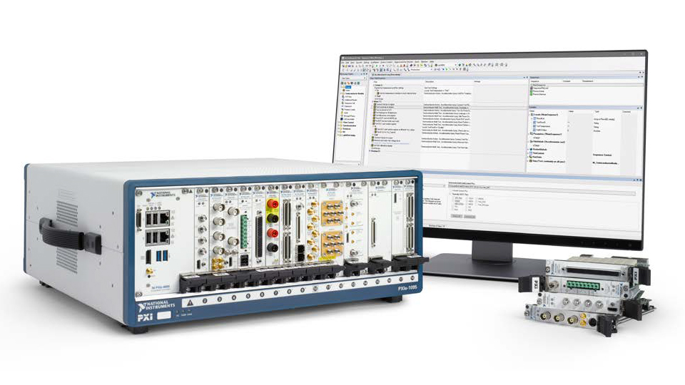  
*Figure 1. A PXI chassis with instrument modules. Replace with an own photo or a freely licensed image before publication.*

### 2.2 Flying probes

In flying-probe testing, several probes are mounted on carriages, on one or both sides of the board. The probes touch component pads and vias one after another.

Advantages:

- no test pads required on the board;
- no adapter or fixture to manufacture;
- no multiplexing of a large number of channels.

The mechanics are not especially hard if throughput is limited (industrial machines may take tens of minutes per board). The hard part is **software**: the positioning program needs more than the pad coordinates that an EDA system normally exports. It needs the 3D shape of the board, component heights, and sometimes lead thickness. A plausible integration path is parsing ODB++ data.

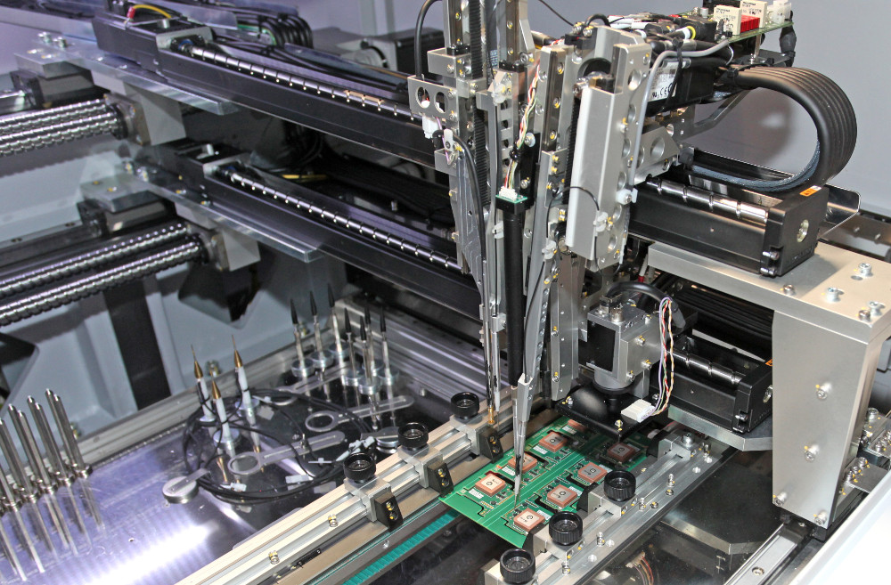  
*Figure 2. A commercial flying-probe tester (Takaya APT-1400F). Licensed image or own drawing required.*

Figure 3 shows a minimal kinematic scheme: four portals P1–P4 move independently left to right, each carrying one carriage K1–K4 that moves vertically; the probes touch the board at T1–T4.

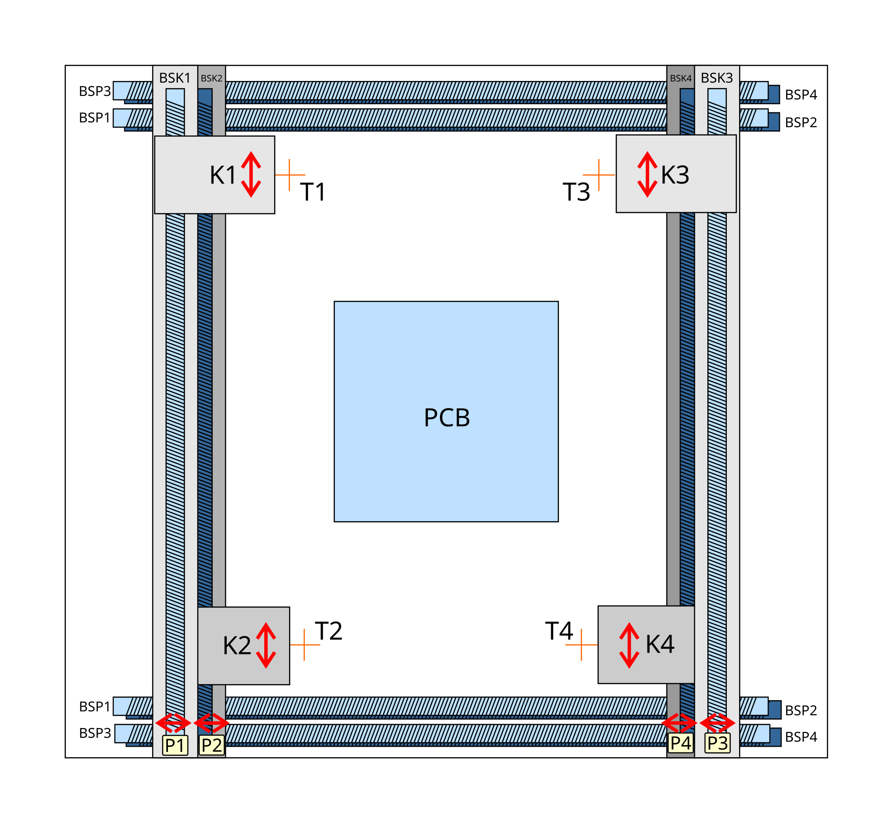  
*Figure 3. Minimal flying-probe kinematics.*

### 2.3 Bed of nails

A bed-of-nails fixture presses an array of spring-loaded pins against dedicated test pads. It scales well to high throughput and is a good method when the board has free space.

The costs are on the design side: test pads enlarge the board and increase its cost, miniaturization makes pad placement harder, and each board design needs its own fixture. Automatic test-point generation tools in EDA systems reduce the effort but do not remove it.

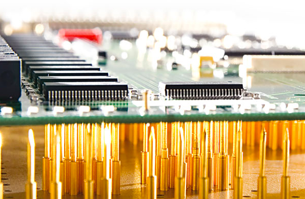  
*Figure 4. Bed-of-nails fixture principle.*

### 2.4 Comparison

| Criterion | Flying probes | Bed of nails |
|---|---|---|
| Test pads required | No | Yes |
| Per-product fixture | No | Yes |
| Throughput | Low | High |
| Software complexity | High (3D positioning, EDA integration) | Moderate |
| Hardware complexity | Fewer channels, more mechanics | Many channels, multiplexing |
| Impact on board design | None | Larger board, extra pads |

### 2.5 Engineering effort

Whichever route is chosen, the project spans three disciplines: mechanical and enclosure design; analog, digital and mixed-signal electronics; and software. The more capable the result, the longer and costlier the development.

---

## 3. Low-cost reference architectures

At the budget end of the market, vendors such as Acroname (MTM modules) and FictureFab (test cartridges) offer a simpler architecture with shorter development and production cycles. MTM modules are PCIe-form-factor cards, although the edge connector is used non-standardly: it carries power, I²C control, and address lines, not PCI signals.

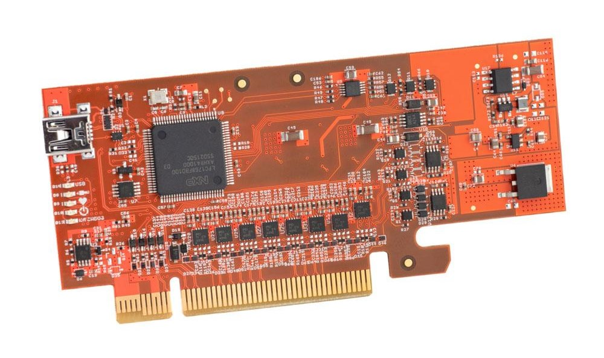  
*Figure 5. MTM-DAQ-2 analog module (vendor image; see Appendix B).*

The measurement modules plug into a **cartridge**, a custom board that is made once per product. The cartridge carries analog multiplexers, card-edge sockets for the instrument modules, a USB connection to a small embedded PC, and spring contacts to the board under test.

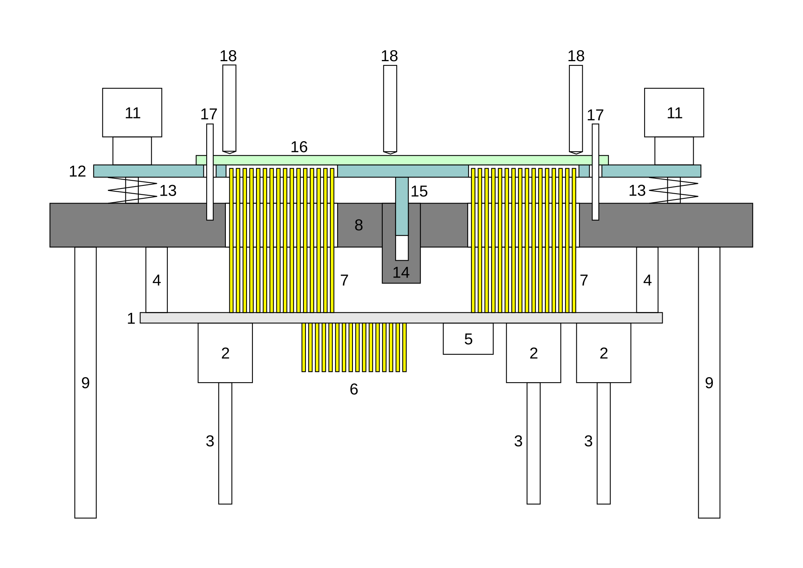  
*Figure 6. Test cartridge. The numbers are explained below.*

Mechanical operation (numbers refer to Figure 6):

- Cartridge PCB (1) carries multiplexers, card-edge connectors (2) for measurement modules (3), a USB connector (5) and spring contacts (7) toward the board under test; contacts (6) on the opposite side allow extra instruments.
- PCB (1) is held by standoffs (4) on an insulating module (8), which has its own standoffs (9). The moving panel (12) is also insulating, with dowel pins that enter slots (14), and is held on springs (13) by knurled screws (11).
- The board under test (16) sits on guides (17). When the top lid closes, pressers (18) push the board down, the panel (12) descends, and the contacts (7) meet the test pads.

The drawback is cost and lead time: a cartridge is needed per product, and because it carries multiplexers and connectors it is not cheap, although still much cheaper than an industrial ICT machine. Only the bottom side of the board is probed, which is acceptable if test pads are placed there.

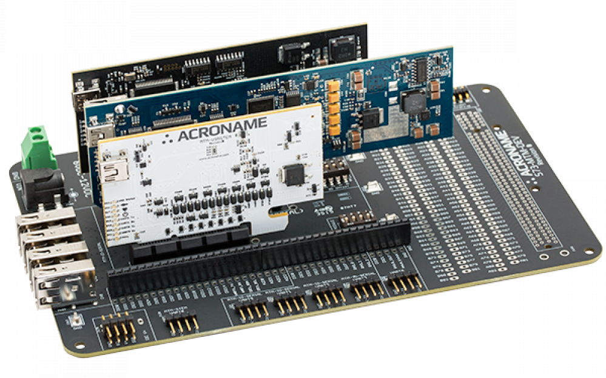  
*Figure 7. MTM evaluation kit.*

### 3.1 Cartridge design flow

1. Export test-pad names and coordinates to a CSV file.
2. Export mounting holes for guide pins, or declare the position and diameter of external guide pins for boards without holes.
3. Export coordinates and diameters of the spring pins.
4. A small utility generates a 3D model of the fixture; the cartridge mother board is designed afterwards.

### 3.2 Adapter variant

A variant adds an intermediate adapter module: test pads on its bottom face, spring contacts on its top face toward the board under test (Figure 8). The adapter is wired to the instrument by wire-wrap, which allows modifications. The instrument side then becomes a regular pin grid, as in commercial ICT systems (Figure 9).

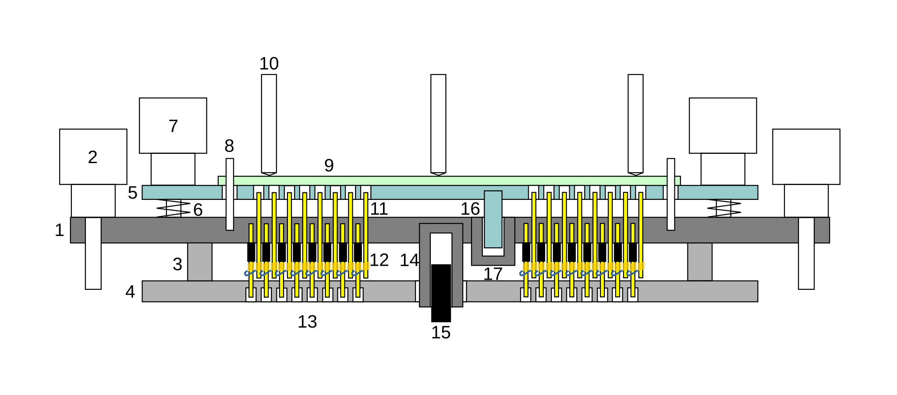  
*Figure 8. Cartridge with an intermediate adapter.*

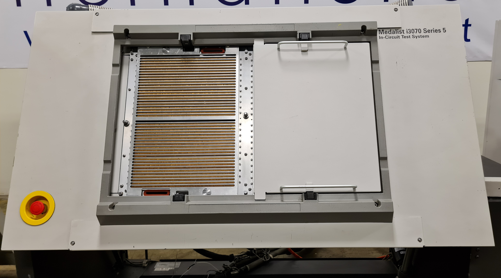  
*Figure 9. Regular pin grid of a commercial system (Keysight i3070 [4]). Licensed image or own drawing required.*

This variant is only a concept; confirming it needs more time and a prototype.

---

## 4. Test strategy and instrument requirements

An ICA consists of three parts:

1. an operator workstation (PC) for the user interface and visualization;
2. measurement controllers, which perform measurements and communicate with the PC;
3. an adapter that connects the controllers to the board under test.

The adapter may contain switching elements, level-matching circuits, low-pass filters for ripple, and connectors for testing interfaces that have no test pads.

### 4.1 Power-off (cold) test

Performed without applying power, with an ICA/MDA system or a DMM-based setup. It detects:

- shorts between traces or components;
- open circuits;
- resistor values;
- jumper and switch states;
- missing passive components;
- limited verification of the presence and function of active components (resistance to ground or between pins differs when a part is damaged, missing or poorly soldered);
- limited verification of component values (C, L, ...).

All of these can in principle be tested with an ohmmeter-style instrument: a capacitor shows as resistance that rises with time after the start of the measurement, an inductor as resistance that falls.

A short circuit invalidates all other measurements and is the cheapest fault to detect, so the test order is:

1. shorts;
2. opens;
3. R and C;
4. diodes;
5. active components;
6. other components.

A failure at any step sends the board to rework.

### 4.2 Power-on (hot) test

Performed by powering an isolated component, the device under test (DUT). It detects wrong orientation, a faulty analog or digital component, propagation delay of a digital device, transistor gain, and (in a power-on context) capacitance or inductance.

### 4.3 Functional test

Functional testing proceeds in stages, and the instrument must control the power supply of the board and cut it on failure:

1. **Transient analysis:** power-up behavior, supply levels and inrush current;
2. **JTAG boundary scan:** under power, finds shorts and missing pull-up/pull-down resistors where no test pad exists. Not all chip vendors publish complete boundary-scan data;
3. **Functional test:** signal quality (frequency measurement, protocol analysis, signatures) and interface function.

During functional testing the instrument may drive input terminals with a generator while ADC channels measure outputs. More than one measurement channel, or even a logic analyzer, may be required. High-speed signals make the instrument substantially more complex.

### 4.4 Requirements per stage

| Stage | Requirements |
|---|---|
| Power-off | One measurement channel; one generator channel |
| Transient analysis | Several measurement channels; power-supply control; supply current measurement; over-voltage tolerance and a wider voltage range; load emulation; some control-signal generation |
| Functional test | Logic analyzer; multichannel signal generation; or hardware emulation of the tested interfaces |

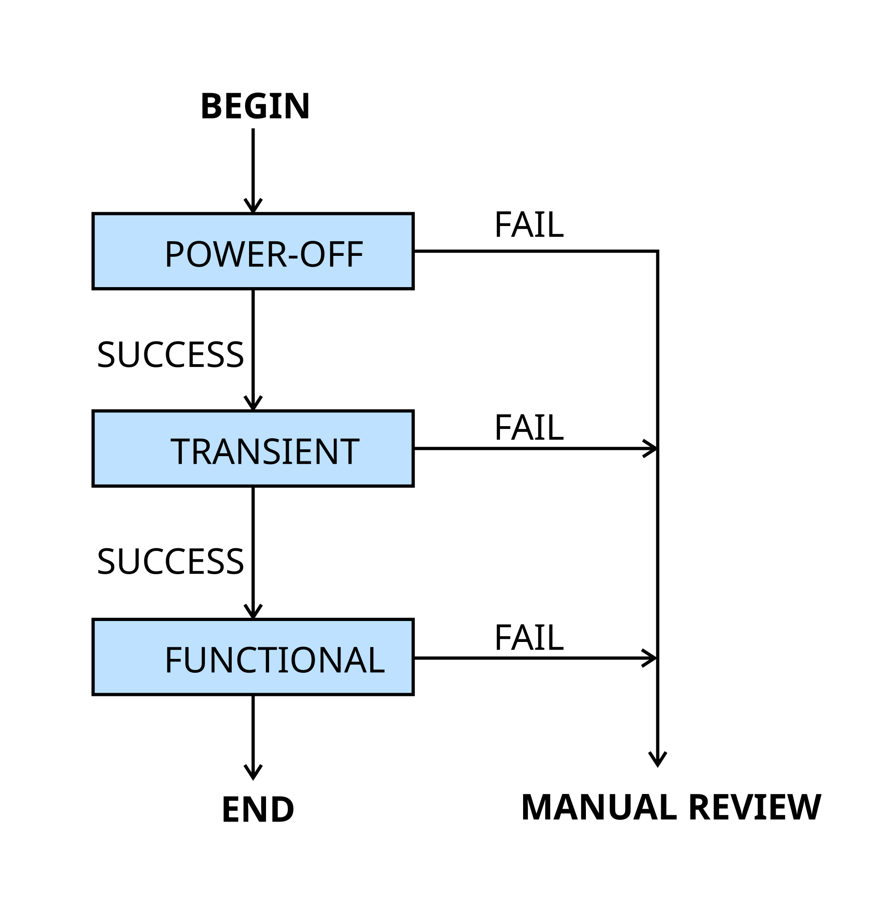  
*Figure 10. Test stages of the target board.*

---

## 5. The measurement channel

### 5.1 Concept

For every pair of terminals the instrument measures R, C, L, impedance Z and ESR. The result is a **signature** of the net. Signatures are compared with a reference using a fuzzy-matching algorithm:

- if the signature is close to the reference, it refines the reference;
- if it is not, the database is searched for a similar signature.

All new signatures are stored. After a board is repaired, the description of the fault is attached to its signature, so a faulty signature found later carries diagnostic information with it.

### 5.2 Structure

Every measurement mentioned above can be done with an ohmmeter, so the channel has two parts:

- a source of voltage or current (a current source need not be regulated);
- a voltmeter or an oscilloscope.

Capacitance and inductance require registering the signal in time, so the practical form is a sampling ADC (an oscilloscope-like capture) and a digital signal generator instead of a DC source.

### 5.3 Initial parameter targets

Targets taken from a published study on automatic in-circuit test generation [1], sufficient for digital boards:

| Parameter | Range |
|---|---|
| Generator frequency | 0 to 150 kHz |
| Capture bandwidth | 0 to 150 kHz |
| Resistance | 10 Ω to 150 kΩ |
| Capacitance | 200 pF to 1 µF |
| Inductance | 10 µH to 1 H |

The 200 pF lower bound in the source is not justified. A lower limit of 10 to 100 pF is better, since many small capacitors on real boards are well below 200 pF.

### 5.4 DC baseline

#### 5.4.1 ADC resolution

A 12-bit ADC integrated in a microcontroller needs a programmable-gain instrumentation amplifier in front of it. Resolution per range:

| Range | LSB | LSB, % of range |
|---|---|---|
| 1 V | 0.24 mV | 0.02 % |
| 10 V | 2.4 mV | 0.02 % |

#### 5.4.2 Measuring R with DC

With a 1 kΩ series resistor and a 1 Ω load, the measured voltage from a 1 V source is about 1 mV, so a 12-bit ADC needs a 1 V range. With a 1 kΩ load the voltage rises to about 0.5 V. At higher voltages the ESD and substrate diodes inside ICs start conducting and corrupt the measurement. To avoid that, the stimulus is lowered to about 0.5 V, which reduces the 1 Ω case to about 0.5 mV.

Two solutions follow: a set of precise switchable resistors chosen to fit the ranges, or a digital potentiometer (e.g. AD5272/AD5274). The potentiometers are flexible but have limited bandwidth (about 60 kHz at 100 kΩ, 300 kHz at 20 kΩ), so parts must be chosen carefully; pre-calibration can partly compensate.

> Industrial testers commonly keep the voltage across the DUT well below the diode forward voltage (on the order of 100–200 mV) for the same reason. The value of 0.5 V used here is the conservative upper limit for the threshold, not a recommended operating point.

#### 5.4.3 Measuring C with DC

The RC time constant is τ = R·C (time to charge to 63.2 %). At a sampling rate of 1 MS/s and at least ten samples per measurement, a cycle is about 10 µs. The resistor must be switched with the range:

| Capacitance measured | Required series resistance |
|---|---|
| > 10 pF | 1 MΩ |
| > 100 pF | 100 kΩ |
| > 200 pF | 50 kΩ |

Time constants for a 1 µF capacitor:

| Resistance | τ |
|---|---|
| 1 MΩ | 1 s |
| 100 kΩ | 0.1 s |
| 50 kΩ | 0.05 s |

The method works, but the resistance must be switched for each range, which is its main weakness.

#### 5.4.4 Measuring L with DC

The time constant is τ = L/R, which calls for a very low source resistance.

- 10 µH with 10 Ω gives τ = 1 µs, which is not resolvable at 1 MS/s. The minimum measurable inductance therefore rises by a factor of 5 to 10.
- 1 H with 10 Ω gives τ = 0.1 s.

Time and accuracy are acceptable, but a low-impedance source is difficult to maintain through a switching matrix serving many terminals. It also increases the test current and produces voltage spikes from the back-EMF of the inductor.

### 5.5 The proposed method: AC measurement

The alternative is to excite the terminal with a sine wave and compute capacitance, inductance and impedance from two digitized signals. The method needs the amplitude and phase of the generator signal (V<sub>a1</sub>) and the amplitude of the signal at the terminal under test (V<sub>a2</sub>), plus the phase difference θ between them. Effectively, it measures C and L at the frequencies where their impedance is convenient.

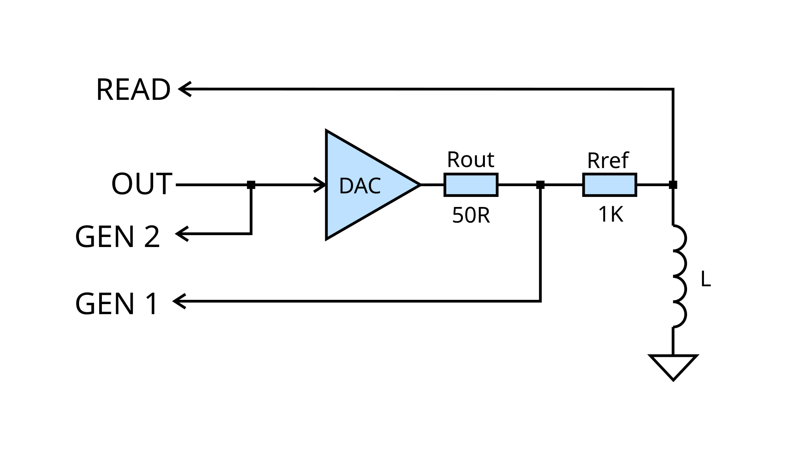  
*Figure 11. Measurement of L; C is measured the same way.*

#### 5.5.1 Derivation

The circuit is a voltage divider: the generator drives a series resistor R<sub>ref</sub>, and the unknown impedance Z<sub>x</sub> connects to ground. V<sub>1</sub> is the generator phasor (reference phase 0) and V<sub>2</sub> is the phasor at the terminal, with phase θ.

Impedance:

$$
Z_x = \frac{V_2 R_{ref}}{V_1 - V_2}
$$

In polar form, with amplitudes V<sub>a1</sub>, V<sub>a2</sub> and phase difference θ:

$$

|Z| = \frac{V_{a2} R_{ref}}{\sqrt{V_{a1}^2 - 2V_{a1}V_{a2}\cos\theta + V_{a2}^2}}
$$

Impedance angle:

$$
\alpha = \theta - \operatorname{atan2}\!\left(-V_{a2}\sin\theta,\; V_{a1} - V_{a2}\cos\theta\right)
$$

With a series model of the component (R<sub>esr</sub> in series with C or L):

$$
C = \frac{-1}{2\pi f\,|Z|\sin\alpha}, \qquad L = \frac{|Z|\sin\alpha}{2\pi f}, \qquad R_{esr} = |Z|\cos\alpha
$$


For a capacitor α is negative (close to −90°), for an inductor positive (close to +90°); the sign of α also tells which one is measured.

#### 5.5.2 Capturing the two signals

The method needs two signals simultaneously. However, since the generator output resistance is low (about 50 Ω) and R<sub>ref</sub> is much larger, the generator-side signal can be taken from the generator itself, corrected for the circuit latency, instead of being captured separately. Alternatively, because the signal is periodic, the two nodes can be captured one after the other.

#### 5.5.3 Frequency selection

The measurement is most accurate when `|Z|` is within roughly one decade of R<sub>ref</sub>, i.e. when the ratio V<sub>a2</sub>/V<sub>a1</sub> is not too small. A practical rule is therefore to **change the generator frequency whenever the level at the terminal falls below −20 dB (0.1×) of the generator level**. With this rule the programmable-gain input amplifier is needed only for DC measurements, not for AC.

Back-of-the-envelope check with R<sub>ref</sub> = 1 kΩ, a usable window `100 Ω ≤ |Z| ≤ 10 kΩ`, and a frequency range 1–100 kHz:

| Frequency | C range | L range |
|---|---|---|
| 1 kHz | 16 nF – 1.6 µF | 16 mH – 1.6 H |
| 100 kHz | 160 pF – 16 nF | 160 µH – 16 mH |
| Overall | about 160 pF – 1.6 µF | about 160 µH – 1.6 H |

This matches the targets of Section 5.3 (200 pF–1 µF, 10 µH–1 H) fairly well. Wider ranges (for example 100 pF–10 µF, 10 µH–10 H, 50 Ω–100 kΩ) can be reached only by accepting a larger dynamic range, down to about −80 dB. These wider figures were **not verified** here and must be treated as goals.

#### 5.5.4 Simulation

Simulation of the capacitance-measuring circuit with R<sub>ref</sub> = 1 kΩ covers 50 pF to 10 µF.

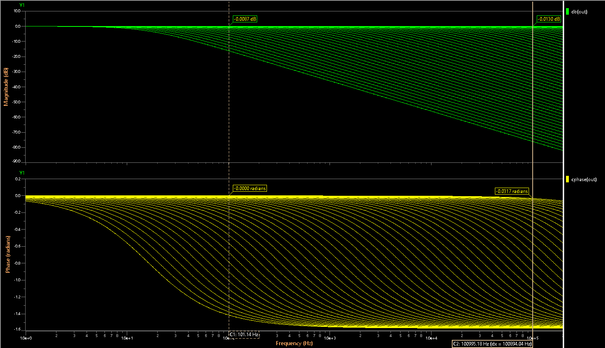  
*Figure 12. Simulated response for capacitance measurement.*

Simulation of the inductance circuit covers 10 µH to 1 H.

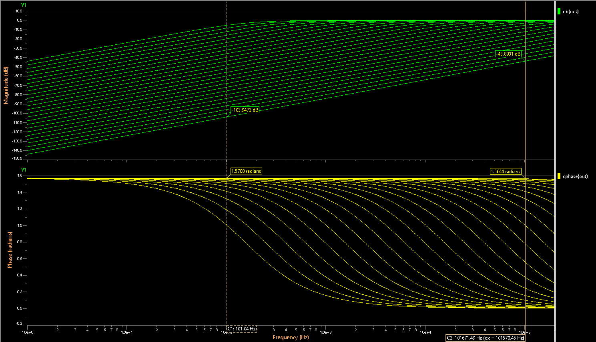  
*Figure 13. Simulated response for inductance measurement.*

The plots reach −80 dB, which is the extreme of the dynamic range. In normal operation the frequency is changed before the signal falls below −20 dB.

#### 5.5.5 Assessment

Advantages:

- small signal levels and no back-EMF spikes;
- no switching of range resistors for C and L: the frequency is the range;
- yields |Z|, phase and ESR in one measurement.

Disadvantages:

- two signals and a phase measurement are needed, so a timing reference (Section 6.9) is required;
- accuracy depends on the phase resolution and on the latency of the signal path, so calibration is needed;
- a series model is assumed; parallel-loss components (leakage) are not resolved.

The algorithm is given in [Appendix A](#appendix-a-reference-implementation-of-the-ac-method).

### 5.6 Short-circuit detection

Shorts could be found by measuring resistance between all terminal pairs, but a cheaper way is to measure resistance from each terminal to ground. When two terminals are shorted, the resistance of each to ground drops. If the two nets have very different resistances, the short is visible at only one of them.

With a generator and an oscilloscope, two strategies exist:

1. the generator drives one terminal while the oscilloscope checks the signal level at all the others;
2. the oscilloscope watches one terminal while the generator pulses the others, either one by one or all at once. The second option is much more complex because it needs many generated signals at the same time.

### 5.7 Other stimuli

- **Current source.** Offers some possibilities, but its value is doubtful: a regulated source saturates in voltage when the load resistance is high.
- **0 Ω load.** Of limited interest for the cold test: zero is simply a generator output of 0 V, especially with a generator output resistance below 50 Ω. Power-on testing needs both logic levels, 0 and 1.
- **Controlled load.** Useful for testing voltage sources such as USB ports.

---

## 6. Channel architecture

### 6.1 Number of channels

A cold test needs one ohmmeter, or one generator and oscilloscope pair. A DUT test needs many generation and measurement channels. To keep cost and complexity down, a reasonable compromise is to concentrate on **digital** boards, where generation and capture are needed only at logic levels 0 and 1:

- power-off testing uses a single channel;
- power-up uses a few measurement channels and no generation channels (except to control the power-up itself);
- interface testing uses hardware or software interface emulators.

For the last point a small SRAM-based FPGA with many GPIOs is well suited. It can implement high-speed interface tests, and its configuration can be changed for each product an unlimited number of times.

An ADC integrated in an ARM microcontroller works well, especially in a scan mode where one ADC measures several GPIOs in turn. An external ADC needs a closer look at its input filter, which often complicates scanned operation.

### 6.2 Signal generation (DAC) options

Connecting one or more DACs to the terminals requires a switching scheme. Figure 14 shows three options.

| Option | Description | Strengths | Weaknesses |
|---|---|---|---|
| 1 | DAC → analog multiplexer → one terminal | Simplest | One terminal at a time: enough for power-off, not for DUT testing or interface emulation |
| 2 | DAC → multiplexer → sample-and-hold per terminal → buffer op-amp → analog switch | Can generate complex waveforms on many terminals | Maximum frequency falls as the number of terminals grows; an op-amp and a switch per terminal |
| 3 | FPGA PWM outputs → low-pass filter cluster → analog switch | High frequency, arbitrary waveforms from FPGA | Two GPIOs per channel (PWM and switch control) |

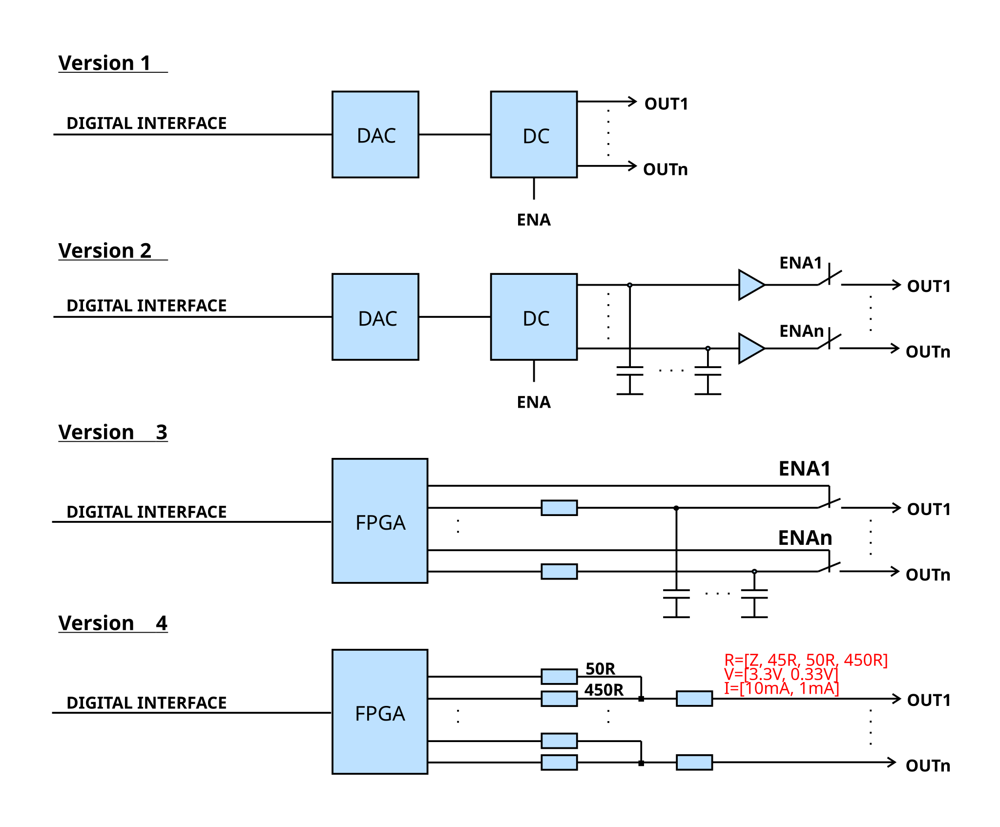  
*Figure 14. Analog output options.*

Some DACs cannot be used in multiplexed mode because they have an output filter that does not support multiplexing between channels. Switching elements in the output path must have low on-resistance.

#### 6.2.1 PWM drive

A digital PWM signal from the FPGA can replace a conventional DAC and halves the component count, since no decoders are needed. Simulation, however, shows a sawtooth ripple at high frequency for low C and L (Figure 15), and smoothing it with a low-pass filter introduces measurement error. The idea is attractive but needs more verification. A different approach based on non-sinusoidal excitation [2] shows acceptable accuracy for this task.

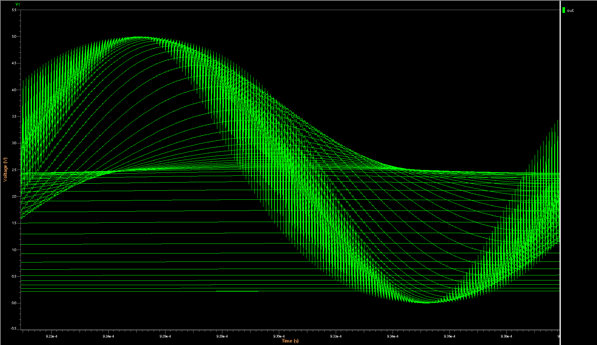  
*Figure 15. Digital PWM drive at 10 MHz.*

### 6.3 ADC channels

An analog multiplexer is required on the inputs, but its on-resistance may be high since the ADC input draws almost no current. Differential ADC measurement methods are described in the module documentation [3]; they allow measuring the voltage drop across a resistor or a group of components, for example to measure supply current or battery discharge rate.

### 6.4 Combined analog-digital terminal

A reasonable solution is a combined channel where the ADC and DAC provide the analog measurement while an FPGA handles the digital functions of the same terminal (Figure 16).

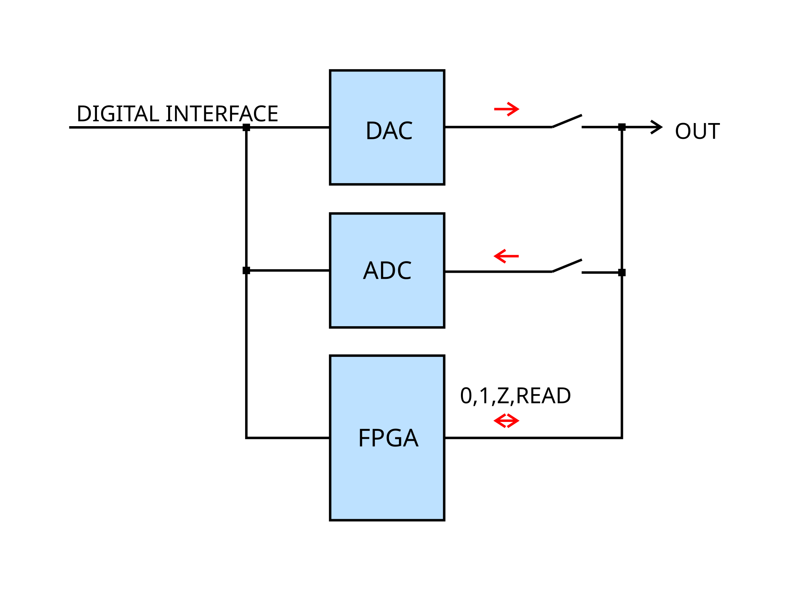  
*Figure 16. Combined terminal circuit.*

### 6.5 Discrete ADCs and DACs

Instead of the converters integrated in the microcontroller, serial ADC and DAC chips can be used. This gives higher resolution, accuracy and speed; better supply routing for the analog section; and shorter analog traces.

### 6.6 Switching

Serially controlled SPST switches (for example the ADG1414) suit both analog and digital signals. Analog multiplexers double the number of parts, since in principle a generator may be connected to any terminal while another terminal is being measured. Component availability may be a serious issue.

### 6.7 Protection

All test terminals need ESD protection, and all or some need overvoltage protection.

### 6.8 Calibration and temperature compensation

- Internal calibration switches are better implemented with miniature relays, which gives a more accurate calibration and removes the effect of the calibration circuit on normal operation.
- The output decoders have limited accuracy and non-trivial on-resistance, which must be compensated. The input multiplexers matter less.
- The instrument should be supplied with a probe having a more accurate measurement channel for diagnostics and calibration.
- The calculation algorithm must use the data from a temperature sensor on the measurement board.

### 6.9 Module control bus

High speed is not needed, so the control bus can be I²C (or I²C-HS), supplemented with addressing and synchronization lines.

**Required signals**

| Signal | Function |
|---|---|
| S[0..3] | Module address. Some lines are tied to ground on the motherboard; each module has pull-ups and reads its number from these lines. |
| SCL, SDA | I²C |

**Synchronization**

| Signal | Function |
|---|---|
| BUSY | A module pulls the line low while measuring; a new cycle may start only when it is high. |
| SYNC | The master starts a measurement cycle by pulling it low. |

**Optional**

| Signal | Function |
|---|---|
| INT | Interrupt from module to processor (active low) |
| NMI | Critical module error (active low) |

Sequence: the processor sends the task to all modules, then drives SYNC low. Participating modules pull BUSY low at the start of the measurement and release it at the end; then the processor issues a new task.

A SYNC edge starts a hardware timer. Its value is latched immediately before (a) the first generator sample is output and (b) ADC capture starts. These timestamps feed the phase-shift algorithm of Section 5.5. INT is used when a module decides to change its range, and NMI when it diagnoses a serious problem.

---

## 7. Mechanical design

The instrument can be built in a standard rack enclosure for 100 × 160 mm boards (Eurocard format). Boards of the same size plug into a backplane that supplies power and communication. The back plate carries connectors for modules such as the central computing unit, interface emulation boards, measurement boards, signal generators and programmable power supplies. The front panel has connectors for the test cartridge, LEDs, buttons, switches and the link to the workstation.

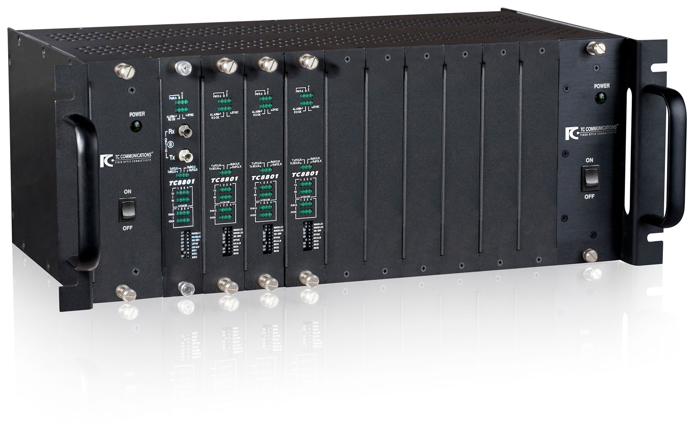  
*Figure 17. A standard rack enclosure.*

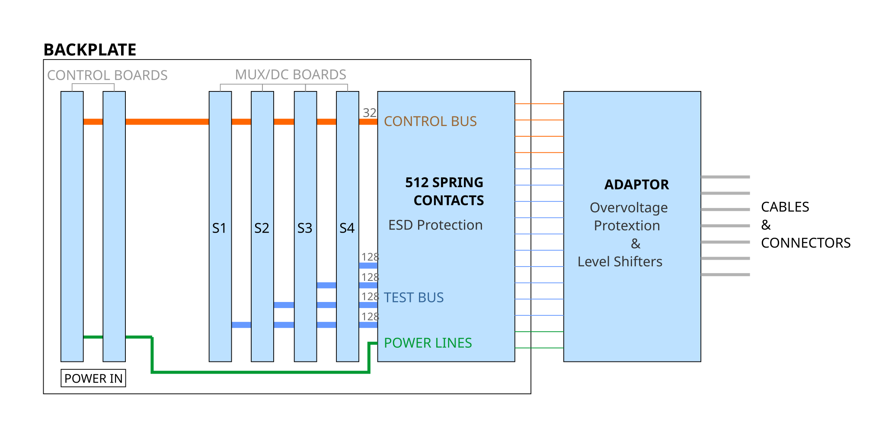  
*Figure 18. Concept of the instrument.*

**Central processor.** A Linux-based board, or alternatively a thin client connected over USB.

**Measurement module.** Built around a microcontroller or an FPGA. It may contain:

- a microcontroller with or without integrated ADC/DAC;
- an ADC and a programmable-gain instrumentation amplifier;
- a DAC and a programmable-gain amplifier;
- an FPGA for digital testing;
- an ADC multiplexer and a generator decoder;
- ESD protection;
- an interface connector;
- calibration elements.

If the module has no FPGA, some digital signals can be generated or scanned by the microcontroller. If it has no microcontroller, the structure stays the same.

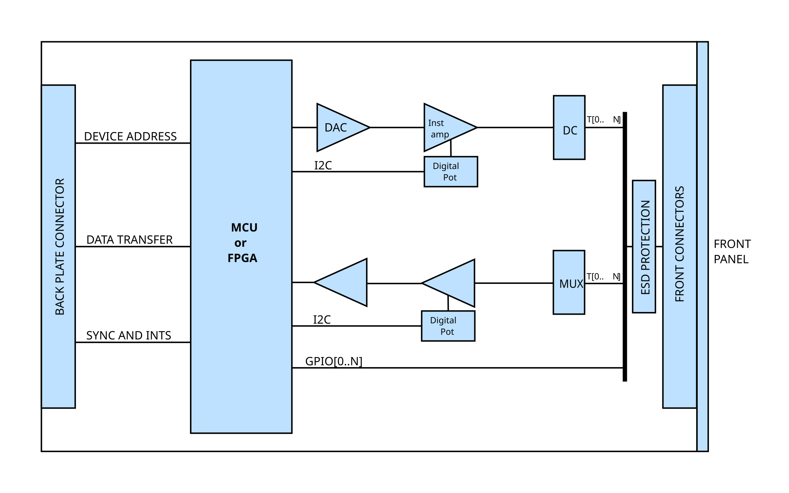  
*Figure 19. Measurement module, rack version.*

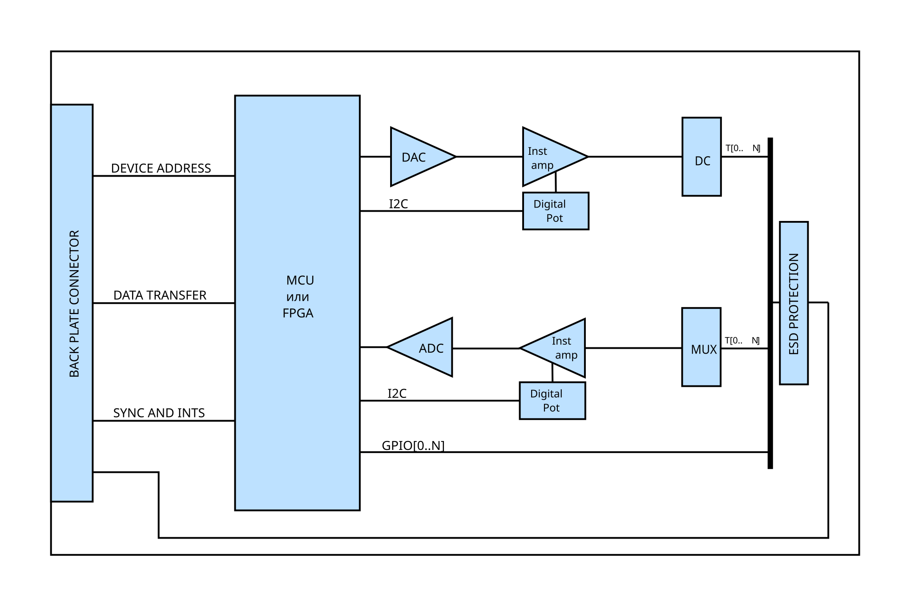  
*Figure 20. Measurement module, MTM version.*

**Indication.** Four options, each with trade-offs:

1. direct LEDs, showing the real state of each terminal;
2. a software-driven LED panel;
3. a small LCD/OLED panel;
4. the workstation display.

The workstation display is the simplest and the most capable.

---

## 8. Software

Integration with LabVIEW and TestStand is possible, but a working system can also be built independently, for example in Common Lisp, where only a DSL for the test platform needs to be implemented. The examples below use S-expressions and are illustrative, not an implemented interface.

### 8.1 Low level

At the lowest level, terminals are addressed by number. A platform configuration file lets them be addressed by signal name.

```lisp
(define-platform thinclient-r1
  "Thin client, revision 1"
  (define-connector usb1
    "USB Type-C connector on the front panel"
    (dp T001)
    (dm T002)
    (gnd 0)
    (power T003)))
```

The processor controlling the DAC and ADC performs the measurements:

```lisp
;; Measure R, C and L:
;;  T001 to GND, T002 to GND, T001 to T002
(measure '(R C L) '((T001 . 0) (T002 . 0) (T001 . T002)))
;; => ((100R 20pF 2uH) (100R 20pF 2uH) (200R nil nil))
```

The function returns one list of values per pair; a failed measurement returns `nil`. To measure every terminal against every other one:

```lisp
(measure-all '(R C L) '(T001 T002 0))
;; => ((T001 0    100R 20pF 2uH)
;;     (T002 0    100R 20pF 2uH)
;;     (T001 T002 200R 10pF 1uH))
```

### 8.2 Middle level

Runs on the instrument's main computer and drives whole tests:

```lisp
(calibrate)

;; Test the SMARC connector of the thin client
(measure thinclient :only 'smarc)
```

### 8.3 Top level

One of three deployment modes:

1. a client-server web application;
2. a workstation application sending HTTP requests and receiving results;
3. control over SSH with a remote file system for configuration and measurement results.

---

## 9. Conclusions and open questions

### 9.1 Conclusions

1. An automatic tester has many components. The best strategy is to divide it into identical modules joined by a backplane; fewer cables and connectors improve stability and service life.
2. Testing only through existing connectors cannot give a complete test.
3. **Flying probes:** fewer electronic components and no fixture, but more complex software (EDA integration, 3D positioning) and low throughput and wear life.
4. **Bed of nails:** complicates the board design and requires a fixture. The simpler strategy is to probe only the bottom side, which usually has no components, and to use automatic test-point placement in the EDA system.
5. To lower cost and time, the instrument can accept modest accuracy: it only needs to separate defective boards from working ones. An FPGA-based variant can test some interfaces, but far from all.
6. LabVIEW/TestStand integration is attractive but not necessary at the first stage.
7. **AC impedance measurement (Section 5.5)** is the most promising measurement method in this study, because it covers C, L, Z and ESR without range-resistor switching and without back-EMF. It is verified only by simulation and by the numeric check in Appendix A.

### 9.2 Make or buy

Board manufacturers already offer testing as a service with fast and expensive equipment. A development of this scale is justified only if it clearly beats paying the manufacturer. Commercial PXIe systems are also available from several vendors.

### 9.3 Open questions

- verify the extended ranges of Section 5.5.3 on hardware;
- quantify the effect of generator-side signal estimation (Section 5.5.2);
- evaluate PWM drive against a true DAC (Section 6.2.1);
- establish phase accuracy and calibration procedure of the timing scheme;
- prototype the adapter-cartridge concept (Section 3.2);
- define the test-pad rules for the EDA flow.

The next steps would be sketches of the main modules, a bench prototype of one measurement channel, and measurements on known components before any full-scale design.

---

## Appendix A: Reference implementation of the AC method

The listing implements the equations of Section 5.5.1. The `theta` argument is the phase of V<sub>2</sub> relative to V<sub>1</sub>, in radians. It is positive for an inductive load and negative for a capacitive load. Two test vectors check the code:

| Test | V<sub>1</sub> | V<sub>2</sub> | θ | f | R<sub>ref</sub> | Expected |
|---|---|---|---|---|---|---|
| Capacitor | 1.934 V | 0.31 V | −80° | 100 kHz | 1 kΩ | C ≈ 9.78 nF, ESR ≈ 2.2 Ω, |Z| ≈ 163 Ω |
| Inductor | 1.906 V | 1.03 V | +55.83° | 10 kHz | 1 kΩ | L ≈ 10.39 mH, ESR ≈ 16.8 Ω, |Z| ≈ 653 Ω |

```c
/* ica_math.c -- impedance, C, L and ESR from two sampled sine signals
 * Build: gcc -Wall -o ica_math ica_math.c -lm && ./ica_math
 */
#include <math.h>
#include <stdio.h>

#define DEG2RAD(d) ((d) * M_PI / 180.0)
#define RAD2DEG(r) ((r) * 180.0 / M_PI)

typedef struct {
    double z;      /* |Z|, ohm                       */
    double alpha;  /* impedance angle, rad           */
    double c;      /* capacitance, F (series model)  */
    double l;      /* inductance, H  (series model)  */
    double esr;    /* equivalent series resistance   */
} rlc_t;

/*
 * v1    amplitude at the generator side
 * v2    amplitude at the terminal under test
 * theta phase of v2 relative to v1, rad (> 0 inductive, < 0 capacitive)
 * rref  series (reference) resistor, ohm
 * f     excitation frequency, Hz
 */
static rlc_t extract(double v1, double v2, double theta, double rref, double f)
{
    rlc_t r;
    double w = 2.0 * M_PI * f;

    r.z     = v2 * rref / sqrt(v1*v1 - 2.0*v1*v2*cos(theta) + v2*v2);
    r.alpha = theta - atan2(-v2 * sin(theta), v1 - v2 * cos(theta));
    r.esr   = r.z * cos(r.alpha);
    r.c     = -1.0 / (w * r.z * sin(r.alpha));  /* meaningful if alpha < 0 */
    r.l     =  r.z * sin(r.alpha) / w;          /* meaningful if alpha > 0 */
    return r;
}

int main(void)
{
    rlc_t c = extract(1.934, 0.31, DEG2RAD(-80.0), 1000.0, 100e3);
    printf("C: |Z|=%.1f ohm  alpha=%.2f deg  C=%.3f nF  ESR=%.2f ohm\n",
           c.z, RAD2DEG(c.alpha), c.c * 1e9, c.esr);

    rlc_t l = extract(1.906, 1.03, DEG2RAD(55.83), 1000.0, 10e3);
    printf("L: |Z|=%.1f ohm  alpha=%.2f deg  L=%.3f mH  ESR=%.2f ohm\n",
           l.z, RAD2DEG(l.alpha), l.l * 1e3, l.esr);
    return 0;
}
```

Output:

```
C: |Z|=162.7 ohm  alpha=-89.22 deg  C=9.780 nF  ESR=2.21 ohm
L: |Z|=652.9 ohm  alpha=88.53 deg  L=10.388 mH  ESR=16.77 ohm
```

---

## Appendix B: Acroname MTM modules

Summary of the modules of the MTM family relevant to this study, from the vendor's documentation at the time of writing. Check the current datasheets before relying on any figure.

| Module | Main features |
|---|---|
| **MTM-DAQ-2** (analog DAQ) | 16-bit ADC; 14 differential bipolar inputs plus 2 with programmable gain; input ranges from about ±64 mV to ±10.24 V; two 12-bit DAC outputs; two protected digital GPIOs; BrainStem I²C |
| **MTM-Load-1** (DC load) | 1 channel, up to 50 W, 30 V / 10 A limit; Kelvin sensing; thermal fail-over; on-board temperature; analog current indication; 4 GPIOs; better than 1 % V/I measurement |
| **MTM-PM-1** (DC power) | Software-set voltage 1.8–5.0 V and current limit; up to 3 A; better than 1 % accuracy; Kelvin sensing; current measurement with 50 µA resolution; thermal fail-over; trigger and GPIO; optional K-type thermocouple input |
| **MTM-IO-Serial** (USB hub and I/O) | 2 banks of 4 adjustable-rail GPIO; fixed 5 V and two adjustable 1.65–5 V outputs (100 mA limit); 4 USB 2.0 ports; 4 UART ports |
| **MTM-Relay** (4× solid-state relay) | 4 relays (60 V, 6 A) with load-voltage measurement; 4 GPIO; 2 UART; USB-to-I²C bridge |
| **MTM-EtherStem** | Ethernet microcontroller module: 3 ADC inputs (12 bit), 1 DAC output, 15 GPIO, I²C, microSD slot, real-time clock, Ethernet-to-I²C bridge |
| **MTM-USBStem** | USB microcontroller module with the same resources as EtherStem, and USB in place of Ethernet |
| **MTM-RCI-1** (ribbon cable interface) | Connects non-MTM equipment to MTM-based systems with ribbon cable, headers or terminal blocks |

---

## References

1. H. van Schaaijk, M. Spierings, and E. J. Marinissen, "Automatic generation of in-circuit tests for board assembly defects," in *2018 IEEE International Test Conference in Asia (ITC-Asia)*, IEEE, 2018, pp. 13–18.
2. L. Ferrigno, M. Laracca, C. Liguori, and A. Pietrosanto, "An FPGA-based instrument for the estimation of R, L, and C parameters under nonsinusoidal conditions," *IEEE Trans. Instrum. Meas.*, vol. 61, no. 5, pp. 1503–1511, 2012.
3. Acroname, *MTM Analog DAQ Module Datasheet (S92-MTM-DAQ-2)*, 2022.
4. Keysight (formerly Agilent) Technologies, *Medalist i3070 Series 5 In-Circuit Test System: Test Methods and Specifications*, 2010.

Further reading:

- L. S. Milor, "A tutorial introduction to research on analog and mixed-signal circuit testing," *IEEE Trans. Circuits Syst. II*, vol. 45, no. 10, pp. 1389–1407, 1998.
- I. A. Grout, *Integrated Circuit Test Engineering*, Springer, 2006.
- Tektronix, application note on capacitance and inductance measurements with an oscilloscope and a function generator.
- GenRad, *Introduction to In-Circuit Testing*, 1984.
