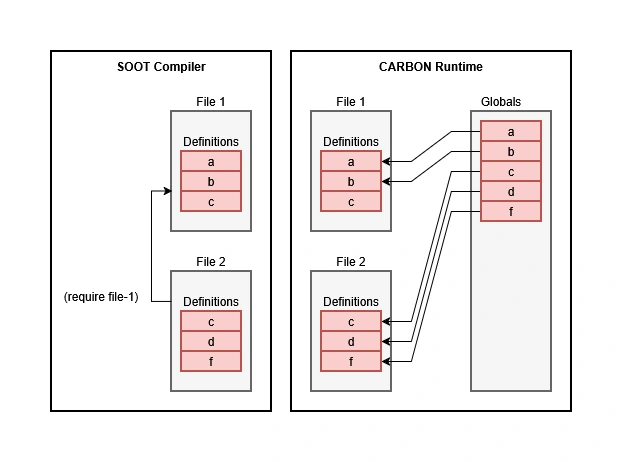

# The SOOT Module System: A Complete Guide

## Table of Contents

- [The SOOT Module System: A Complete Guide](#the-soot-module-system-a-complete-guide)
  - [Table of Contents](#table-of-contents)
  - [Part 1: How Names Work in SOOT](#part-1-how-names-work-in-soot)
    - [1. Definitions in Files](#1-definitions-in-files)
    - [2. How the Compiler Finds Definitions](#2-how-the-compiler-finds-definitions)
    - [3. What Happens at Runtime](#3-what-happens-at-runtime)
    - [4. What Happens in the REPL](#4-what-happens-in-the-repl)
    - [5. Summary](#5-summary)
  - [Part 2: Using the Command Line](#part-2-using-the-command-line)
    - [Compiling a Single File](#compiling-a-single-file)
    - [Compiling a File with Dependencies](#compiling-a-file-with-dependencies)
    - [Compiling with SIDBase](#compiling-with-sidbase)
    - [Starting the REPL with a Runtime](#starting-the-repl-with-a-runtime)
  - [Part 3: Using the Interactive Session](#part-3-using-the-interactive-session)
    - [What Happens When You Type a Form](#what-happens-when-you-type-a-form)
    - [The Problem of Faulty Input](#the-problem-of-faulty-input)
    - [Compiling a Dependency Request](#compiling-a-dependency-request)
    - [Loading a Module into the Runtime](#loading-a-module-into-the-runtime)
    - [Saving the Console History](#saving-the-console-history)
    - [Saving a Module](#saving-a-module)
    - [The Difference Between `save-session` and `save-module`](#the-difference-between-save-session-and-save-module)
  - [Part 4: Loading a Module](#part-4-loading-a-module)
  - [Part 5: Calling a Function](#part-5-calling-a-function)
  - [Part 6: Finding Project Files](#part-6-finding-project-files)
    - [Project Root](#project-root)
    - [Directories](#directories)
    - [Files](#files)
    - [Search Paths](#search-paths)
  - [Part 7: Common Scenarios](#part-7-common-scenarios)
    - [Compile a Single File](#compile-a-single-file)
    - [Compile a File with Dependencies](#compile-a-file-with-dependencies)
    - [Build Several Modules in One Call](#build-several-modules-in-one-call)
    - [Open the REPL and Load a Module](#open-the-repl-and-load-a-module)
    - [Work in the REPL and Save the Session](#work-in-the-repl-and-save-the-session)
    - [Load the Saved Session](#load-the-saved-session)
    - [Recompile a File from the REPL](#recompile-a-file-from-the-repl)
  - [Part 8: Rules and Pitfalls](#part-8-rules-and-pitfalls)
  - [Conclusion](#conclusion)

## Part 1: How Names Work in SOOT

In SOOT, it is important to distinguish two things: how the compiler finds definitions, and how the runtime stores their values.

### 1. Definitions in Files

Each `.sc` file is a separate module. Within a single file, you cannot declare the same name twice:

```lisp
(defun greet () "hello")
(defun greet () "hi") ; error
```

To change a function, you must edit its definition, not add a second one.

At the same time, different files may define the same names.

### 2. How the Compiler Finds Definitions

When a file includes another one via `(require "b.sc")`, the compiler gains access to its definitions.

If several files define `greet`, that is not an error: each definition is tied to its own file. When resolving a name, the compiler first checks the current file, then the files it requires (recursively along the `require` graph).

Thus, identical names in different files can exist independently at the compilation level. The compiler does not merge them into a single table.

### 3. What Happens at Runtime

When a module is loaded, its global names are registered in the shared `Globals` table.

In this table, each name has exactly one current value. If several modules define `greet`, the last load replaces the previous value.

For example, `bar.sc` defines `greet` as `"hello"`, and `baz.sc` defines it as `"hi"`.

- If `bar` is loaded first and then `baz`, `Globals` will contain `"hi"`.
- If `baz` is loaded first and then `bar`, `Globals` will contain `"hello"`.

This rule applies to the runtime. It does not mean that the compiler mixes definitions from different files.



### 4. What Happens in the REPL

The REPL is an interactive console. Code entered there is treated by the compiler as a separate virtual file, such as `<repl>` or `<repl-N>`.

Therefore, defining `greet` in the REPL does not remove the definition from `bar.sc` in the compiler's tables. But once the new definition is loaded, its value may replace the previous one in the shared `Globals` table.

### 5. Summary

- **File:** contains its own definitions; redeclaring a name within a file is forbidden.
- **Compiler:** distinguishes definitions from different files and resolves names according to visibility rules.
- **Runtime:** stores one current value for each global name; the last load may replace it.
- **REPL:** creates separate definitions that, when loaded, may change values in the runtime.

---

## Part 2: Using the Command Line

### Compiling a Single File

```bash
sootc --no-repl --target build soot_src/tests/bar.sc
```

What happens:

1. The compiler reads `soot_src/tests/bar.sc`.
2. It builds an AST for it (`FileNode` named `bar`).
3. It generates `build/bar.bin` and `build/bar.h`.
4. It exits because of `--no-repl`.

`--target build` is the directory where results are written. If it does not exist, it is created. If omitted, `build` is used by default.

What is inside `bar.bin`:

- `bar-greet` — the compiled function.
- `top-level` — if the file contains top-level expressions (for example, a bare `(bar-greet)` not wrapped in a `defun`). If the file contains only declarations, there is no `top-level`: on load the module does nothing except register names.

### Compiling a File with Dependencies

```bash
sootc --no-repl --target build soot_src/tests/foo.sc
```

`foo.sc` contains:

```lisp
(require "bar.sc")

(defun foo-greet () (bar-greet))

(foo-greet)
```

What happens:

1. The compiler reads `foo.sc`.
2. It sees `(require "bar.sc")`.
3. It looks for `bar.sc`: first next to `foo.sc` (`soot_src/tests/bar.sc`), then in `PROJECT`, then in `search_paths`.
4. It finds it, compiles `bar.sc` as a separate module in memory, and registers it in the runtime.
5. It continues compiling `foo.sc`: `foo-greet` now sees `bar-greet` through the import graph.
6. It generates `build/foo.bin`, which records: “this module requires `bar`”.

`build/bar.bin` is not written to disk at this point: `require` compiles `bar.sc` in memory, but only a separate `sootc bar.sc` run or `(save-module "bar.sc")` from the REPL creates the `.bin`.

### Compiling with SIDBase

```bash
sootc --no-repl --target build --sidbase build/sidbase.bin soot_src/tests/foo.sc
```

SIDBase is a file that maps 64-bit hashes (SIDs) back to their strings. Inside `.bin`, all names are stored as SIDs (`0xF9E6E6EF197C2B25`), not as strings — this is more compact and faster. But without SIDBase, the disassembler and inspector show `<unknown:0x...>` instead of `bar-greet`.

Why `--sidbase`:

- It is loaded at the start of compilation, so that every string encountered in `lib.sc`, `lib.st`, and your own files ends up in SIDBase.
- It is saved at the end, so that the disassembler can recover names.

If `--sidbase` is not given:

- SIDBase is not loaded (stays empty).
- SIDBase is not saved.
- This is fine for one-off compilations, but `list-symbols`, `inspect`, and `sc-run` in the REPL will show `<unknown:...>`.

Recommendation: always pass `--sidbase build/sidbase.bin`. One file, accumulating names between runs.

### Starting the REPL with a Runtime

```bash
sootc --repl --runtime local --sidbase build/sidbase.bin
```

- `--repl` — open an interactive session.
- `--runtime local` — use the in-process VM (Carbon). Alternatives: `--runtime null` (execute nothing) or `--runtime host:port` (remote host).
- `--sidbase` — load SIDBase so that names resolve.

In the REPL you can:

- Compile forms (`(defun f () ...)`).
- Load modules (`(load-module "./build/foo")`).
- Call functions (`(sc-run foo-greet)`).
- Save the session (`(save-session "mysession")`).
- Save modules (`(save-module "soot_src/tests/bar.sc")`).

---

## Part 3: Using the Interactive Session

The compiler can be started with an interactive REPL session.

```bash
$ sootc --repl
```

The window that opens can be used for incremental compilation. To do so, type an expression and press Enter.

### What Happens When You Type a Form

For example, the user types into the REPL:

```lisp
sci> (defun bar-greet () (print "hello"))
```

The following happens:

1. The reader parses the string into a SOOT object.
2. The REPL dispatcher checks: is this a REPL command (from `repl_commands()`) or an ordinary form? `defun` is not a command, so it continues.
3. The compiler compiles the form as a separate module named `<repl-N>` (N increments with each input).
4. The runtime loads the module `<repl-N>`: `bar-greet` is added to `Globals`.
5. The runtime runs the module's `top-level` section (if any).
6. The form is stored in `m_session_forms` — the session history.

Key point: each REPL input is a separate module `<repl-0>`, `<repl-1>`, and so on. This is done so that redefining a name in a later input does not shadow the previous one in the compiler. In the runtime, `Globals` is a single table, and the last load wins there.

### The Problem of Faulty Input

If you type an incorrect `defun` or any other invalid expression, compilation fails, and the compiler state rolls back to its previous state:

```lisp
sci> (defun bar-greet (lambda () "wrong"))
; ERROR: FunctionCompiler::parse_arguments ...
```

This form does not go into `m_session_forms` — it is not part of the session. Only successfully compiled forms are recorded. That is why `(save-session ...)` will not fail on earlier errors.

### Compiling a Dependency Request

```lisp
sci> (require "bar.sc")
```

This is a language form, not a REPL command. It is processed during compilation:

1. The compiler looks for `bar.sc` (next to the current file, then `PROJECT`, then `search_paths`).
2. It compiles `bar.sc` as a separate module (`FileNode("bar")`).
3. It registers the module in the runtime.
4. It adds `bar.sc` to the import graph of the current file (`<repl-N>`).

Result: `bar-greet` is visible to the compiler in the current form via `FileNode::lookup`, which walks the import graph recursively.

### Loading a Module into the Runtime

```lisp
sci> (load-module "./build/foo")
```

`load-module` is an ordinary function call that performs loading at program run time. It is not a compiler command and not a REPL dispatcher command. It:

1. Looks for `foo.bin` (first as-is, then in `PROJECT`, then in `search_paths`).
2. Loads it into `Globals`.
3. Recursively reads `requires: ["bar"]` and loads `bar.bin`.
4. Runs the `top-level` section of `foo.bin` (if any).

The key difference between `require` and `load-module`:

- `require "bar.sc"` — compiles `bar.sc`, registers it in the runtime, and adds an import edge to the graph.
- `load-module "./build/bar"` — loads the already-compiled `bar.bin` into the runtime; it does not compile and does not add an import edge.

What follows from this: after `(load-module "bar")` you can call `(sc-run bar-greet)`, but you cannot write `(bar-greet)` — the compiler does not know about `bar-greet`, because `bar.bin` did not go through `require`.

### Saving the Console History

```lisp
sci> (save-session "mysession")
```

What is saved:

- Every form you entered in the console that compiled successfully.
- Not saved: failed forms, runtime commands (`(e)`, `(reload)`, `(gc)`), forms originating from `require`.

What is not saved:

- Modules loaded via `load-module`. They are not in `m_session_forms`.
- `requires` from the console, if they were added only via `load-module`.

So `mysession.bin` saves the forms entered in the console, not copies of every module the console loaded. If the saved session should have a compile-time dependency on the source module `foo`, use `require`. `load-module` loads the finished binary module at run time but does not create such a compiler dependency.

Self-dependency: if you save a session as `"bar"` and the console had `(require "bar.sc")`, `bar` is removed from `requires` — otherwise `bar.bin` would require itself and could not be loaded.

### Saving a Module

```lisp
sci> (save-module "soot_src/tests/bar.sc")
```

What is saved:

- The contents of the file `bar.sc`: its `defun`, its `require`, its `top-level`.
- But not what you entered in the console.

When it is useful: when you have edited a `.sc` file and want to compile exactly that file without leaving the REPL, or when you are working with several files and want to rebuild one of them.

There is also `(save-module-recursive "src/main")` — it saves the module and every module it requires, in the correct order (dependencies first). One call — the whole dependency graph on disk.

Self-dependency: `save-module "bar.sc"` removes `bar` from `requires` — if `bar.sc` contains `(require "bar.sc")`, that is discarded.

### The Difference Between `save-session` and `save-module`

|                    | `save-session "x"`             | `save-module "x.sc"`                       |
|--------------------|--------------------------------|--------------------------------------------|
| What is saved      | forms entered in the console   | the contents of the file `x.sc`            |
| `requires`         | from `require` in the console  | from `require` in the file                 |
| `top-level`        | every form from the console    | the `top-level` from the file              |
| Self-dependency    | removed                        | removed                                    |
| When to use it     | “save what I have built up”    | “rebuild a file without leaving the REPL”  |

---

## Part 4: Loading a Module

```lisp
sci> (load-module "./build/foo")
hello from bar
; => null
```

What happens:

1. `load-module` looks for `foo.bin` (first as-is, then `PROJECT/foo.bin`, then `PROJECT/search_path/foo.bin`).
2. It loads `foo.bin` into `Globals`:
   - `foo-greet` — registered.
   - `top-level` — not registered (it is the module's entry point, not a symbol).
   - `requires` — not registered (it is metadata).
3. It reads `requires: ["bar"]`.
4. It recursively loads `bar.bin`:
   - `bar-greet` — registered.
5. It runs the `top-level` section of `foo.bin`: `(foo-greet)` → `(bar-greet)` → `print "hello from bar"`.
6. It prints `hello from bar`.

`; => null` — `top-level` returns nothing, which is normal.

## Part 5: Calling a Function

```lisp
sci> (sc-run foo-greet)
hello from bar
; foo-greet => 1
```

`sc-run` is a REPL command. It:

1. Looks up the name `foo-greet` in `Globals`.
2. Finds the `ScriptLambda*`.
3. Calls it through the VM.
4. Prints the result (`1` — because `print` returns `1`).

The difference between `(sc-run foo-greet)` and `(foo-greet)`:

- `(sc-run foo-greet)` — runtime; works because `foo-greet` is in `Globals`.
- `(foo-greet)` — compiler; fails with `'foo-greet' not visible from the current file`, because `foo.sc` is not in the import graph of the current `<repl-N>` (unless `foo.sc` was required from the console).

If you want `(foo-greet)` to work:

```lisp
sci> (require "foo.sc")   ; ← not load-module!
```

`require` compiles `foo.sc` and adds `foo.sc` to the import graph of the current `<repl-N>`. After that `(foo-greet)` compiles and runs.

---

## Part 6: Finding Project Files

### Project Root

`PROJECT` is the project root. It is determined in the following order:

1. `--project-root <dir>` (or the alias `--project <dir>`);
2. the environment variable `SOOT_ROOT`;
3. the `project_root` field in `soot.json` (a path relative to the directory containing `soot.json`);
4. the directory that contains the found `soot.json`;
5. the current working directory.

The `project_root` field in `soot.json` lets you place the config file anywhere and point to the real root relative to it. Without the field, the directory containing `soot.json` is the root. Example:

```json
{
  "project_root": "..",
  "runtime": "local",
  "sidbase": "build/sidbase.bin",
  "search_paths": ["lib", "src", "examples"]
}
```

Here `PROJECT` is the directory one level above `soot.json`, and `sidbase` and `search_paths` are resolved relative to that `PROJECT`.

### Directories

- `PROJECT` — project root (see above).
- `build/` — default output directory (`--target build`).
- `soot_src/` — sources `lib.st`, `lib.sc` (prelude).

### Files

- `*.sc` — source.
- `*.bin` — compiled module.
- `*.h` — C header describing types (for external tools).
- `sidbase.bin` — SIDBase.

### Search Paths

When looking for `require` and `load-module`, the following are checked:

1. Next to the current file (for `require`; for `load-module` — next to the `.bin`).
2. `CWD` — current directory.
3. `EXE` — directory of the executable.
4. `PROJECT` — project root.
5. `PROJECT / search_path` — each of the `search_paths` (by default `., scripts, src, examples, soot_src`, or from `soot.json`).
6. `CONFIG` — system config directory.
7. `SHARE` — system shared directory.

---

## Part 7: Common Scenarios

### Compile a Single File

```bash
sootc --no-repl --target build --sidbase build/sidbase.bin soot_src/tests/bar.sc
```

### Compile a File with Dependencies

```bash
sootc --no-repl --target build --sidbase build/sidbase.bin soot_src/tests/foo.sc
```

`foo.bin` will contain `requires: ["bar"]`. `bar.bin` is not written to disk: `require` compiles `bar.sc` only in memory. To get `bar.bin`, compile `bar.sc` separately (`sootc --no-repl bar.sc`) or use `(save-module "bar.sc")` / `(save-module-recursive ...)` from the REPL.

### Build Several Modules in One Call

Create a script `do.st`:

```lisp
; soot_src/tests/do.st
(require "./tests/bar.sc")
(require "./tests/foo.sc")
(save-module "tests/bar")
(save-module "tests/foo")
```

Run:

```bash
sootc --run soot_src/tests/do.st
```

`--run <script.st>` executes the script in a new session — equivalent to interactive input. `--run` does not require `--no-repl`: by default `sootc` exits after execution. The REPL is opened only if `--repl` is explicitly passed, or `"repl": true` is set in `soot.json`.

### Open the REPL and Load a Module

```bash
sootc --repl --runtime local --sidbase build/sidbase.bin
sci> (load-module "./build/foo")
hello from bar
sci> (sc-run foo-greet)
hello from bar
```

### Work in the REPL and Save the Session

```lisp
sci> (require "bar.sc")
sci> (defun my-fn () (bar-greet))
sci> (save-session "mysession")
; saved mysession.bin, requires: ["bar"]
sci> (e)
```

### Load the Saved Session

```bash
sootc --repl --runtime local --sidbase build/sidbase.bin
sci> (load-module "./mysession")
hello from bar
sci> (sc-run my-fn)
hello from bar
```

### Recompile a File from the REPL

```lisp
sci> (save-module "soot_src/tests/bar.sc")
; saved bar.bin
sci> (load-module "./build/bar")
sci> (sc-run bar-greet)
hello from bar
```

---

## Part 8: Rules and Pitfalls

The following notes explain how the compiler works.

- Every definition belongs to a file. Inside a file, a repeated name is an error. Across different files, it is normal.

- In the global runtime scope, the last one wins. It does not matter how many files define `greet`. `Globals` holds one `greet`, from the last loaded module.

- `require` is compilation, `load-module` is loading.
  - `require` → compiles `.sc`, registers it in the runtime, adds an import edge to the graph.
  - `load-module` → loads `.bin`, registers it in the runtime, does not add an import edge.
  It follows that after `require "foo.sc"` you can write `(foo-greet)`. After `(load-module "foo")` — only `(sc-run foo-greet)`.

- `require` looks next to the file. If `foo.sc` in `soot_src/tests/` requires `bar.sc`, `bar.sc` is found in `soot_src/tests/`, even if `soot_src/tests/` is not in `search_paths`.

- The REPL is a separate file. Everything entered in the console belongs to `<repl-N>`. It does not override files. In the runtime, it replaces values.

- `save-session` is not the same as `save-module`.
  - `save-session` — saves the console.
  - `save-module` — saves a file.

- A module cannot depend on itself.
  - `save-module "bar.sc"` removes `bar` from `requires`. `save-session "bar"` does the same.

The following notes describe potential problems.

- Pitfall: the system does not check for cyclic dependencies. Using a dependency `a -> b -> a` will not produce a compile error and will not produce a runtime error, but determinism may be lost.

- Pitfall: `<unknown:0x...>` in `list-symbols`. If the REPL is started without `--sidbase`, names are shown as `<unknown:0x...>`. This is not a bug; it is the absence of SIDBase. Always pass `--sidbase`.

- Pitfall: `foo.bin` in the project root. If you compile `foo.sc` without `--target build`, `foo.bin` ends up in the root of `PROJECT`. `load_module_recursive` looks for `foo.bin` first next to `foo.bin`, then in `PROJECT`, then in `search_paths`. If an old `foo.bin` sits in the root, it may win over a fresh `build/foo.bin`. Always use `--target build`.

---

## Conclusion

To navigate the system, it is enough to remember three main distinctions: definitions inside source files and the runtime name table are not the same thing; `require` works with source code at compile time, while `load-module` loads a finished binary module at run time; `save-session` saves console history, while `save-module` saves a specific source file.

- File — the unit of compilation. `defun`, `deftype`, `require`.
- Compiler — knows all files, but does not mix them.
- Runtime — one `Globals`, the last one wins.

`require` — compiles and registers. `load-module` — loads and registers. `save-session` — saves the console. `save-module` — saves a file.

Everything else is detail.

---

[Project Status](./project-status.md)