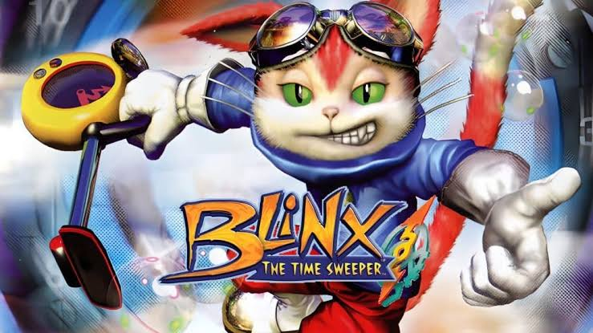

# Time Vector: How to Design a Non-Linear Timeline in Unity and Stay Sane

<div style="text-align: center; max-width: 650px; margin: 20px auto; padding: 20px; border: 1px solid #e1e4e8; border-radius: 8px; background-color: #fafbfc;">
  <div style="font-size: 1.2em; font-weight: bold; margin-bottom: 5px; color: #24292e;">Valeriya Pudova</div>
  <p style="margin: 0 0 15px 0; color: #586069; font-size: 0.95em;">
  💬 Telegram: <a href="https://t.me" style="text-decoration: none; color: #0366d6; font-weight: 600;">@valery_h2w</a> 
  &nbsp;|&nbsp; 
  ✉️ Business: <a href="mailto:valery.hww@gmail.com" style="text-decoration: none; color: #0366d6;">valery.hww@gmail.com</a> 
  </p>
  <div style="margin: 15px 0; overflow: hidden; border-radius: 6px; box-shadow: 0 2px 8px rgba(0,0,0,0.08);">
    
  </div>
</div>

When we start making a game where time is not just a monotonically ticking counter but a gameplay element (in the spirit of Blinx, Braid, or Superhot), Unity's standard toolkit quickly puts us in a tight box. The static class Time [Time](https://docs.unity3d.com/ru/530/ScriptReference/Time.html) is good for linear gameplay, but in complex time-manipulation mechanics it is helpless.

This article is a chronicle of an architectural search. We will examine popular time-control approaches, step on hidden mines, cut off non-working options, and assemble an elegant, scalable solution ready for high loads.

------------------------------

## When Time Becomes a Weapon

In 2002, the game *Blinx: The Time Sweeper* was released. The main hero — a cat cleaner — could speed up, slow down, stop, and even rewind time to collect trash and defeat enemies. In 2008, *Braid* showed that time can be a puzzle: each room has its own rules — somewhere time goes forward, somewhere backward, and somewhere it is tied to the player's movement.

These games did not just use time as a mechanic — they **made it part of the architecture**. And if you have ever tried to replicate something similar in Unity, you know: the standard `Time.deltaTime` is a dead end. It is great for linear gameplay, but as soon as you try to make one object fly into the past while another stands still, chaos begins.

This article is a chronicle of how we designed a time system for a game where time is not a background but a tool. We will examine popular approaches, step on hidden rakes, and assemble a solution that works in a real project without losing performance or sanity.

------------------------------

## Important Disclaimer: Scope of Applicability

Before starting the design, let us immediately set a hard boundary. The system described below is applicable exclusively to:

   1. Fully custom / kinematic physics. The movement of characters, enemies, and projectiles must be calculated manually in code (via Transform or Rigidbody.MovePosition).
   2. Decorative physics. Particles, wall fragments, and splinters may use standard Rigidbody if their freezing does not affect gameplay.

Attempting to befriend individual time reversal with the built-in dynamic framework PhysX / Chaos in Unity is architectural suicide, since the physics engine is rigidly tied to the global frame time [Time-fixedDeltaTime].

------------------------------

## Stage 1: The Dead End of Global State and Parallel Universes

The first idea that comes to mind is to create several isolated "sources of truth." For example, split the world into static classes or global singletons: PlayerTime, EnemyTime, AnomalyTime.
Let us imagine a classic task: "Temporal Grenade." A sphere forms at the explosion site. All enemies caught inside are slowed down by 90%.
If we use parallel time sources, then when an enemy enters the grenade trigger, we will have to switch it from EnemyTime to AnomalyTime. At that moment, a catastrophe occurs. Suppose the "Fast Time" clock of the world has ticked 100 conventional minutes, while the "Slow Time" clock of the anomaly has only 50. At the moment of switching the source, the enemy's local time abruptly jumps back by 50 minutes. The object's internal state is instantly destroyed: ability cooldowns roll back, animations go crazy, and physical interpolations fly to infinity.

Conclusion of the first stage: It is impossible to have several independent absolute time sources. Time inside each object must flow continuously and increase monotonically. Switching external sources breaks logic. The object must manage its own internal time.

------------------------------

## Stage 2: The Delivery Paradigm (How to Feed the Load Balancer)

Since time must be individual, the object needs a time delta (deltaTime) to update. But how to deliver this delta?
In a large-scale game with thousands of objects, we vitally need a Scheduler (Load Balancer). There is no point in updating distant objects every frame — they can be distributed across buckets and called, for example, once every 3–5 frames for optimization.

## Option A: Passing Delta Time (Relative Time)

We call the object's update and pass it a scalar value: UpdateObject(float deltaTime).

* Where the mine is: If the scheduler calls a distant object once every 5 frames, it must know that this object needs a different, accumulated delta. The scheduler turns into a cumbersome accounting machine. It has to manually sum and store micro-deltas of past frames for each individual group of objects, and when an object transitions from a rare bucket to a frequent one — frantically recalculate these tails. It works, but it is inelegant, fragile, and generates hidden bugs.

## Option B: Passing Absolute Time (Point of Truth)

We pass the object a single point on the global time scale: UpdateObject(double absoluteTime). The method of passing is not so important: it can be a pure scalar value in a method argument, a pointer to a context, or a ref-structure (as recommended by technical publications [Insomniac Games: Core](https://insomniacgames.github.io/)). For simplicity of understanding in the examples below, we will use a scalar float.
With this approach, the object calculates the delta itself. It stores the timestamp of its previous update and finds the difference with the current one.

* Why this is a triumph for the scheduler: The scheduler absolutely does not care how often it calls the object. It can call it three frames in a row and then forget about it for 10 frames. At the moment of the call, the object simply looks at the "point of truth," subtracts the old point, and gets a mathematically precise, honest delta for the entire skipped period. The scheduler is completely unloaded.

## Stage 3: True Elegance. Separation of Simulation and Visualization

We have arrived at the optimal formula: the Scheduler (Load Balancer) supplies the object with a global time point, and the object calculates the delta itself and applies its local modifiers. But if we try to calculate the new coordinates of the object and immediately move its 3D model on screen in the same method, we will inevitably encounter the hidden trap of interpolation.
Since the balancer, for optimization purposes, calls object logic unevenly (near ones — every frame, far ones — once every few frames), the calculated delta time will constantly jump. Standard motion smoothing on a jagged deltaTime will start twitching unnaturally, and objects in rare-update buckets will move across the screen in teleports.
To defeat this problem, we will apply the architectural pattern on which AAA engines and network shooters are built: a rigid separation of the object into Logical State (State) and Visual Representation (View).

```txt
 [Scheduler]  ──> Logical Tick (Jagged FPS)    ──> Calculation of State A and State B
                                                           │
                                                           ▼
 [Player Screen] ──> Visual Frame (Max FPS) ──> View Interpolation (Smooth Motion)
```

## 1. Logical Layer (Custom FixedUpdate)

This layer calculates only dry data: where the object actually is in the space of our timeline. It is pulled by the scheduler at a variable frequency. So that the visual can smoothly render movement between rare logical steps, the object must store the last two calculated states (snapshots) — current and previous.

```cs
public struct ObjectState
{
    public Vector3 position;
    public Quaternion rotation;
}

public class TimeDrivenLogic : MonoBehaviour
{
    [SerializeField] private float myTimeScale = 1.0f;
    private float _lastMasterTime;

    // Two sources of truth for the visual layer
    public ObjectState PreviousState { get; private set; }
    public ObjectState CurrentState { get; private set; }

    public void Initialize(float currentMasterTime)
    {
        _lastMasterTime = currentMasterTime;
        var initial = new ObjectState { position = transform.position, rotation = transform.rotation };
        PreviousState = initial;
        CurrentState = initial;
    }

    // Called by the scheduler (frequency may be jagged)
    public void ManagedUpdate(float currentMasterTime)
    {
        float masterDeltaTime = currentMasterTime - _lastMasterTime;
        _lastMasterTime = currentMasterTime;

        float localDeltaTime = masterDeltaTime * myTimeScale;

        // Shift the state history backward
        PreviousState = CurrentState;

        // Calculate the new "honest" state
        CurrentState = CalculateNewState(CurrentState, localDeltaTime);
    }

    private ObjectState CalculateNewState(ObjectState current, float dt)
    {
        // Only dry mathematics without directly modifying the graphics Transform!
        ObjectState next;
        next.position = current.position + (Vector3.forward * 5f * dt);
        next.rotation = current.rotation;
        return next;
    }
}
```

## 2. Visual Layer (Screen Update)

This layer runs at the maximum frequency of the player's monitor in the standard Update(). It does not know at all about the existence of the scheduler or time anomalies. Its task is to smoothly move the picture using the stable Time.deltaTime [Time-deltaTime] of the current frame.
Depending on the game's dynamics, the visual can use two approaches:

* Interpolation (Motion in the past): Graphics smoothly slide from PreviousState to CurrentState. The visual always lags behind the logic by exactly one scheduler step, but the movement is guaranteed to be smooth, even if the scheduler delays frames significantly.
* Extrapolation (Predicting the future): The visual takes the velocity vector between two states and continues to move the model further in that direction, predicting the position. As soon as the scheduler sends the real CurrentState, the visual smoothly corrects the picture to the true coordinates.

Example implementation of visual smoothing via interpolation:

```cs
public class TimeDrivenView : MonoBehaviour
{
    [SerializeField] private TimeDrivenLogic logic;
    
    private float _timeSinceLastLogicTick;
    private float _currentTargetTickDuration;

    // This method must now accept the time over which the scheduler
    // promises to make the next logical step (bucket interval).
    public void ResetInterpolation(float targetTickDuration)
    {
        _timeSinceLastLogicTick = 0f;
        _currentTargetTickDuration = targetTickDuration; 
    }

    void Update()
    {
        // Calculate the honest physical time elapsed since the logic tick
        _timeSinceLastLogicTick += Time.deltaTime;

        // Find the real percentage of progress between logical frames.
        // Protect against division by zero if the interval is not set.
        float t = _currentTargetTickDuration > 0 
            ? _timeSinceLastLogicTick / _currentTargetTickDuration 
            : 1f;
        
        t = Mathf.Clamp01(t);

        // Now the graphics slide strictly following the logic, without jerks or pauses
        transform.position = Vector3.Lerp(logic.PreviousState.position, logic.CurrentState.position, t);
        transform.rotation = Quaternion.Slerp(logic.PreviousState.rotation, logic.CurrentState.rotation, t);
    }
}
```

## Why Is This the Ideal Solution for Our Architecture?

   1. Complete victory over scheduler lags: The screen Update always has a stable step. It does not care that the logic of a bullet or enemy was calculated only 15 times per second instead of 144 — on screen the object will continue to move like silk.
   2. Perfect readiness for time reversal: If we change the sign of time and the local delta becomes negative, the logical layer simply starts generating CurrentState and PreviousState in reverse order (or retrieving them from a history buffer). The visual script will not even notice: for it, these are exactly the same two points in space between which a smooth transition needs to be drawn.

## A Fly in the Ointment: The Main Limitation of Visual Smoothing

For absolute honesty, it is necessary to record the fundamental compromise of this system: at every specific moment in time, the object on screen is not where it exists in the game logic.

While our custom physics collider or logical trigger is already at the CurrentState point (e.g., has made a jump forward), the visual interpolator is still smoothly dragging the graphical 3D model from the PreviousState point. The picture on the player's screen is always an "echo of the past," lagging behind the logic by one scheduler step. In the case of extrapolation, the situation is the opposite — the graphics try to "guess" the future and may for a fraction of a second miss the real position of the collider.
This means that:

* If the player aims at an enemy that is updated by the balancer very rarely, they may visually shoot exactly at the model's head but, from the logic's point of view, miss, because the true hitbox has flown slightly forward.
* This is exactly why this approach requires balance: important interactive objects (near enemies, projectiles flying at the player) must be updated more often by the scheduler, reducing visual desync to an imperceptible minimum, while on distant objects or decorations the CPU savings will be colossal.

**Important caveat:** The described desync problem exists only during aggressive optimization (Load Balancing). If the update frequency of an object's logical state matches the update frequency of its image on screen (the scheduler pulls the logic every frame at honest 60/120/144 FPS), **this problem completely disappears**. In this case, the true hitbox and the visual model move synchronously, and all architectural solutions described in the article work perfectly and without any compromises.

## Stage 4: Pragmatic Reversal and the Singularity Point

When we change the sign of the local time scale (myTimeScale = -1.0f), the delta calculated by the object becomes negative. At this moment, developers often make the mistake of trying to build an "omniscient time machine": they try to save health snapshots, cancel discrete events (e.g., suck fired particles back into the barrel), and reverse AI logic. Trying to implement this head-on leads to titanic labor, memory leaks, and bugs in associated subsystems.
The real practical solution is much more elegant. We must accept the fact: honest time reversal without huge memory costs is possible only for procedural calculations and continuous mathematical functions.
When an object transitions to a certain state (e.g., a jump attack), its code records two things: the global start time of this state (T_start) and a mathematical function depending on local time t (how many seconds have passed since the start).

   1. Procedural physics: The trajectory function (flight parabola) with a negative dt is obediently calculated in reverse order. The enemy flies back along the same arc.
   2. Procedural animation: The animation player (e.g., via manual control of Animator.Play("Attack", 0, normalizedTime)) receives a decreasing normalized timeline and plays the movements backward.

At the same time, we simply ignore or destroy associated subsystems (particle systems, sparks, bullet trails) — this is more than enough for good gameplay.

## Singularity Threshold

Rewinding time backward, the local time counter inside the object's current state will inevitably reach zero (t = 0). We hit the singularity point — the moment when this jump or this animation did not yet exist in nature.

Trying to rewind the code even further back to "cancel" the AI's decision to attack itself is meaningless and architecturally dangerous. Instead, we apply a limiting rule: upon reaching the singularity point, the object's local time counter is fixed at zero. The enemy simply freezes in the air in its starting attack pose, and the animation freezes on the first frame.
For the player, this looks like flawless, stylish operation of a temporal anomaly, and for our engine, it is a triumph of optimization that required not a single byte of RAM for storing frame history.

------------------------------

## Conclusion

Having passed through the entire web of architectural options, we have derived the optimal leitmotif for creating non-linear time in Unity:

* Time is delivered by the scheduler as an absolute point of the master timeline, which unloads the frame optimization system (Load Balancing).
* The object is fully autonomous; it calculates its own delta and adapts it to its needs, excluding time jumps backward when changing zones.
* Simulation is separated from visualization, thanks to which the jagged scheduler step turns into silky motion on screen through state interpolation.
* Reversal works at the level of local mathematical functions and stops at the singularity point, preserving the stability of gameplay code.

---

### Additional Materials and Source Code

For a deeper dive into architectural patterns of separating logic and representation in Unity, as well as for studying associated systems, you can familiarize yourself with the following resources:

* 🛠 **[hww/unity_mvc](https://github.com/hww/unity_mvc)** — A practical implementation and examples of building game systems based on the MVC pattern in Unity.
* 📖 **[Real-Time Systems Architecture in Unity (2022)](https://hww.github.io/articles/2022/rtts_unity/index)** — A fundamental analysis of designing and optimizing complex systems that laid the foundation for the approaches described in this article.