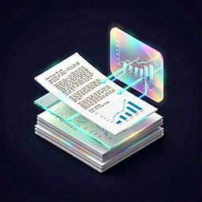

# Portfolio Navigator & Architectural Index

  

    
  

  

    <h1 style="margin-top: 0; margin-bottom: 6px; border-bottom: none; padding-bottom: 0; font-size: 2em; font-weight: 700;">Valeriya Pudova (hww)</h1>
    

      Systems Architect &nbsp;|&nbsp; R&D Infrastructure Engineer &nbsp;|&nbsp; Low-Level Specialist
    

    

      🌐 <a href="https://github.com/hww" target="_blank" rel="noopener">GitHub Profile</a> &nbsp;|&nbsp;
      💼 <a href="https://www.linkedin.com/in/valeriyap/" target="_blank" rel="noopener">LinkedIn</a> &nbsp;|&nbsp;
      ✉️ Telegram: <a href="https://t.me/valery_h2w" target="_blank" rel="noopener">@valery_h2w</a> &nbsp;|&nbsp;
      ✉️ Email: <a href="mailto:valery.hww@gmail.com">valery.hww@gmail.com</a>
    

    

      <a href="resume.en" style="background-color: #24292e; color: #ffffff; padding: 6px 12px; border-radius: 6px; text-decoration: none; font-size: 0.85em; font-weight: 600; display: inline-block;">Read CV (EN)</a>
      <a href="resume.ru" style="background-color: #24292e; color: #ffffff; padding: 6px 12px; border-radius: 6px; text-decoration: none; font-size: 0.85em; font-weight: 600; display: inline-block;">Посмотреть резюме (RU)</a>
      <a href="acknowledgments/" style="background-color: #24292e; color: #ffffff; padding: 6px 12px; border-radius: 6px; text-decoration: none; font-size: 0.85em; font-weight: 600; display: inline-block;">Acknowledgments</a>
    

  

---

**Systems Architect · R&D Engineer · Runtime & Low-Level Specialist**

I design software runtimes, game-engine architecture, embedded systems, and hardware-software solutions. My work spans deterministic simulation, data-oriented programming, virtual machines, compilers, FPGA development, and real-time digital signal processing.

I focus on the engineering problems beneath the surface: execution models, memory layout, system boundaries, performance, and the integration of software with physical hardware.

---

## Explore

<table>
<tbody>
<tr>
<td width="200px">
  
</td>
<td>
  <!-- Ссылка теперь оборачивает текст заголовка -->
  <a href="/projects/" title="Projects & Engineering History">Projects & Engineering History</a>
  

    Selected engineering projects across runtime architecture, programming languages, Unity, embedded systems, FPGA, and hardware.
  

</td>
</tr>

<tr>
<td width="200px">
  
</td>
<td>
  <a href="/articles/" title="Articles & Technical Papers">Articles & Technical Papers</a>
  

    Technical writing on game architecture, deterministic runtimes, performance engineering, and development practices.
  

</td>
</tr>

<tr>
<td width="200px">
  
</td>
<td>
  <a href="/about/" title="About Me">About Me</a>
  

    Professional background, core competencies, education, and contact information.
  

</td>
</tr>
</tbody>
</table>

## Selected Engineering Projects

### Runtime Architecture & Embedded Tooling

**[SOOT: Scriptable Object-Oriented Toolkit](https://github.com/hww/soot)**

An embeddable Lisp-based automation and runtime environment for resource-constrained platforms, including MCUs and DSPs. Combines an interactive REPL, scriptable build orchestration, source preprocessing, and a virtual-machine execution layer through the SOOT and Carbon ecosystem.

### Hardware, FPGA & Embedded Systems

**[KIRA SHARC DSP Module](/projects/kira_dsp_module/index)**

Designed a standalone digital signal-processing module for real-time audio processing, combining dedicated DSP hardware with embedded software.

**[6DOF IMU Hand Tracking Gloves — Arcadia/VR Commercial Project](/projects/ar_vr_gloves)**

Architected firmware, sensor-fusion algorithms, and hardware integration for VR input gloves using a distributed array of 6DOF IMU sensors.

**[Aleste LX FPGA Computer](https://github.com/hww/aleste-lx-fpga-sv)**

Implemented a classic computer architecture in SystemVerilog on FPGA, exploring hardware design and digital system integration.

**[Oculus Quest 2 — Haptic Feedback Rifle — Arcadia/VR Commercial Project](/projects/ar_vr_rifle)**

Designed the electrical system, custom I/O signaling, and mechanical interface for a haptic-feedback rifle peripheral used in commercial VR experiences.

[Browse all projects →](/projects/)

---

## Selected Articles

### [SOOT: A Compiler and Virtual Machine for a Strictly Typed Language](/articles/2026/soot/en/)

An evolving language runtime combining a compiler, virtual machine, incremental REPL, garbage collector, and a fixed-tick scheduler for scripted state machines. A series exploring the architectural decisions and engineering trade-offs behind the system.

### [Game Developing — The Last of Us Case Study](https://hww.github.io/articles/2022/nd_gfs_en/index)

An architectural study of Naughty Dog's game runtime, exploring its object model, scripting language, compiler, virtual machine, and data-driven development workflow.

### [Lisp-Based Scripting in Unity 3D: A Practical Case Study](https://hww.github.io/articles/2013/lisp_with_unity/)

Integrating Scheme scripting into Unity, covering runtime integration, interactive development, bytecode execution, and the connection between a dynamic language and a game engine.

[Browse all articles and technical papers →](/articles/)

---

## Architectural Consulting & Collaboration

I am open to project-based collaboration, technical consulting, architecture reviews, and challenging engineering roles.

Areas where I can contribute include:

- **Runtime architecture:** deterministic simulation, state machines, task scheduling, and isolated execution environments.
- **Performance engineering:** memory layout, low-allocation C#, Zero-GC techniques, profiling, and data-oriented design.
- **Programming languages:** interpreters, virtual machines, embedded Lisp/Scheme, compilers, and domain-specific languages.
- **Systems integration:** embedded firmware, microcontrollers, FPGA/HDL, PCB design, and hardware-software integration.

For inquiries, contact me via [Telegram](https://t.me/valery_h2w) or [email](mailto:valery.hww@gmail.com).

---

## Background

My engineering foundation combines game-engine development, low-level software architecture, and hands-on hardware R&D. My experience includes work at SyberSoft and Rocket Amusements, as well as independent research into runtime systems, graphics, and embedded development.

Selected academic work includes:

- **UC BerkeleyX CS184.1x — Foundations of Computer Graphics:** 100% score; subsequently invited to serve as a Teaching Assistant in 2013 and 2014.
- **UC BerkeleyX CS188.1x — Artificial Intelligence:** 97% score.

I work in **English** and **Russian**.

For more about my background and experience, see [About Me](/about/) and the [CV in English](/resume.en) or [CV in Russian](/resume.ru).

---

[GitHub](https://github.com/hww) · [LinkedIn](https://www.linkedin.com/in/valeriyap/) · [Telegram](https://t.me/valery_h2w) · [Email](mailto:valery.hww@gmail.com) · [Acknowledgments](/acknowledgments/)
