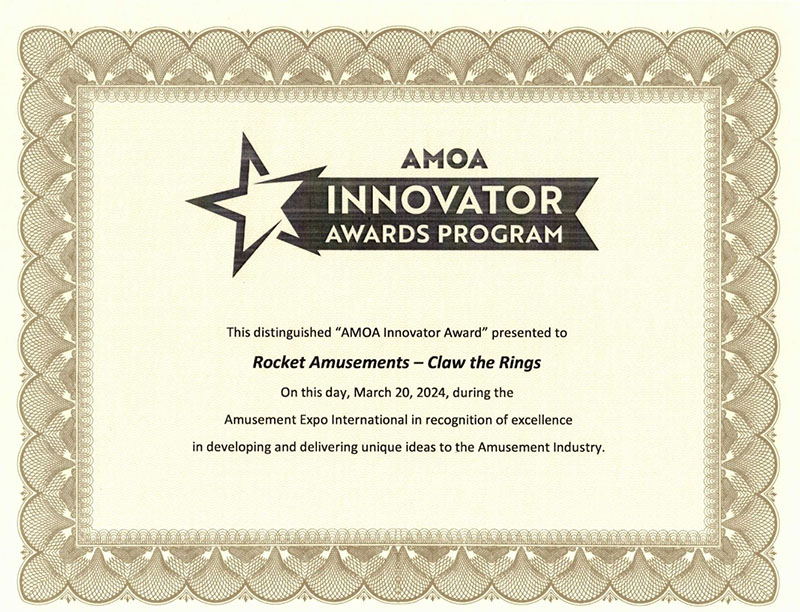
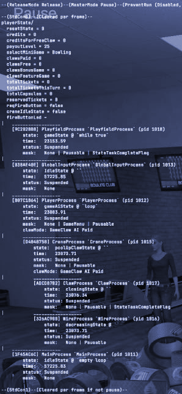
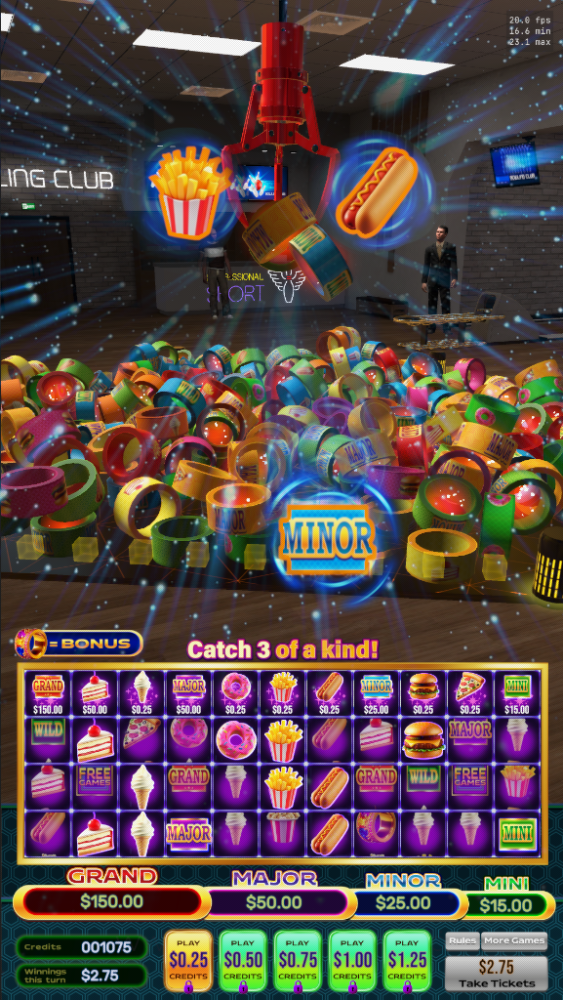
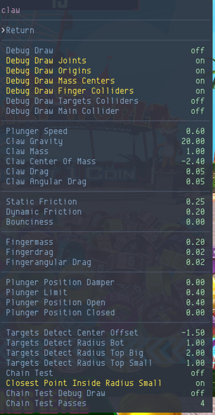

# Crazy Claw Rings
**Arcade redemption skill game · Developed for Rocket Amusements**

*[Hero image: the machine or in-game screenshot]*

Crazy Claw Rings is a physics-driven arcade skill game for the amusement industry. I was the primary engineer on the project and handled the complete technical implementation: the game and its custom runtime, internal tools, the Go backend, and the integration with the physical machine. The only part I did not build was the firmware of the external controller board.

## Recognition

The game received the **AMOA Innovator Award** on March 20, 2024, at Amusement Expo International. The award recognizes excellence in developing and delivering unique ideas to the amusement industry. On the certificate the game appears under the name *Claw the Rings*.

## Custom runtime and state machines

Instead of relying only on standard game frameworks, I built a custom runtime that manages thousands of concurrent finite state machines. It gives predictable execution and reliable transitions, and it stays stable under heavy load. Almost all gameplay logic is built on top of it.

## Physics and AI

The game depends on real-time physics, so the performance-critical parts are written with Unity Burst. I also developed AI algorithms that distribute prizes across the game scene while respecting the operator's configured parameters.

The **demo mode** is driven by AI as well. It doesn't replay recordings: the AI plays the actual game in real time and aims to behave like a human player, so the attract mode always looks natural.

## Uninterrupted gameplay

Playability was a core requirement. Notifications and UI never block player input, and scenes are loaded asynchronously in the background. The switch happens only when the new scene is fully ready, so there are no visible loading pauses.

## Operator configuration and physics tuning

Operators can adjust thousands of parameters, including prize distribution, to fit their audience and local regulatory requirements. I also built an in-game physics configuration and debugging system. It exposes crane mechanics, prize properties (mass, friction, bounciness) and solver performance settings, and it can visualize joints, colliders and centers of mass. Physical behavior can therefore be tuned without touching gameplay code.

## Backend and management tools

I wrote the backend in Go. It uses a custom UDP protocol to talk to the machines, stores data in MySQL, and keeps a full change history of configuration modifications. An HTTP service lets operators and administrators view statistics and inspect or edit configurations remotely.

## Hardware integration

I developed the software layer that connects the game to the machine's control electronics over serial and USB, and coordinates hardware operations with the game runtime.

---

**Tech:** Unity · C# · Burst · Go · MySQL · UDP · HTTP · Serial/USB

