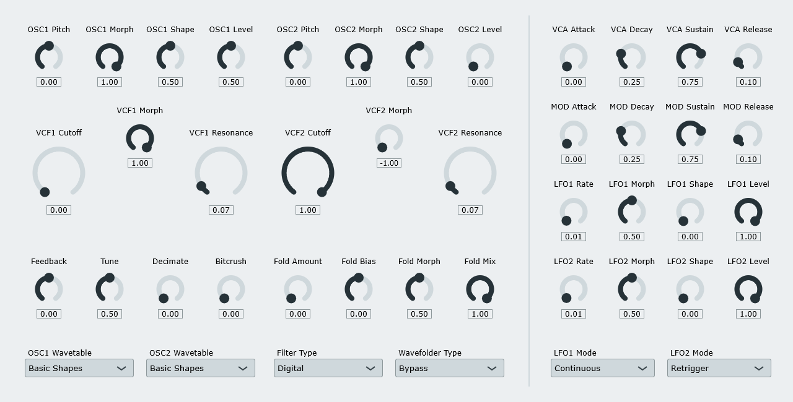
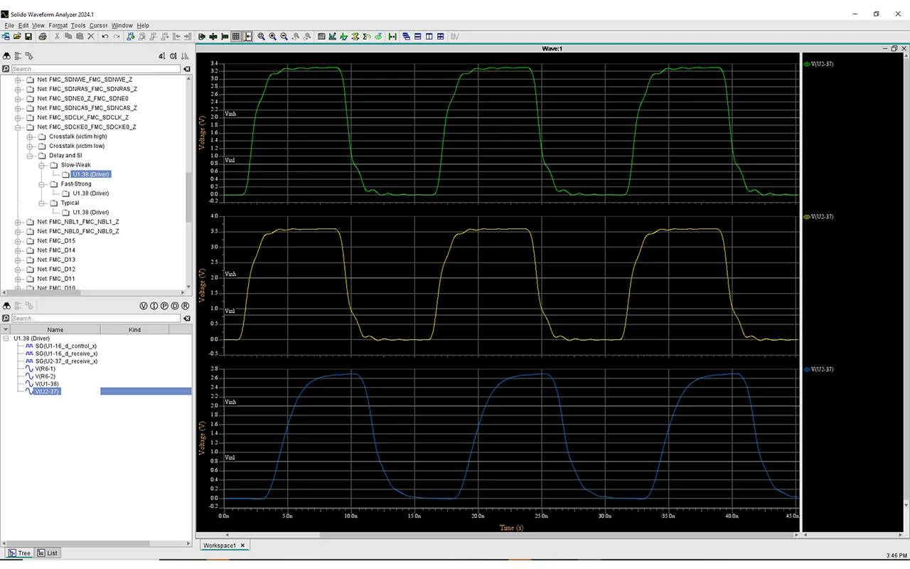
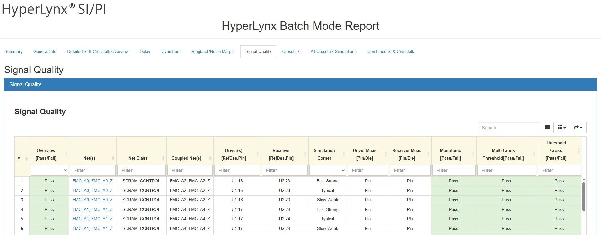
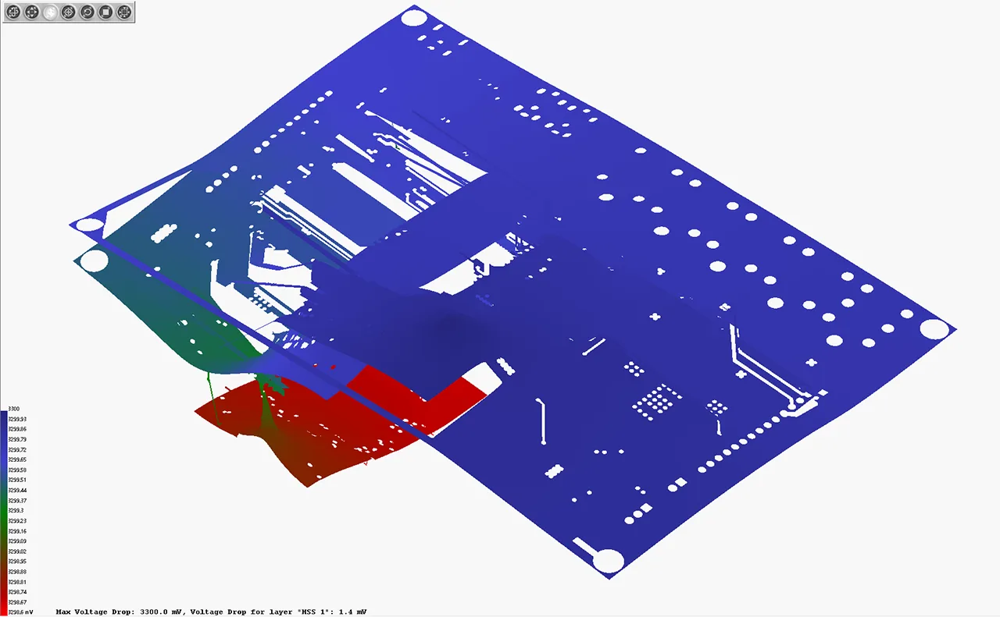
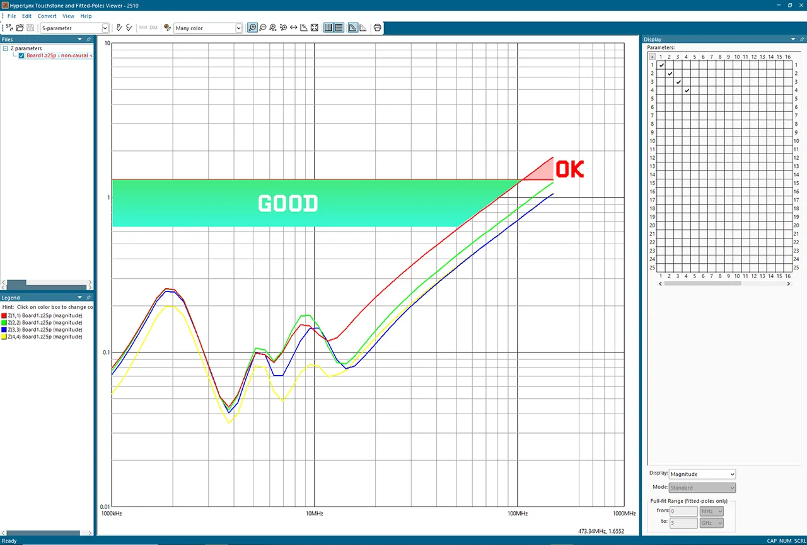

# KIRA Neon 
**Low-cost sound synthesizer**

**KIRA Neon** is a compact, portable, low-cost synthesizer built on a custom hardware DSP platform and powered by proprietary sound synthesis firmware developed by our team. Combining additive and sample-based synthesis engines, KIRA is designed as both a versatile sound-design instrument and a semi-modular compositional environment for sound art and experimental music.

At its core, KIRA features a high-performance, data-oriented DSP architecture optimized for per-sample processing at elevated internal sampling rates of 96 or 192 kHz. This approach enables precise, low-latency sound generation and processing, bringing digital synthesis closer to the responsiveness and behavior of analog systems. It is particularly effective for complex audio-rate cross-modulation, tonal delay networks, and other demanding synthesis techniques.

The development of KIRA involves ongoing research into the mathematics and physics of sound, synthesis algorithms, and sound generation methods. The primary focus is on building a precise, predictable sound engine while expanding the possibilities of sound design and musical composition.

**UI Inrterface**

## PCB Simulation in HyperLynx 

Simulation of the **STM32H743 + Winbond W9812G6KH SDRAM** interface fully validated the PCB layout and caught critical component-value issues prior to manufacturing.

### 1. Memory Bus Signal Integrity (HyperLynx SI)

* **IBIS Model Setup:** Assigned accurate IBIS buffer models for the STM32H743 (`io8_ft_fs_3v3` / `hs_3v3`) and the Winbond `W9812G6KH` SDRAM, and configured operating frequencies (`133 MHz` for `FMC_SDCLK` and `66.5 MHz` for data/address lines).
* **Issue Found & Fixed:** Identified that series termination resistor arrays (`RN1–RN5`) were erroneously imported as `1 kΩ` instead of `33 Ω`, causing severe signal degradation. Updated the values to `33 Ω` and verified isolated resistor-pack pinouts (`1-8`, `2-7`, `3-6`, `4-5`).
* **Routing & Constraint Tuning:** Adjusted critical data traces, applied realistic JEDEC thresholds, and verified the following:
  * **Signal Quality:** Clean transitions at the SDRAM inputs with no hazardous ringing in the switching region (`0.8 V – 2.0 V`).
  * **Propagation Delay & Skew:** Flight-time skew across `FMC_SDCLK`, address, and data lines remains well within Setup/Hold timing margins.
  * **Crosstalk:** Coupling between adjacent traces (including `FMC_NBL0` and `DQ0–DQ15`) stays within ~`25–250 mV`, leaving a `> 500 mV` noise margin for 3.3 V LVTTL logic.

**SDRAM Clock Signal Diagram (All Three Corners)**

**Signal Quality**

### 2. Power Integrity & Decoupling (HyperLynx PI)

* **Connector & Ground Partitioning:** Evaluated connector placement and decided against routing digital `+5V` and digital `GND` through the analog connector to prevent ground loops and noise coupling into the `±12V` rails.
* **DC Voltage Drop (DC Drop):** Simulated the `+3.3V` power rails with the LDO regulator and active loads (STM32H743 and SDRAM). Maximum voltage drop across the planes is only ~`5.4 mV` (well below the `100–150 mV` limit), confirming no plane bottlenecks or via overheating.
* **Decoupling Capacitors (PDN Impedance):** Evaluated decoupling network impedance across `+3V3`, `+3V3_MCU`, and `+3V3_DRAM` from `1 MHz` to `150 MHz`. Impedance stays below the target threshold (`0.04–1.0 Ω`) up to `100 MHz` with no sharp anti-resonance peaks.

**DC Voltage Drop Diagram**

**Decoupling (PDN Impedance)**

