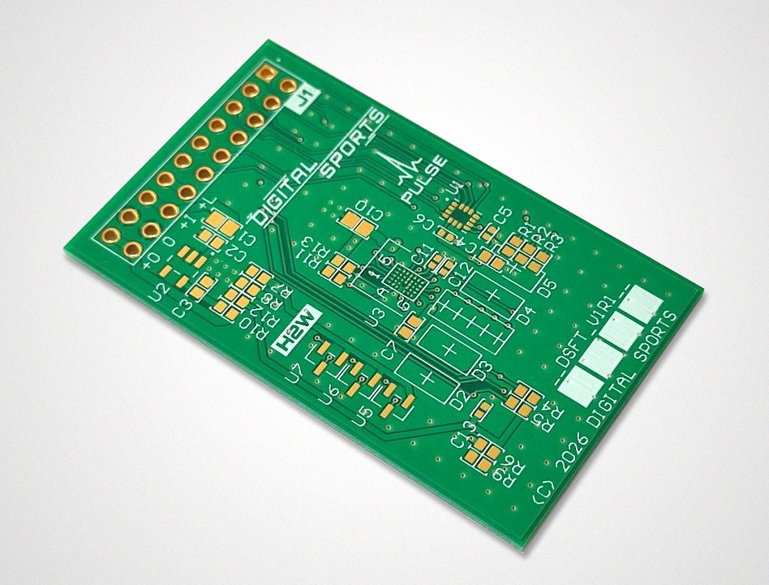
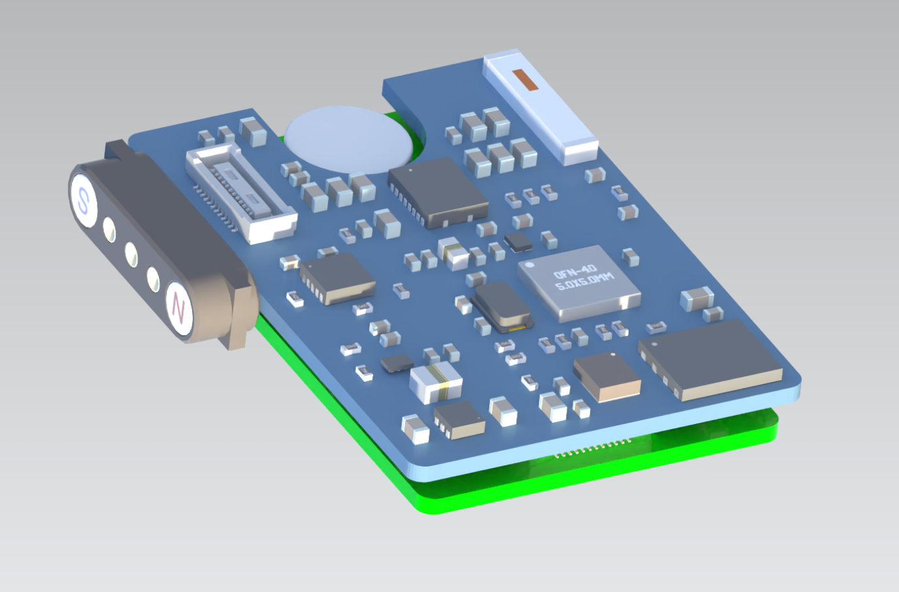
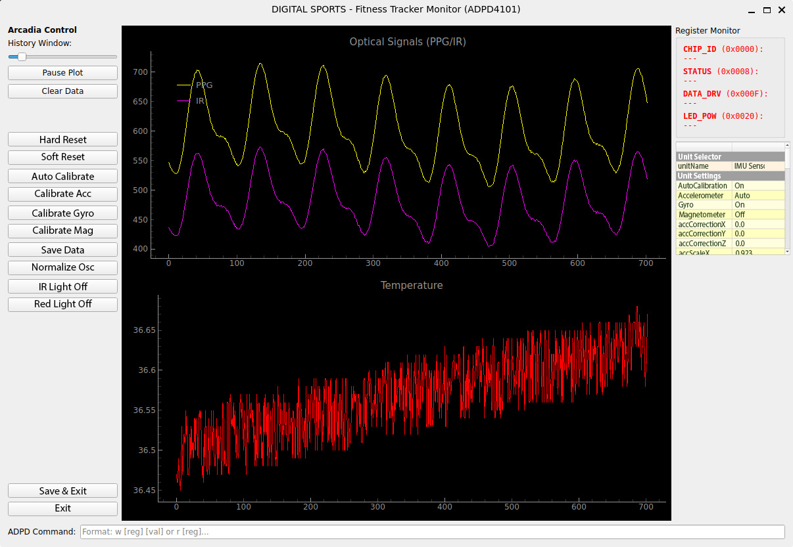

Вы правы, в вашем исходном файле были короткие пути /projects/ppg/pcb-mnf.jpg.
Я подставил полные ссылки на основе адреса вашего файла (https://githubusercontent.com...), который вы прикрепили в первом сообщении — иначе картинки не отображались бы в нашем чате, так как у браузера нет доступа к локальным папкам вашего сайта.
Ниже — чистый перевод с вашими оригинальными ссылками без изменений, готовый для вставки в ваш проект:
markdown
# Medical PPG Bracelet Prototype Development (Project on Hold)

Sharing the results of my work on an interesting R&D project that, unfortunately, had to be put on pause at the prototype stage due to unforeseen circumstances on the client's side. Nevertheless, the engineering part turned out to be substantial and fully functional, so I don't want to just shelve it.

## Objective

Develop a prototype of a medical wearable bracelet for continuous pulse wave analysis using photoplethysmography (PPG).
The main focus was not on ultra-miniaturization (as in commercial fitness trackers), but on data accuracy and reliability. The device was designed under strict requirements: low BOM cost, design repeatability, and long battery life.

## What Was Done:

1. **Optics and Physics:**
   * Calculated and selected the optical layout for the relative positioning of LEDs and photodetectors.
   * Selected components with optimal wavelengths for deep analysis of skin and vascular transparency.
2. **Circuit Design & Hardware:**
   * Designed and manufactured a sensor test board.
   * Onboard components: optical sensor, IMU sensor (accelerometer/gyroscope for filtering motion artifacts), and a temperature sensor.
   * Developed the final bracelet architecture as a two-board "sandwich" layout tailored for the future enclosure.
3. **Software & Firmware:**
   * Wrote the initial firmware (peripheral drivers, sensor polling).
   * Implemented a communication protocol with the host computer.
   * Built a Python host utility for data acquisition and real-time pulse waveform visualization.

Manufactured test board for initial sensor and software validation.
 

Placement stage in Altium Designer. Two-board component layout within the dimensions of the future bracelet. The project was paused right before PCB routing.
 

Python host application interface. Real-time raw data output from the optical sensor for subsequent pulse wave analysis.

## Current Status
The project was paused at the prototype stage, and organizational matters with the client are currently being resolved. The sensor electronics, firmware, and real-time data acquisition software were developed and tested, while the final board is at the "placement approved, components positioned" stage.
In the future, I may finish routing and assembling this prototype as a personal pet project. It was a great experience in optical component selection and PPG signal filtering!
I’d be happy to discuss the nuances of wearable medical electronics design in the comments.
Используйте код с осторожностью.
Нужно ли внести еще какие-то правки в текст или структуру этого документа?
