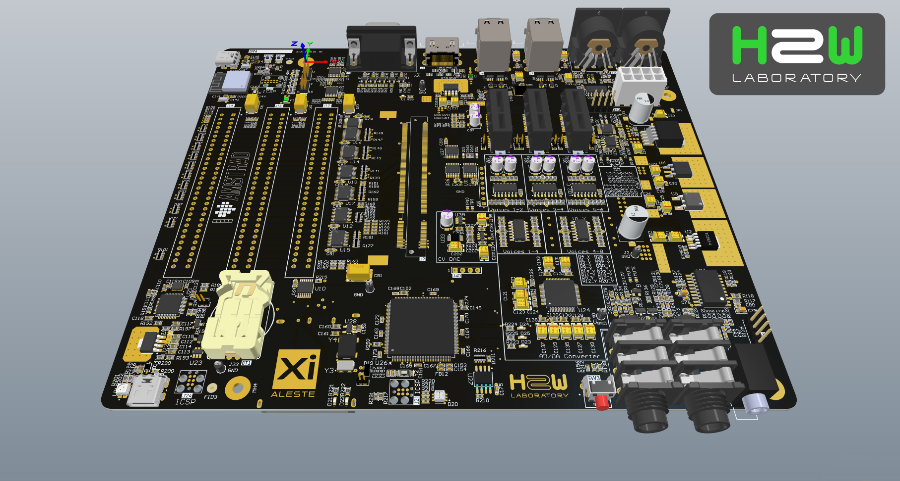

# Aleste XI — Aleste EX Without Compromises

### An Attempt to Create the Most Perfect Hardware Implementation of Aleste EX

Aleste XI was conceived as the next step in the evolution of Aleste EX — an attempt to create a full-fledged hardware platform that would eliminate the original compromises and implement everything that was desired in the original project.

To understand the concept behind Aleste XI, one must recall the history of Aleste EX.

Aleste EX was created as a development of the Amstrad CPC architecture. The main idea was to preserve compatibility and the core principles of the original computer while significantly expanding its capabilities.

In particular, DMA channels, a sampler synthesizer, and other hardware features that were absent from the standard CPC were introduced.

However, the initial implementation had significant limitations. Much of the system was built on discrete components. Each new functional block required board space, separate chips, and additional costs. Therefore, many decisions had to be made with cost, component availability, and physical dimensions in mind.

As a result, Aleste EX turned out to be an interesting and functional system, but far from everything that was desired could be implemented.

That is why the idea of Aleste XI emerged.

It was meant to be not just another board revision, but a full-fledged hardware platform realizing the Aleste EX concept without the original limitations.

## Foundation — Amstrad CPC, Capabilities Far Broader

The guiding principle of Aleste XI remained continuity with the Amstrad CPC.

We did not want to create an entirely different computer that loses its connection to the original architecture. On the contrary, the goal was to preserve everything that constitutes the foundation of the CPC and add capabilities that organically develop this platform.

Aleste XI can be regarded as the most fully developed hardware implementation of the Aleste EX idea.

At the same time, a significant portion of the system was moved into an FPGA. This made it possible to implement far more complex logic without proportionally increasing the number of discrete components.

At the heart of the board is an FPGA module based on the **Lattice LFE5U-25F-6BG256C** chip. This organization allows the computational architecture to be separated from the specific board implementation and leaves broad possibilities for further development of the system.

## Self-Contained Infrastructure

One of the distinguishing features of Aleste XI was the goal of making the board as self-sufficient as possible.

It includes a built-in FPGA programmer. Updating the software configuration does not require a separate external device — the necessary tools are already on the board itself.

A small Wi-Fi module is also installed, providing the possibility of wireless connectivity and remote operation with the system.

A USB hub is provided for connecting external peripherals.

Thus, Aleste XI was designed not as a minimal expansion board, but as a complete hardware platform with built-in infrastructure for development, updating, and operation.

## Sound Subsystem: Digital Control of Analog Synthesis

The sound architecture of Aleste XI deserves particular attention.

The board features a multichannel audio codec **PCM3168APAP** — an eight-channel converter combining digital-to-analog and analog-to-digital converters.

It provides six channels of audio input and output, enabling full multichannel audio operation, including stereo inputs and outputs.

But the most interesting part of the sound architecture is associated with three special Voice Board connectors.

Each of these connectors is designed for connecting a board with two analog filters. As a result, the system supports up to six independently controlled analog filters, forming a six-voice analog synthesizer.

The connectors are mechanically implemented in a format reminiscent of PCI Express, but electrically they are a specialized Aleste XI interface designed specifically for analog sound boards.

The idea is to combine digital control with analog sound processing.

A high-speed DAC is installed on the system board, which, through sample-and-hold devices, generates control voltages for the additional boards.

Moreover, the control voltages are not limited to filter cutoff frequency or resonance alone. The architecture allows control of virtually any parameters of the analog circuit on the daughter board.

This opens the possibility of creating a wide variety of analog sound modules using a unified digital control system.

In effect, the result is a hybrid synthesizer: the digital system generates control signals, while the actual sound processing is performed by analog circuits.

This approach combines the flexibility of software control with the characteristics of analog sound.

## Expansion System: Full-Fledged Daisy Chain Bus Mastering

One of the most significant architectural improvements of Aleste XI was the redesign of the expansion system.

Aleste EX already had DMA channels, but lacked full Bus Mastering support from expansion boards.

In Aleste XI, we decided to eliminate this limitation as well.

The board received three full-featured expansion slots with Daisy Chain Bus Mastering support.

This means that expansion devices can independently become initiators of operations on the system bus, not limited to simple data exchange at the command of the central processor.

For arbitration, a sequential bus grant scheme is used, reminiscent of the solutions employed in the Apple IIgs.

The system includes dedicated arbitration logic that takes into account requests from expansion devices and ensures transfer of bus control between slots.

The priority is determined by the physical order of the slots: the first slot has the highest priority, followed by the second and third.

This organization makes system behavior predictable and allows arbitration to be implemented quite simply without complex centralized logic.

But the expansion system received other important improvements as well.

The connectors expose a 24-bit address bus, an 8-bit data bus, and the necessary control signals. Separate signals for memory and I/O space selection are provided.

Address decoding and generation of memory and port select signals are performed on the system board. Expansion devices receive already-prepared select signals, which significantly simplifies the development of additional boards.

Another important feature: each expansion device has its own interrupt signal.

Thus, the expansion system received virtually all the necessary mechanisms for creating complex peripherals: independent bus access, arbitration, address selection, and individual interrupts.

We essentially attempted to make the expansion interface not just a set of contacts, but a full-fledged system bus for intelligent devices.

## Interfaces and Connectivity

In addition to the specialized expansion interfaces, Aleste XI received a rich set of standard connections.

The board provides:

- a USB hub for connecting external devices;
- VGA and HDMI for video output;
- a MIDI interface;
- a headphone amplifier;
- Wi-Fi for wireless connectivity;
- built-in FPGA programming tools;
- a multichannel audio system based on the PCM3168APAP.

This allows the computer to be used as a standalone system that does not require a large number of additional boards and external adapters.

## Alternative Configuration

We also provided for a variant in which the user does not need all three expansion slots.

In this case, the design can be implemented with an edge connector instead of separate slots.

This allows the hardware platform to be adapted to different configurations and layouts without abandoning the system architecture itself.

## The Price of No Compromises

Aleste XI was a very ambitious project.

We attempted to combine on a single board virtually everything that was desired in the evolution of Aleste EX: a full-fledged FPGA platform, an advanced sound subsystem, a six-voice analog synthesizer, USB, networking capabilities, modern video outputs, and, most importantly, a fundamentally new expansion system with Bus Mastering.

However, this approach had its downside.

The board turned out to be quite large and complex. The large number of components, specialized logic, additional connectors, and advanced infrastructure significantly increased production costs.

In other words, we achieved exactly what we wanted from an engineering standpoint, but had to pay for it in size and cost.

This was a deliberate compromise of a different kind: instead of economizing on capabilities, we preferred to implement the intended architecture as fully as possible.

## In Lieu of a Conclusion

Aleste XI is an attempt to imagine what Aleste EX could have become if its original development had not been constrained by the cost of discrete components, board dimensions, and the capabilities of the component base available at the time.

This is not merely an updated version of the computer. It is a full-fledged hardware platform in which we sought to bring the ideas embedded in Aleste EX to their logical completion.

It is especially important that Aleste XI combines several directions of development: a programmable digital architecture, an advanced expansion system with Bus Mastering, and the possibility of building a multi-voice analog synthesizer.

That is why Aleste XI occupies a special place in the history of the project.

It became the embodiment of the Aleste EX idea without compromises — a computer in which the capabilities of expansion, sound, graphics, and peripheral interaction are determined not so much by the limitations of the original design as by the capabilities of the architecture itself.

## Schematic

[Xi Aleste Schematic Diagram](https://github.com/hww/XiAleste_PCB/blob/main/pcb/Output/XiAleste.PDF)
